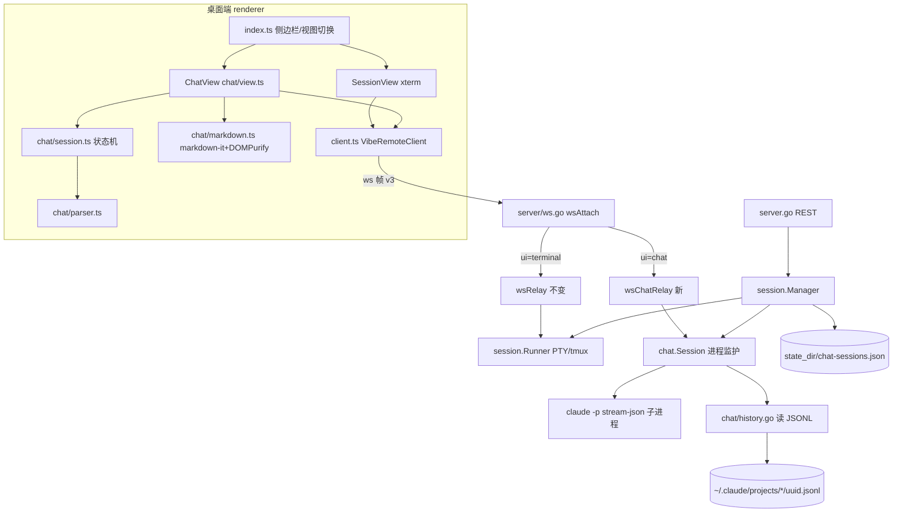
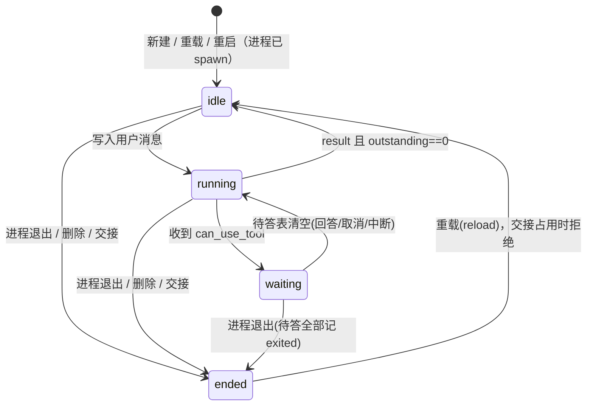

# 技术设计：双模式会话（终端 + 对话）

对应需求：spec.md（R1–R19，H1–H17，关口 A：Q1 按 H1、Q2=A、Q3=A、c1 同意）　更新：2026-11-14（工程评审 15 条 + 复审 10 条 + 关口 B 四轮意见 + 第二批前置验证已修订，见第 10 节）

术语：**会话 id** = vibe-remote 会话 id（`<ms>-<8hex>`，客户端生成的 `newSessionId`）；**claude 会话 id** = claude 自己的 UUID（`--session-id` / `--resume` 的参数，JSONL 文件名）。两者由 daemon 保存映射（H12）。

依据：claude 2.1.210 的 stream-json 实测见 `evidence/probe-stream-json.md`（第一批 V1–V7、第二批 V9–V23；下文记作「探针 Vn」），第 9 节汇总。

## 1. 方案

### 1.1 对话进程放在哪（H4）

| 方案 | 做法 | 好处 | 代价 | 结论 |
|------|------|------|------|------|
| A | daemon 直接持有子进程：`<shell> -lic 'exec claude -p …stream-json…'`，stdin/stdout 管道，每会话一个监护 goroutine 组；daemon 内存里保留消息环形缓冲和待答请求表，多个 WS 订阅同一会话 | 与 VS Code 扩展同构；断线不影响进程（P3）；补发、先答先生效都在一处判定；零新进程类型 | daemon 重启即丢进程（Q2=A 已接受）；daemon 内存承担缓冲 | **选用** |
| B | claude 跑在 tmux 里，stdio 通过 FIFO/`pipe-pane` 接出 | daemon 重启后进程可存活 | tmux 不提供可靠的双向行管道；重新接管时 stdout 缓冲丢失、无法判定半行；R2「只有一个进程」难以保证 | 放弃：Q2 已选 A，可靠性差 |
| C | 独立看护进程（每会话一个 helper 持有 claude，daemon 经 unix socket 连它） | 跨 daemon 重启存活 | 新增一个可执行文件和一套 IPC，工作量约翻倍（Q2 备选 B） | 放弃：Q2=A |

### 1.2 daemon 对 stream-json 理解到什么程度

| 方案 | 做法 | 好处 | 代价 | 结论 |
|------|------|------|------|------|
| A | **信封级透传**：daemon 只解析每行的信封字段（`type`/`subtype`/`request_id`/`message.id`/`session_id`/`permissionMode`/`slash_commands`/`claude_code_version`/`is_error`），消息体原样（`json.RawMessage`）放进 `chat` 帧；控制协议由 daemon 代理：待答请求表、先答先生效、取消、中断、初始化 | 客户端拿到的就是 claude 原始结构，复用 7 月 TS 解析器；daemon 只管「谁能答、答没答、发没发」；claude 新增字段零改动透传 | 客户端需要完整解析器（已有 935 行可移植） | **选用** |
| B | daemon 全量语义化：把 stream-json 归一成自定义帧（text/tool/permission…） | 客户端简单 | Go 侧重写一遍解析器；claude 每次改字段都要改协议；7 月 TS 代码作废 | 放弃 |
| C | 行级哑管道：daemon 不看内容，客户端直接写 stdin | 最省 daemon 代码 | 做不到 R5.7 先答先生效、R5.5 待答重现、R12 补发、R16 无 hook 状态 | 放弃 |

### 1.3 断线补发

| 方案 | 做法 | 好处 | 代价 | 结论 |
|------|------|------|------|------|
| A | 每进程一个 `epoch`（随机 8hex），每条出站消息单调 `seq`；环形缓冲只存**完整消息**（非 `stream_event`）1000 条 + 32 MiB；当前在生成的那条回复的 `stream_event` 单独存「流式尾巴」；重连带 `(epoch, seq)` 增量补发，否则整体重同步（JSONL 历史 + 缓冲 + 尾巴） | 满足 H2 补充（增量不占缓冲）；R12.4 靠 `message.id` 合并保证不重复 | 需要 epoch/seq 两个字段 | **选用** |
| B | 只补发完整消息，流式增量不补 | 简单 | 中途断线时回复要等整条完成才出现 | 放弃：R12.4 体验差 |
| C | 重连一律整体重同步 | 无 seq 逻辑 | 每次重连重渲染全部消息；R12.2「没有重复」靠客户端清屏实现，滚动位置丢失 | 放弃，仅作为 gap/epoch 变化时的回退路径 |

### 1.4 对话会话的持久化（H9、H13）

| 方案 | 做法 | 好处 | 代价 | 结论 |
|------|------|------|------|------|
| A | daemon 写 `<state_dir>/chat-sessions.json`（原子写，0600），只存会话元数据，不存消息；消息历史以 claude 自己的 JSONL 为准 | 文件小、写入频率低（只在增删改/结束时写）；daemon 重启后会话和名字都在；历史天然完整 | 要实现 JSONL 读取 | **选用** |
| B | 把对话会话也登记成一个空 tmux 会话，借 tmux 用户选项存元数据 | 复用 reconcile | tmux 里挂一个不跑东西的会话很怪；`use_tmux:false` 的机器不可用；reconcile 会把它当终端会话 | 放弃 |
| C | daemon 自己把消息落盘（每会话一个 NDJSON） | 不依赖 claude JSONL 格式 | 与 JSONL 重复存储；写放大 | 放弃 |

`state_dir` 默认放在配置文件旁边（`<配置文件目录>/vibe-remoted-state/`），可配置。理由：verify / gui-smoke 都用临时配置文件，状态自动隔离，不会碰用户真实数据；放弃 `~/.local/state/vibe-remote`（测试必须显式设置，漏设就污染真实状态）。见 decisions d6。

### 1.5 「新建终端会话接上」走哪条路（H15）

| 方案 | 做法 | 好处 | 代价 | 结论 |
|------|------|------|------|------|
| A | 新终端会话的 WS `attach` 帧带 `handoffFrom: <对话会话 id>` + `newSessionId`；daemon 在 attach 内：停对话进程 → 拼命令 → 新建终端会话 → `ready` | 复用 attach 的幂等（同一 `newSessionId` 重放只建一个）；`use_tmux:false` 也能用（REST 新建的非 tmux 会话没有客户端就会死）；客户端只传两个 id | attach 多一个分支 | **选用** |
| B | `POST /api/v1/sessions/{id}/handoff` 返回新 id，客户端再 attach | 语义直观 | 非 tmux 模式不可用；REST 与 WS 之间断线会留下无人接的会话；需要另做幂等 | 放弃 |

「重新启动」和「重载」语义相同（停旧进程 → 用同一 claude 会话 id 启动：有 JSONL 时 `--resume U`，无 JSONL 时用 `--session-id U`），**复用现有 `POST /api/v1/sessions/{id}/reload`**，不新增 restart 端点（d7）。交接同理：无 JSONL 时终端命令用 `--session-id U`。

### 1.6 客户端结构

| 方案 | 做法 | 好处 | 代价 | 结论 |
|------|------|------|------|------|
| A | 新增 `ChatView`，与 `SessionView` 并列放进同一个 `views` Map（共同字段 key/machine/sessionId/client/container/activity/ui）；连接层复用 `VibeRemoteClient`（重连、退避、看门狗、幂等重放都不复制）；对话逻辑放 `desktop/src/renderer/chat/` | 侧边栏、切换、通知一套代码；重连语义与终端一致 | `client.ts` 要认识 chat 帧 | **选用** |
| B | 单独写 `ChatClient` | 互不影响 | 复制 400 行重连/存活逻辑，两份将来必然漂移 | 放弃 |

### 1.7 claude 版本门槛（H3，最低 2.1.210）

| 方案 | 做法 | 好处 | 代价 | 结论 |
|------|------|------|------|------|
| A | daemon 启动时在后台探测一次 `claude --version`（同登录 shell 环境，15 s 超时），结果缓存 10 分钟；`/api/v1/info?recheck=1` 强制重测；运行时再用 `system/init.claude_code_version` 兜底 | 打开新建对话框时就能置灰（R1.4），不拖慢 info；用户升级后点「重新检测」即生效 | 每 10 分钟最多一次子进程 | **选用** |
| B | 每次 `/api/v1/info` 都探测 | 永远最新 | 登录 shell 起一次 0.5–2 s，info 被机器管理页频繁调用 | 放弃 |
| C | 只在 `system/init` 时判断 | 零探测 | 用户新建后才失败，R1.4 要求新建前就置灰 | 放弃，仅作兜底 |

## 2. 总体结构



daemon 新包 `vibe-remoted/internal/chat`：

| 文件 | 职责 |
|------|------|
| `cmdline.go` | 按 shell 规则拆 `claude_cmd`+flag（H14）、判定是否 claude（H7）、构造对话启动参数、交接命令（H15）、`--version` 解析与比较 |
| `session.go` | `chat.Session`：一个对话会话的进程生命周期、epoch/seq、环形缓冲、流式尾巴、待答请求表、自身发出的控制请求表、状态机、订阅者扇出 |
| `control.go` | 控制协议信封的解析与构造（initialize / interrupt / set_permission_mode / can_use_tool 回复 / 未知请求回错） |
| `transcript.go` | 纯文件函数：定位 JSONL（`FindTranscript`）、找目录最近一次对话（`LatestSessionForWorkdir`） |
| `trust.go` | 工作区信任 `TrustState`（待 c3 确认，第 7 节） |
| `history.go` | 读取截止点之前的历史行 |
| `store.go` | `chat-sessions.json` 读写（原子替换、损坏隔离） |
| `probe.go` | `claude --version` 探测与缓存 |
| `orphan.go` | daemon 启动时清理上次遗留的 claude 进程 |
| `fakeclaude/main.go` | CI 用的假 claude（第 9.2 节） |
| `chattest/chattest.go` | 测试辅助：构建假 claude、起临时 Session |

`session.Manager` 增加 `chats map[string]*chat.Session`，与 `sessions`（终端 Runner）共用 id 空间、`beginCreate` 幂等和 `gen` 计数；tmux reconcile 只碰 `sessions`。

**单进程守卫 `claudeOwners`**（R2 的唯一判定点）：`Manager.claudeOwners map[claudeSessionID]ownerID`，owner 是 vibe-remote 会话 id（对话或终端）。
- 任何会启动 claude 进程、且进程会占用某个 claude 会话 id U 的操作，都必须**先**在 `Manager.mu` 下 `claimClaude(U, owner)`，成功后才 spawn：对话新建（新 UUID 或 `-c` 解析出的 U）、交接（由交接创建的新终端会话 claim 原对话的 U）。对话会话的重载/重启是**同一 owner 的停止再启动**：停止阶段不释放 U（见下），启动前再次 claim 时因 owner 相同而直接成功；若 U 已不归它（例如它结束后被别的会话用 `-c` 接走）则 claim 失败 → `claude_session_busy`。daemon 自己以 continue 语义启动的终端会话（`claude_cmd` 或勾选的 flag 含 `-c`/`--continue`，新建或重载）**固定身份后再 claim**：启动前确定 U（有对话记录取最近一次，没有则由 daemon 生成新的 UUID v4），把命令里的 `-c` 改写成 `--resume U`（有记录）或 `--session-id U`（无记录）并原子地 claim U，使实际进程的会话 id 与占用表一致（见 6.9；该规则改写了用户配置的终端参数，**待 c4 确认**，确认前不实现）。不带 continue 语义的终端会话不 claim。
- U 已被别的 owner 持有 → 返回 `ErrClaudeSessionBusy{Owner}`；持有者是同一个 owner → 视为成功（幂等重放）。
- 释放：对话会话在其进程 `Wait()` 返回、且停止原因**不是** `restart` 时释放（已结束的对话会话不持有 U；重载/重启期间「停 → 等退出 → 启动」全程占用不释放）；终端会话（交接创建的，或以 continue 语义启动的）在被删除或其 tmux 会话消失（reconcile 移除）时释放；任何会话被删除时释放它持有的全部 U。
- 退出回调：进程 `Wait()` 返回后的处理（记录结束、按上条释放 owner、`persist()`）在**独立的 goroutine** 里执行，执行时**不持有** `Session.mu`，只获取 `Manager.mu`（以及之后短暂的 `Session.mu` 更新状态），因此不会与持 `opMu`/`Session.mu` 的路径形成环。
- 终端会话持有的 U 同时写进 tmux 用户选项 `@vibe_remote_claude_u`（与 `@vibe_remote_name` 同一机制；`liveTmuxSessions` 的 `-F` 格式多读这一列）。daemon 重启后，reconcile 恢复终端会话条目时按该选项重新 claim，保证交接与 continue 终端会话的占用跨重启仍受保护；`LoadChats` 不再单独处理交接。

**每会话操作锁 `chat.Session.opMu`**（不可重入）：串行化同一对话会话的重载/重启、停止、交接、删除（这些操作要等进程退出，耗时秒级）。对外只暴露 `(*Session).WithOp(func(ops OpHandle))`：`WithOp` 获取一次 `opMu`，回调里通过 `OpHandle.StopLocked(reason)` / `OpHandle.RestartLocked(spec)` 完成需要的组合动作；Manager 的 `Handoff`、`Delete`、`Reload` 各自只调用一次 `WithOp`，回调里不得再调 `WithOp`。

**全局锁顺序（只许向下获取，禁止反向）**：`beginCreate` 的 creating 通道（按会话 id 占位）→ `chat.Session.opMu` → `Manager.mu` → `chat.Session.mu` → `store.mu`。`opMu` 与 creating 占位可以跨阻塞等待持有；`Manager.mu`、`Session.mu`、`store.mu` 只短暂持有、不跨阻塞 IO（写 stdin 走写协程，写盘走 persist 协程）。

**持久化单通道**：所有对 `chat-sessions.json` 的写都走 `Manager.persist()`：在 `Manager.mu` 下拍下全部记录的快照，非阻塞地放进容量为 1 的「最新快照」槽（已有未写的旧快照就覆盖它），由唯一的 persist 协程取出写盘（临时文件 + fsync + rename）。因此并发修改不会互相覆盖成旧值，写盘也不在任何锁下进行；`Shutdown` 最后同步刷一次。

## 3. 技术选型

| 选型项 | 选定 | 理由 | 放弃的备选 | 放弃原因 |
|--------|------|------|------------|----------|
| Markdown 渲染 | `markdown-it` **15.0.3**（`html:false`、`linkify:true`、`typographer:false`） | 默认把原始 HTML 当文本转义（第一层防线）；`validateLink` 默认拦 `javascript:`/`vbscript:`/`file:`/`data:`；内置 GFM 表格；自带 d.ts | `marked` 18.2.0 | 默认放行原始 HTML，安全完全依赖第二层 |
| HTML 净化 | `dompurify` **3.4.17**（`ALLOWED_URI_REGEXP` 只放 `https?:`/`mailto:`，禁 `style`/`on*`） | 第二层防线；浏览器端事实标准；自带 d.ts | 只靠 markdown-it | 单层防线，R3.3 和非功能安全要求两层 |
| 版本固定 | package.json 写精确版本、不带 `^` | 与 xterm 的锁版本做法一致 | 浮动范围 | 安全相关依赖不应静默升级 |
| Markdown 测试环境 | devDependency `jsdom` **29.1.1**（精确版本；29.x 最新，engines `^20.19 \|\| ^22.13 \|\| >=24`，与 CI 的 Node 22 兼容），测试里 `DOMPurify(new JSDOM('').window)` 注入 `createMarkdownRenderer` | 纯 Node 下 `DOMPurify.isSupported` 为 false，不给 DOM 就测不到净化；jsdom 是 DOMPurify 官方测试用的环境 | happy-dom；只在 gui-smoke 里测 | happy-dom 与 DOMPurify 的兼容性无官方背书；只靠浏览器测试则 `make check` 守不住 R3.3 |
| 代码高亮 | 不做（等宽 + 复制按钮） | spec 未要求；省 100KB+ | highlight.js | 范围外 |
| shell 拆词 | 自写 `cmdline.splitWords`（单/双引号、反斜杠），遇未加引号的 `| & ; < > ( ) $ \` * ? { }` 判为「含 shell 语法」不支持对话 | 现有 go.mod 只有 2 个依赖；规则子集小、可全测 | `github.com/kballard/go-shellquote` | 新增依赖换 60 行代码不划算 |
| 假 claude | Go 程序 `internal/chat/fakeclaude`，测试里 `go build -o <tmp>/claude` | CI 不需要额外运行时；文件名就是 `claude`，满足 H7 判定；`go vet` 覆盖 | node/python 脚本 | CI 多依赖一个解释器 |
| TS 单测形式 | 沿用 `desktop/scripts/test-*.mjs`：esbuild 打包被测 TS + `node:assert/strict`，7 月 vitest 用例改写进来 | 与现有 9 个测试脚本一致，无新测试框架 | 引入 vitest | 新依赖 + 与现有约定不一致 |

## 4. 接口

### 4.1 协议版本

`protocol.Version` / `PROTOCOL_VERSION` = **3**。版本表新增一行：「3：对话界面（`attach.ui`/`since`/`epoch`/`handoffFrom`、`chat*` 帧、`ready.ui`、`sessions[].ui/state/activitySeq`、`/api/v1/info.chat`、错误码 `ui_mismatch`/`chat_unsupported`/`claude_session_busy`）」。全部新增字段在接收端可选；终端会话的 `ready`/`sessions`/`data`/`exit`/`error` 帧除 `proto` 值外**逐字节不变**（`ui` 省略即终端）。

### 4.2 attach（C→S）新增字段

| 字段 | 类型 | 必填 | 说明 |
|------|------|------|------|
| `ui` | `"terminal"\|"chat"` | 否 | 省略 = `terminal`（旧客户端）。新建时决定会话类型；接入已有会话时必须与会话类型一致，否则 `ui_mismatch` |
| `epoch` | string | 否 | 仅 `ui:"chat"` 接入已有会话：客户端上次看到的 epoch |
| `since` | number | 否 | 仅 `ui:"chat"`：客户端已收到的最大 `seq`；与 `epoch` 同时给出才走增量补发 |
| `handoffFrom` | string | 否 | 仅新建且 `ui:"terminal"`：要交接的对话会话 id（R14）。此时 `workdir`/`flags`/`mode` 被忽略，全部取自对话会话 |

新建对话会话沿用 `newSessionId`/`workdir`/`flags`/`mode`（R1.7 worktree 照常）。客户端在**每次发送 attach 的那一刻**读取 `(epoch, since)`，而不是在创建意图时固定（重连时位置已前进）。只有在收到**当前 epoch 的同步结束标志**（同步序列末尾那条 `chat_state`）之后，客户端才有资格报告位置；同步进行中断线、收到 `chat_sync{reset:true}`、或 epoch 变化时清空 `lastSeq`，下一次 attach 不带 `epoch`/`since`，从而走 `reset`，不会把半截同步当成已收全。`ui` 是会话的固有属性：客户端的 attach 意图在 `ready` 之后仍保存 `ui:'chat'`，自动重连和手动 Retry 的重放都带上；`handoffFrom` 只属于创建意图，`ready` 后重放只用 `sessionId`。

### 4.3 ready（S→C）新增字段

```json
{"type":"ready","sessionId":"1763000000000-9f3a1c2e","workdir":"/home/u/p","proto":3,"mode":"normal",
 "ui":"chat","claudeSessionId":"0b6c…-uuid","existing":true}
```

- `ui`：对话会话为 `"chat"`；终端会话省略。
- `claudeSessionId`：仅对话会话。
- `existing`：仅当新建请求被转为接入另一个已有会话时为 `true`（R2.6：勾 `-c` 指向的 claude 会话已在会话 X 里运行，`sessionId` 返回 X）。客户端据此提示「这段对话已在 <名字> 里打开」，若本地已有 X 的视图则关闭新视图、切到 X。
- `handoffFrom`：终端会话由交接创建时回显原对话会话 id。

### 4.4 对话同步序列（S→C，attach 成功后、以及进程重启后）

`ready` 之后 daemon 依次发：

1. `chat_sync`
   ```json
   {"type":"chat_sync","epoch":"a1b2c3d4","reset":true,"omitted":0,"historyCount":3120,"backlog":57}
   ```
   - `reset`：`true` = 客户端清空对话区按本次内容重建；`false` = 增量，保留已有内容。增量条件：attach 带的 `epoch` 等于当前 epoch，且 `since` ≥ 缓冲区最早 `seq`−1。
   - `omitted`：本 epoch 内被缓冲淘汰的完整消息数（只在 `reset` 时有意义，R12.3 显示「更早的 N 条消息已省略」）。
   - `historyCount`：随后发送的 JSONL 历史**完整**条数（第 5.3 节；不截断，d13）。
   - `backlog`：随后发送的缓冲消息条数（增量时就是「已补回 N 条」）。
2. `historyCount` 条 `chat` 帧，`seq: 0`，`h: true`（仅 `reset`），从旧到新；daemon 流式读 JSONL，每 200 帧为一批，一批写完（WS 写返回）再读下一批，不把整份历史载入内存。
3. `backlog` 条 `chat` 帧（`seq > since` 的完整消息与流式尾巴，按 seq 升序）。
4. 一条 `chat_state`（同步结束标志）。

进程被重载/重启（epoch 变化）时，daemon 对所有已连接的订阅者主动推一遍 `reset:true` 的同步序列，连接不断。

### 4.5 chat（S→C）

```json
{"type":"chat","seq":1043,"msg":{ …claude stdout 的一行原样，或 daemon 合成的 vr_* 消息… }}
```

- `seq`：本 epoch 内单调递增，所有出站消息（含 `stream_event`）都占号；历史帧为 0 并带 `"h":true`。客户端丢弃 `seq ≤ 已见最大 seq` 的帧（历史帧除外）。
- `msg` 来源：
  - claude 原样输出（`system`（含 `init`/`status`/`api_retry`/`thinking_tokens`/`hook_*` 及将来的未知子类型，一律透传，客户端忽略不认识的）、`assistant`、`user`（tool_result；中断时 claude 自己发的文本 `[Request interrupted by user]` 或 `[Request interrupted by user for tool use]`；`/compact` 等本地命令产生的 **content 为字符串**的 user 消息——对话摘要和 `<local-command-stdout>…</local-command-stdout>`，探针 V20）、`stream_event`、`result`、`control_request` can_use_tool、`control_cancel_request` 等；`keep_alive` 丢弃；daemon 自己发出的控制请求的 `control_response` 不转发）。
  - `system/init` 在**每个回合开始时都会重发**（探针 V1），daemon 与客户端都把它当「会话元信息更新」（permissionMode、slash_commands、model、claude_code_version），不是会话开始。
  - daemon 合成（`type` 以 `vr_` 开头，claude 不会产生）：

| `msg.type` | 字段 | 含义 |
|------------|------|------|
| `user`（合成回显） | `message:{role:"user",content:[{type:"text",text}]}`, `vr_client_msg_id` | daemon 写入 stdin 的用户消息原样入缓冲，供所有桌面显示（R2.4）。claude 不回显用户写入的文本（V8） |
| `vr_resolved` | `request_id`, `outcome: "allowed"\|"denied"\|"cancelled"\|"interrupted"\|"exited"`, `message?` | 某个待答请求被解决（R5.7/R5.8/R8.2），入缓冲，补发时可重现。claude 发来 `control_cancel_request` 时：若本会话有一个已发出、尚未收到回复的 `interrupt`，记 `interrupted`（R8.2），否则记 `cancelled`（R5.8） |
| `vr_notice` | `code: "line_dropped"\|"stderr"\|"stale_turn"\|"set_mode_failed"\|"dropped_on_stop"`, `text`, `clientMsgId?` | 超长行被丢弃（>16 MiB）；回合看门狗判定某条消息不会再有 `result`（5.2）；计划批准后的模式切换未能入队（4.7）；停进程时某条已写入的消息没有执行完（6.4） |

看门狗之后迟到的 `result`：daemon 原样转发但在 `msg` 顶层加 `"vr_stale": true`，客户端不拿它做回显配对（6.8）。
| `vr_exit` | `code`, `reason`, `stderrTail` | 进程结束（R13.2，带 stderr 最后 8 KiB） |

### 4.6 chat_state（S→C）

```json
{"type":"chat_state","status":"waiting","permissionMode":"default","permissionLocked":false,
 "pending":[{"requestId":"r-17","seq":1040,"request":{"subtype":"can_use_tool","tool_name":"Bash","input":{"command":"npm test"},"permission_suggestions":[…],"tool_use_id":"toolu_…"}}],
 "slashCommands":[{"name":"compact","description":"…"}],"claudeVersion":"2.1.210","claudeSessionId":"0b6c…",
 "ended":null}
```

| 字段 | 说明 |
|------|------|
| `status` | `idle`/`running`/`waiting`（running 且有待答请求）/`ended`。进程起来即 `idle`：`initialize` 不是必需的握手（探针 V1），stdin 在进程启动期间会被缓冲（探针 V7） |
| `permissionMode` | `default`/`acceptEdits`/`plan`/`bypassPermissions`；以 claude 报告为准：每回合的 `system/init.permissionMode`、`set_permission_mode` 成功回复的 `mode`、`system/status.permissionMode`（如计划批准后 claude 自动恢复**进入 plan 之前的模式**并广播 status，探针 V6、V22）。首回合前取启动参数推断值 |
| `permissionLocked` | 启动参数含 `--dangerously-skip-permissions` 或 `--permission-mode bypassPermissions`（R1.6/R11.2）。此时 claude 报告 `bypassPermissions`，普通工具不再发 `can_use_tool`，但 **AskUserQuestion 仍以 `can_use_tool` 到达**（探针 V18 实测；ExitPlanMode 在 bypass 下未直接观察，按同一机制处理并由 V25 补看），客户端照常显示提问/计划卡片；只是不会再出现工具权限提示 |
| `pending` | **权威**的待答请求列表（不受缓冲淘汰影响）；客户端的提示框只按它显示（R5.5/R5.6/R6.4） |
| `degraded` | 可选，字符串数组；缺少的 claude 能力（目前只有 `interrupt_receipt`，6.1），客户端只用于诊断显示 |
| `slashCommands` | 来源优先级：`initialize` 回复的 `commands`（name/description/argumentHint，首条消息前即可用，R10.1）**高于** `system/init.slash_commands`。拿到 initialize 列表后，之后每回合重发的 init 不再覆盖它；只有 `initialize` 失败或 10 s 无回复时才用 init 的列表（只有名字），且之后若 initialize 迟到成功仍以它替换 |
| `ended` | `null` 或 `{reason:"exited"\|"daemon_restart"\|"handed_off"\|"version_unsupported"\|"stopped"\|"restart_failed", code?, message?, handedOffTo?, stderrTail?, claudeVersion?, minClaudeVersion?}`。重载进行中先广播 `ended.reason="stopped"`，新进程起来后广播 `status:"idle"`、`ended:null` 和新 epoch 的 reset 同步；启动失败广播 `restart_failed` + `message` |

任何字段变化都向全部订阅者广播一次完整 `chat_state`（不入缓冲）。

### 4.7 对话的 C→S 帧（仅在 `ui:"chat"` 的 `ready` 之后有效）

| 帧 | 形状 | daemon 处理 |
|----|------|-------------|
| `chat_send` | `{type, clientMsgId, text}` | `text` 去首尾空白后为空 → ack `empty`；>256 KiB → ack `too_large`；`clientMsgId`（≤64 字符）在最近 256 个里已出现 → ack ok、不重复写（客户端手动重发安全）；进程不在 → ack `chat_not_running`；否则写 stdin、追加合成回显、`outstanding++` |
| `chat_respond` | `{type, requestId, response:{behavior:"allow"\|"deny", updatedInput?, updatedPermissions?, message?, interrupt?}, setMode?}` | 请求不在待答表 → ack `request_not_pending`（R5.7）；`updatedPermissions` 每一项必须与该请求 `permission_suggestions` 中某一项 JSON 相等，否则 ack `foreign_rule`（H17）；`behavior:"allow"` 缺 `updatedInput` 时 daemon 补上原请求的 `input`（claude 要求 allow 必须带它，探针 V2）；通过后在 `Session.mu` 内**先**把 `control_response` 非阻塞放进 stdin 写队列；放入成功才从待答表删除、追加 `vr_resolved`、广播 `chat_state`；写队列满 → 待答保持不变，ack `chat_busy`（客户端提示稍后再点，不会出现「显示已回答、claude 还在等」，R5.6）。`setMode`（只允许 `acceptEdits` 或 `default`，其它值 ack `invalid_mode`）存在时，紧接在 `control_response` 之后（同一次持锁内）再非阻塞入队一条 `set_permission_mode`（R6.1 用 acceptEdits，R6.2 用 default；探针 V22：立刻发不会被 claude 的自动恢复覆盖）；只有 `control_response` 入队成功而这一条入队失败时 → 广播 `vr_notice{code:"set_mode_failed"}`，切换器保持 claude 报告的模式，用户可手动再切 |
| `chat_interrupt` | `{type}` | 非 running → ack ok 不做事（R8.3）；否则在 `Session.mu` 内把**一条** `interrupt` 控制请求非阻塞放进写队列（只需 1 个空位），成功才记「中断进行中」并 ack ok；写队列满 → ack `chat_busy`，什么都不改。daemon **不**替待答请求回 deny：claude 收到 interrupt 后自己先对每个待答请求发 `control_cancel_request{request_id}`，daemon 据此删待答、记 `vr_resolved interrupted`（4.5）；随后 claude 回 interrupt 的 control_response（`{still_queued:[]}`）并结束回合（探针 V12、V19）。两种结束形态都显示为「已中断」，不是回合出错：普通流式中断——带部分文本的完整 `assistant`、文本 user `[Request interrupted by user]`、`result{subtype:"error_during_execution",terminal_reason:"aborted_streaming"}`（V3）；工具等待或执行中中断——`is_error` 的 tool_result「The user doesn't want to proceed…」、文本 user `[Request interrupted by user for tool use]`、`result{…,terminal_reason:"aborted_tools", permission_denials:[…]}`（V12）。进程存活。`still_queued` **不可靠**（stdin 里排队的用户消息不会列出，但仍会在中断后作为下一回合执行，V14），daemon 不用它改 `outstanding` |
| `chat_set_mode` | `{type, mode}` | `mode` ∉ {default, acceptEdits, plan} → ack `invalid_mode`；`permissionLocked` → ack `mode_locked`；否则发 `set_permission_mode`，成功回复后更新 `permissionMode` 并广播 |
| `ping` | 同现有 | 回 `pong` |

`chat_ack`（S→C，只发给发起方）：`{type:"chat_ack", op:"send"|"respond"|"interrupt"|"set_mode", ref?, ok, code?, message?}`，`ref` 回显 `clientMsgId` 或 `requestId`。用独立帧而不是 `error`：`error` 帧语义是「随后断开」，客户端会把它写进终端并可能停止重连。

### 4.8 sessions 列表条目（WS `sessions` 帧与 `GET /api/v1/sessions`）

新增可选字段（终端会话一律省略）：

| 字段 | 说明 |
|------|------|
| `ui` | `"chat"` |
| `state` | 同 `chat_state.status` |
| `activitySeq` | 当前 epoch 的最大 seq（侧边栏轮询时变化 = 有新消息，R16.1 灰点） |
| `epoch` | 当前 epoch（与 `activitySeq` 一起比较） |
| `endReason` | 已结束时的原因 |

`title` 规则与终端一致（自定义名 → workdir 末段 → id）。

### 4.9 REST

| Method | Path | 变化 |
|--------|------|------|
| GET | `/api/v1/info` | 新增 `chat` 对象（下）。`?recheck=1` 强制重新探测 claude 版本（「已升级，重新检测」） |
| GET | `/api/v1/sessions` | 条目新增 4.8 字段 |
| DELETE | `/api/v1/sessions/{id}` | 对话会话：停进程（第 6.4 节）、按 worktree 规则清理、删记录；JSONL 保留（R15.2）。worktree 有改动时同终端返回 409 `worktree_preserved` |
| POST | `/api/v1/sessions/{id}/rename` | 对话会话：名字写进 `chat-sessions.json`（R15.1） |
| POST | `/api/v1/sessions/{id}/reload` | 对话会话：在 `Manager.mu` 下做同步检查（不碰 `opMu`）：会话不存在 → 404；U 被别的会话（如交接出去的终端会话）持有 → 409 `{"error":"claude_session_busy","owner":"<会话 id>"}`；`reloading` 已为真 → 直接 202，不再起第二次重启（幂等）；否则置 `reloading=true` 并返回 **202**。后台 goroutine 调 `WithOp`：拿到锁后**重新检查**——会话已被删除 → 什么都不做；已交接（`handedOffTo` 非空）→ 只广播一次不变的 `chat_state`（`ended.reason="handed_off"`），什么都不做；否则 `RestartLocked`：停 → 等退出 → 按 6.2 第 6 步选 `--resume`/`--session-id` 启动，**占用不释放**（R2.2/R15.3/R13.2「重新启动」）。结束时清 `reloading`。进度和结果只走 `chat_state` 广播（4.6），`rest.ts` 的 8 s 超时不变（d10）。由交接创建的终端会话：重载命令不是 `ResolveClaudeReloadCmd()` 的 `-c`，而是 `HandoffCommand(exe, args, U, FindTranscript(U) 是否存在)`（`--resume U` 或 `--session-id U`），它持有的 U 不变。以 continue 语义启动的终端会话（**待 c4 确认**）：重载按 6.9 第 6 步执行——先确定并 claim 新的 U′（被别人持有 → 409 `claude_session_busy`，什么都不改），旧 U 在旧进程确认退出、新进程启动成功之前**一直保持占用**；启动失败时仅当 U′≠U 且本次新增了 claim 才释放 U′，U′=U 时不释放原 claim（旧 U 始终归该会话）。持有 U 的终端会话（交接创建的、continue 启动的）重载时都先停旧进程并确认退出，再 `respawn-pane`（6.9 第 6 步），不用 `respawn-pane -k` 的「边杀边起」。其它终端会话：行为不变 |
| GET | `/api/v1/fs` | 响应新增可选 `chatTrust: "trusted"\|"untrusted"\|"unknown"`（当前列出目录的 `TrustState`，第 7 节；**待 c3 确认**）。目录选择器与 daemon 一致：只有 `trusted` 可选「对话」，`untrusted` 与 `unknown` 都置灰并提示「先用终端界面在该目录打开一次 claude 以信任此目录」 |

`/api/v1/info.chat`：

```json
{"chat":{"supported":false,"reason":"claude_too_old","claudeVersion":"1.0.51","minClaudeVersion":"2.1.210"}}
```

`reason` 取值：`not_claude`（H7，`claude_cmd` 第一个词的文件名不是 `claude`）、`shell_syntax`、`conflicting_args`（`claude_cmd` 自带 `-p`/`--print`/`--input-format`/`--output-format`/`--permission-prompt-tool`/`--resume`/`-r`/`--session-id`/`--fork-session`）、`claude_not_found`、`claude_too_old`、`state_dir_unwritable`；只在新建（attach）时出现的 `workdir_untrusted`（c3，6.2 第 3 步）。版本探测在后台进行时 info 最多等 5 秒；仍未知则 `supported:true, claudeVersion:""`，由启动后的 `system/init` 兜底（R13.4）。旧 daemon 没有 `chat` 字段且 `proto<3` → 客户端判为「需升级 vibe-remoted」（R1.4/R17.2）。

### 4.10 错误码（`error` 帧，attach 阶段）

| code | fatal | 什么时候 | 客户端处理 |
|------|-------|----------|------------|
| `ui_mismatch` | ✓ | 接入的会话类型与 `ui` 不符（含旧桌面接入对话会话，R17.3） | 停止重连，显示「这是对话会话，请升级桌面端」/「这是终端会话」 |
| `chat_unsupported` | ✓ | 新建对话但 4.9 的任一 `reason` 成立 | 停止重连，显示原因 |
| `claude_session_busy` | ✓ | `claimClaude` 失败：对话 `-c`、交接、重启指向的 claude 会话正被终端会话（交接创建的，或 c4 确认后以 continue 语义启动的）持有；或终端会话带 continue 语义新建时 U 正被运行中的对话会话持有（d11）。`message` 写明持有者会话名 | 停止重连，提示去那个会话 |
| `create_failed` | ✓ | 对话进程启动失败（spawn 失败、worktree 失败） | 同现有 |
| `session_not_found` | ✓ | `handoffFrom` 指向的会话不存在 | 同现有 |

对话会话运行中的失败（版本过旧、进程崩溃、重启失败）不走 `error` 帧，而是 `chat_state.ended` + `vr_exit` + `exit` 帧，连接保持，客户端不重连（R13.4）。

### 4.11 Go 内部接口

```text
chat.Spec{ID, Workdir, Args []string /*已拆好的用户参数，不含会话控制参数*/, Resume bool, ClaudeSessionID,
          LoginShell, Shell, Env []string, ProjectsDir, Lock bool}
chat.Start(spec) (*chat.Session, error)            // 起进程；后台发 initialize 取命令列表（不阻塞）。调用前必须已 claimClaude
(*Session).Subscribe(epoch string, since uint64) (backlog [][]byte, live <-chan []byte, cancel func())
(*Session).Send(clientMsgID, text string) Ack
(*Session).Respond(requestID string, resp json.RawMessage, setMode string) Ack
(*Session).Interrupt() Ack
(*Session).SetMode(mode string) Ack
(*Session).WithOp(fn func(ops OpHandle))           // 获取一次 opMu（不可重入）并执行 fn；Handoff/Delete/Reload 各调用一次
OpHandle.StopLocked(reason string) error            // 停并等退出，幂等；reason=restart 时不释放 owner
OpHandle.RestartLocked(spec) error                  // 停 → 等退出 → 启动（新 epoch），占用不释放；启动前 claim（同 owner 直接成功）
(*Session).Reloading() bool                         // reloading 标志（4.9 幂等 202）
(*Session).Snapshot() chat.Info                    // status/epoch/seq/endReason/claudeSessionId…
chat.ParseClaudeCmd(cmd string) (Parsed{Exe, Args, Continue bool, Bypass bool}, reason string)
chat.HandoffCommand(exe string, args []string, u string, resume bool) string   // 已做 shell 引号；resume=false 时用 --session-id u
chat.LatestSessionForWorkdir(projectsDir, workdir string) (uuid string, ok bool)
chat.Probe(ctx, exe string, loginShell bool, shell string) (version string, reason string)
session.CreateOptions 新增 UI string, ChatArgs []string, HandoffFrom string
(*Manager) ChatGet(id) / Handoff(...) / LoadChats(store) / Shutdown()
(*Manager) claimClaude(u, owner string) error / releaseClaude(u, owner string) / persist()
(*Manager) createTerminalLocked(id string, opts CreateOptions) (*Runner, error)   // 不走 beginCreate；只供已持有该 id creating 占位的交接流程调用
chat.FindTranscript(projectsDir, u string) (path string, ok bool)   // 决定 --resume 还是 --session-id
chat.WorkdirTrusted(workdir string) chat.TrustState   // c3（待确认）：trusted | untrusted | unknown，只读 hasTrustDialogAccepted，见第 7 节
```

### 4.12 客户端模块（`desktop/src/renderer/chat/`）

从 `69d8c70:packages/core/src/chat/` 移植（零 DOM 部分），测试从 vitest 改写成 `desktop/scripts/test-chat-*.mjs`：

| 新文件 | 来源（行数） | 保留 | 去掉 / 改动 |
|--------|--------------|------|-------------|
| `chat/types.ts` | `types.ts`（119） | `Part`/`Message`/`ToolResult`/`SlashCommand`/`PendingPermission*` | 删 `ChatCheckpoint`、`localRollback`、`CostInfo`（d5 推迟）；`pendingPermission` 单值改为 `pending: PendingRequest[]`；`Message` 增 `id?`（message.id）、`clientMsgId?`、`delivery?: 'sending'\|'sent'\|'undelivered'`、`error?` |
| `chat/parser.ts` | `parser.ts`（184） | `parseAssistantContent`、`flattenResultContent`、delta/api_retry 解析 | 输入从「一行字符串」改为已解析对象；`user` 消息解析**全部** tool_result（原版只取第一个）并识别文本型用户消息；新增 `message_start` 的 `message.id`、`content_block_start`、`control_request`、`control_cancel_request`、`vr_*`、`result.is_error/subtype/terminal_reason`（`error_during_execution`+`aborted_streaming` 判为「已中断」，不是回合出错，探针 V3）；`terminal_reason:"aborted_tools"` 同样判为「已中断」（V12）、claude 自发的文本 user `[Request interrupted by user]` / `[Request interrupted by user for tool use]`（渲染为中断标记，不是用户气泡）、claude 发出的 **content 为字符串**的 user 消息（`/compact` 后的对话摘要渲染为可折叠的「对话已压缩」块；`<local-command-stdout>…</local-command-stdout>` 渲染为命令输出块；都不是用户气泡，V20）、`system/compact_boundary`（压缩分隔线）、`system/status` 与每回合重发的 `system/init`（只更新元信息）、未知 `system` 子类型（忽略） |
| `chat/session.ts` | `session.ts`（365） | 状态机骨架、预览→落定、`mergeParts`、tool_result 按 id 回填 | 删 `BUILTIN_SLASH_COMMANDS`（中文描述，改由 `chat_state.slashCommands` 提供）、checkpoint/rollback/`clearMessages`/cost；不再按本地 `streaming` 门控（多桌面时别人的回合也要显示）；回合边界由回显的用户消息和 `result` 决定；新增 `applyChat(seq,msg)`、`applyHistory(msg)`、`applyState(chat_state)`、`reset()`；预览与完整块按 `message.id` 合并；状态文案改为 i18n key |
| `chat/permission.ts` | `permission.ts`（147） | `classifyPermissionKind`、`parsePermissionQuestions` | 输入从 7 月的 `PermissionFrame` 改为原始 `can_use_tool` 请求；新增 `describeSuggestion()`（建议 → 「对 <范围> 里的 <规则> 不再询问」+ 保存位置 key）、`buildAnswer()`（6.7 的三类回复） |
| `chat/diff.ts` | `diff.ts`（103） | 全部（LCS 行级 diff、`diffFromToolInput`） | 无 |
| — | `lines.ts`（17） | 不移植 | WS 帧本身就是逐条消息，不需要 NDJSON 分行 |

新写：

| 文件 | 职责 |
|------|------|
| `chat/queue.ts` | 发送队列纯逻辑（6.8），可单测 |
| `chat/markdown.ts` | 唯一允许写 `innerHTML` 的地方：`createMarkdownRenderer(win: Window = window) → renderMarkdown(text): DocumentFragment`（markdown-it → `DOMPurify(win)` → 给 `<a>` 加点击拦截、给 `<pre>` 加复制按钮）。窗口可注入，Node 测试传 jsdom 的 window |
| `chat/view.ts` | `ChatView`：对话区、按 rAF 节流刷新流式块、分隔线与省略标记；**虚拟列表**：消息状态全部保存在 `ChatSession`，DOM 只为可见窗口生成——历史加载完先渲染最新 300 条，上滑到顶时每次多生成 200 条（d13） |
| `chat/window.ts` | 虚拟列表的纯逻辑：`initialWindow(total) → [start, end)`、`expandUp(win, page=200)`、新消息到达时窗口如何跟随（贴底时跟随，否则不动），可单测 |
| `chat/tools.ts` | 工具块渲染（Read/Grep/Bash/Edit/Write/其它），默认折叠，diff 增删行分色 |
| `chat/prompts.ts` | 权限、计划、提问三种提示（替换输入框位置，原型场景 2/3） |
| `chat/composer.ts` | 输入框、斜杠菜单、模式切换器（Shift+Tab 循环 default→acceptEdits→plan）、停止按钮、Esc |

改动：`client.ts`（`AttachIntent` 加 `ui`/`handoffFrom`，新增 `chatPosition` 回调、`onChatSync/onChat/onChatState/onChatAck`、`sendChat*`；对话会话收到 `exit` 帧时**不**清 `currentSessionId`，以便重载后继续接入）、`index.ts`（`views` 存 `SessionView | ChatView`，`setActive` 只对终端 fit，侧边栏对话图标/状态点、REST 轮询比较 `activitySeq`/`state`）、`dirpicker.ts`（「界面」一节）、`rest.ts`（`MachineInfo.chat`、`SessionInfo` 新字段）、`i18n.ts`（新文案中英成对）、`main/index.ts` + `preload.ts`（`open-external` IPC；`notify` 增加可选 `tag`，点击通知回传 `notification-click` 事件让 renderer 打开对应会话，R16.3。通知不可用（未签名 app 走降级）时只做 Dock 弹跳 + 角标 + 侧边栏黄点，**不自动切换会话**（d12）；Dock 角标在窗口获得焦点时清除，沿用现有逻辑）、`styles.css`（按原型）。

浏览器测试用的 `data-testid`：`chat-view`、`chat-transcript`、`chat-msg-user`、`chat-msg-assistant`、`chat-tool`（带 `data-tool`、`data-status`）、`chat-diff`、`chat-input`、`chat-send`、`chat-stop`、`chat-queue-item`、`chat-perm`（带 `data-request-id`、`data-state`）、`chat-perm-allow`、`chat-perm-always`、`chat-perm-deny`、`chat-perm-deny-text`、`chat-plan`、`chat-plan-opt-1/2/3`、`chat-question`、`chat-question-submit`、`chat-mode`、`chat-slash-menu`、`chat-ended`、`chat-restart`、`chat-handoff`、`chat-retry`、`chat-omitted`、`chat-resync-divider`、`picker-ui-terminal`、`picker-ui-chat`、`picker-ui-chat-reason`；侧边栏条目带 `data-ui` 与 `data-dot`（`none|output|idle|waiting`）。

## 5. 数据

### 5.1 `chat-sessions.json`

```json
{"version":1,"sessions":[{
  "id":"1763000000000-9f3a1c2e","name":"","workdir":"/home/u/p","mode":"worktree",
  "sourceWorkdir":"/home/u/p","sourceRepo":"/home/u/p","worktreeRoot":"/home/u/p-worktrees/1763…","branch":"vibe/1763…",
  "worktreeHandedOff":false,"flags":["skip-perms"],"args":["--dangerously-skip-permissions"],
  "claudeSessionId":"0b6c…","permissionLocked":true,"createdAt":"2026-11-13T10:00:00Z",
  "status":"running","endedAt":"","endReason":"","exitCode":0,"handedOffTo":"","pid":48211}]}
```

- 目录 0700、文件 0600；写入 = 同目录临时文件 + fsync + rename，只由 persist 协程执行（第 2 节「持久化单通道」，最新快照胜出）。写入时机：新建、改名、结束、删除、重载、交接；**不**随消息写。
- `args` 是创建时由服务端从 `claude_cmd`+flag 解析出的用户参数（已去掉 `-c`/`--continue`）；重载和交接用它，配置改了也不影响已有会话的行为一致性。命令只在服务端拼接（第 7 节）。
- 读到损坏文件：改名为 `chat-sessions.json.corrupt-<unix>`，以空表启动并打日志。
- 迁移：新文件，无已有数据。

### 5.2 内存结构（每个 `chat.Session`）

| 结构 | 内容 | 上限 |
|------|------|------|
| `ring` | `[]entry{seq, bytes}`，只放完整消息与合成消息 | 1000 条且 32 MiB，超出淘汰最旧并 `omitted++`（H2） |
| `tail` | 当前回复从 `message_start` 起的 `stream_event`，`message_stop`/`result`/退出时清空 | 20000 条或 8 MiB，超出丢最旧并记 `tailTruncated`（完整 `assistant` 消息仍会到达） |
| `pending` | `request_id → {seq, raw request}`，仅 `can_use_tool` | 不淘汰 |
| `ours` | daemon 自己发出的控制请求 `request_id → kind`（initialize/interrupt/set_permission_mode） | 回复或进程退出时清 |
| `recentMsgIDs` | 最近 256 个 `clientMsgId` | LRU |
| `subs` | 订阅者 `chan []byte`（缓冲 1024） | 写满即判慢消费者：关闭其 channel，relay 断开 WS（状态码 1013），客户端带 `since` 重连补齐，**不静默丢帧** |
| `outstanding` | 已写入的用户消息数 − 已收到的 `result` 数（逐条计数：每条写入的消息恰好产生一个 `result`，中断产生的 `result` 也算本回合那一条；回合中写入、被 claude 排队的消息在中断后仍作为下一回合执行，V14；不使用 interrupt 回复的 `still_queued`）；`outstanding` 最小为 0（不会减成负数）。看门狗：`outstanding>0`、待答表为空、且 10 分钟内 stdout 没有任何**非 `keep_alive`** 的行 → 打日志、发 `vr_notice{code:"stale_turn", clientMsgId:最早未配对的那条}`、`outstanding--`（到 0 即回到 idle）、`ignoreResults++`（待答请求存在时不计时，守 R5.4）。之后到达的 `result` 若 `ignoreResults>0`：`ignoreResults--`、不再减 `outstanding`，并在转发的 `msg` 上加 `vr_stale:true`（4.5）。回合中写入的消息由 claude 自己排队、在当前回合后依次执行并各自产生 `result`（探针 V5 补充、V14），所以计数在多端竞态下也成立。看门狗「有待答请求时不计时」是必要的：待答期间 claude 15 分钟内不输出任何一行（V13） | `>0` 即 running |

读协程**始终**把 stdout 读进上述结构，与有无订阅者无关：claude 在管道写满（约 64 KiB）后会阻塞（探针 V5），daemon 不能用「不读」来暂停它。

### 5.3 JSONL 历史

- 定位：`<projects>/*/<claudeSessionId>.jsonl` 按文件名 glob（不依赖目录编码规则）；`<projects>` = daemon 环境的 `$CLAUDE_CONFIG_DIR/projects`，否则 `~/.claude/projects`。
- 「目录最近一次对话」（`-c`，H6）：目录名 = workdir 规范路径把 `/` 和 `.` 换成 `-`（探针 V4）；其它特殊字符的编码未实测，靠下述 `cwd` 回退；目录不存在时回退为扫描所有项目目录里最近修改的 10 个 JSONL，读首个带 `cwd` 的行与 workdir 比较。取 mtime 最新者。
- 截止点：每个 epoch 启动前记下 JSONL 当时的字节长度 `cutoff`；同步时只读 `[0, cutoff)`，之后的内容由缓冲提供，二者不重叠。已结束且无缓冲的会话（daemon 重启后）读到文件末尾。
- 过滤：只发 `type` 为 `user`/`assistant`、且 `isSidechain != true`、`isMeta != true` 的行，原样作为 `msg`。
- 完整性：发送 `[0, cutoff)` 内全部符合过滤条件的行，不设条数/字节上限（R1.5「完整历史」、H6、H13；d13）。单行仍受 16 MiB 行上限（超出的那一行跳过并计入日志）。客户端收到后先只为**最新 300 条**生成 DOM，更早的在用户上滑时按每页 200 条懒生成（4.12 `chat/view.ts` 的虚拟列表）。非功能「补发 500 条 ≤2 s」只约束断线补发（缓冲 backlog），不约束整份历史的首次加载。

### 5.4 配置

`config.Config` 新增 `state_dir`（`json:"state_dir,omitempty"`）。`Load(path)` 在其为空时设为 `filepath.Join(filepath.Dir(path), "vibe-remoted-state")`；`Validate` 不因其不可写而失败（终端模式不受影响），启动时尝试 `MkdirAll(0700)`，失败则打日志且 `info.chat.reason=state_dir_unwritable`。`vibe-remoted.example.json` 与 CLAUDE.md「配置」节补一行说明。无其他新配置项（最低版本、缓冲上限是代码常量）。

## 6. 状态和流程

### 6.1 对话会话状态



固定 bypass（R1.6/R11.2）：`permissionLocked` 会话里工具权限提示消失，但 AskUserQuestion 仍会作为待答请求出现（V18 实测；ExitPlanMode 同样处理，V25 待观察），其处理与非 bypass 会话相同。

能力检测（H3）：每次 `system/init` 读 `capabilities`。必需项只有 `interrupt_receipt_v1`（interrupt 的 control_response 会立即确认，见 4.7、6.4）；`msg_lifecycle_v1` 只记录不依赖。缺少 `interrupt_receipt_v1`（含整个字段缺失）**不致命**：打一次日志，`chat_state.degraded` 加入 `"interrupt_receipt"`，中断改为不等确认（入队即 ack），停进程时第一段改为「等 `result` 最多 2 s」不再看确认。

版本门槛主要靠新建前的 `claude --version` 探测（1.7）。`system/init` 要到**第一条用户消息**时才出现（探针 V1），所以运行时兜底发生在首个回合：若 `claude_code_version` 缺失或低于 2.1.210 → 停进程，`ended.reason=version_unsupported`（R13.4）。之后每回合重发的 init 只更新元信息。

### 6.2 新建对话会话（wsAttach，`ui:"chat"`，sessionId 为空）

1. 校验 workdir（同终端）、`mode`、`newSessionId`。
2. `beginCreate(id)`：已存在 → 若是对话会话走接入；若是终端 → `ui_mismatch`。
3. `ParseClaudeCmd(cfg.ResolveClaudeCmd(flags))`：不支持 → `chat_unsupported`。版本探测缓存显示过旧/找不到 → `chat_unsupported`。工作区信任（**待 c3 确认**）：`WorkdirTrusted(目录)` 不是 `trusted`（`untrusted` 或 `unknown`）→ `chat_unsupported`，`reason=workdir_untrusted`；worktree 模式检查的是**源仓库目录**（新 worktree 路径不会有信任记录，内容来自同一仓库）。
4. 定 U：`Continue` 时 `LatestSessionForWorkdir` 得到 U，找不到则当作新对话；新对话 U = daemon 生成的 UUID v4。然后 `claimClaude(U, id)`：U 已被对话会话 X 持有 → 若 X 还在创建中则等它的 `creating` 通道结束；X 存在 → 返回 X 的 `ready{existing:true}`（R2.6），X 创建失败 → 重新 claim；U 被终端会话持有 → `claude_session_busy`。两个不同 `newSessionId` 的 `-c` 并发新建因此只会起一个进程。
5. worktree 模式：`CreateWorktree`，失败回滚（同终端）。
6. 启动（`--resume` 的记录若在检查与启动之间被删，claude 1 s 内输出 stderr `No conversation found with session ID: …` 和一条 `result{error_during_execution, errors:[…]}` 后 exit 1，V21：新建按 `create_failed`、重载/重启按 `ended.reason=restart_failed` 处理，`message` 取 `errors[0]`）：`FindTranscript(U)` 找到 JSONL → `--resume U`（session_id 不变、续写同一 JSONL，探针 V4）；找不到（新对话，或曾经启动但从未写出 JSONL）→ `--session-id U`（init 之前就知道 JSONL 路径）。重载、重启、交接一律用同一规则，避免对不存在的记录 `--resume` 失败（V21）。命令 = `<exe> <args…> -p --input-format stream-json --output-format stream-json --verbose --include-partial-messages --permission-prompt-tool stdio`，各参数 shell 引号后放进 `<shell> -lic 'exec …'`（`login_shell:false` 时直接 argv 执行）。环境 = `utf8Env` + `VIBE_REMOTE_*`（hook token，同终端），并**去掉** `CLAUDECODE`、`CLAUDE_CODE_ENTRYPOINT`（daemon 若由 claude 会话启动会继承它们，触发嵌套保护，探针环境说明）。`Setpgid`，Linux 另设 `Pdeathsig=SIGKILL`。spawn 后在后台发一次 `initialize`（只为取 `commands`，探针 V1），不等回复即可接受用户消息。
7. 登记 `chats[id]`，`persist()`（status running、pid）。任何一步失败：`releaseClaude(U, id)`、回滚 worktree，不留记录，`create_failed`。
8. `ready` → 同步序列 → relay。

### 6.3 增量补发（重连）

`Subscribe(epoch, since)` 在 `Session.mu` 内同时完成「算出 backlog」与「登记订阅者」，因此 backlog 与实时帧之间无缝、无重复。增量条件不满足（epoch 不同、`since` 早于缓冲）→ `reset`。客户端规则：

- 每条 `assistant` 消息与流式预览按 `message.id` 合并：完整块到达时替换同 id 同 index 的预览块（R12.4 不出现半截重复）。
- `seq ≤ lastSeq` 的帧丢弃。
- 增量且 `backlog>0`：在断线位置插入分隔线「本地连接在此中断，远程会话未受影响」与「已补回 N 条」（原型场景 6）。

### 6.4 停进程（重载、交接、删除、daemon 退出共用）

在 `WithOp` 内（`StopLocked`），记 `stopping=reason` → 若 running 先发 `interrupt` 并等当前回合的 `result`（≤2 s；能力降级时同样只等 result）→ **立即** `SIGTERM` 进程组（不依赖 stdin EOF：EOF 会让 claude 跑完已排队的消息，V5、V14）→ 等 1 s（claude 退出**且** stdout 读到 EOF 都要在这 1 s 内：进程组里忽略 SIGTERM 的后代可能在 claude 退出后仍占着 stdout）→ 否则 `SIGKILL` 进程组 → 等 `Wait()` 返回 → **再等 stdout 读协程读到 EOF、并把已读到的每一行都处理完（join 读协程，最多 1 s；仍被组外进程占着就不再等，旧读协程之后读到的行一律丢弃）** → 关闭 stdin 管道（只做清理）→ 然后在 `Session.mu` 下结算：对每条已写入但仍没有配到 `result` 的用户消息恰好发一条 `vr_notice{code:"dropped_on_stop", clientMsgId}`（客户端标「未送达」，可在新进程里重发，6.8）→ 退出回调（独立 goroutine，不持 `Session.mu`）：`reason≠restart` 时 `releaseClaude(U)`；`reason=restart`（`RestartLocked`）时**占用不释放**，随后直接启动新进程（停 → 等退出 → 启动，占用不释放）。最坏约 4 s（d10；stdout 被组外进程占着时再加 1 s）。先中断让当前回合以「已中断」正常收尾、写完 JSONL；随后直接发信号（只关 stdin 时 claude 会跑完当前回合**和排队的消息**再退出，探针 V5、V14，不能用来停止）。停止边界按真实进程语义定义：daemon 与 claude 是两个进程，中断回合的 `result` 之后 claude 可能已经取出排队的消息并跑完，SIGTERM 不能撤回已经写出的输出。因此——**SIGTERM 生效前 claude 已经输出的任何 `result` 都正常记录（含排队回合）；Stop 后对每条已写入但没有配到 `result` 的消息发 `vr_notice dropped_on_stop`；每条写入的消息恰好得到 `result` 或 `dropped_on_stop` 之一**，不保证排队回合一定不完成。只有 `Wait()` 返回、读协程 join 完毕、结算完成后才允许启动新进程（R2.2/R2.3）。管道归属：stdout 管道由 daemon 自己用 `os.Pipe()` 创建并持有读端（不用 `exec.Cmd.StdoutPipe`——它会在 `Wait()` 时自动关闭读端，可能丢掉已写入管道但尚未读出的行）；子进程启动后 daemon 关闭自己手里的写端，读协程读到 EOF 后才关闭读端。读协程绑定其所属 epoch：它只往该 epoch 的缓冲与状态里写，结算后旧 epoch 即封闭，新 epoch 由新进程的新读协程负责，旧读协程任何迟到的处理都不会写进新 epoch。读协程见到 EOF 时按 `stopping` 区分「我方停止」与「真退出」，与终端 `detaching` 同义。WS 断开从不触发停进程（R12.1/R13.3）。

### 6.5 交接（attach `handoffFrom`）

1. `beginCreate(newSessionId)` 已存在 → 直接接入（幂等）。
2. 取对话会话 C；不存在 → `session_not_found`。`C.handedOffTo` 指向的终端会话仍活着 → 接入它（`ready.sessionId` = 那个 id）。
3. 本流程此时已持有 `newSessionId` 的 creating 占位（第 1 步）。调 `C.WithOp`（与 C 的重载、删除互斥；拿到锁后重新检查 C：已被删除 → `session_not_found`；已交接 → 接入 `handedOffTo`）。C 在跑：`StopLocked("handed_off")`（含先中断）；退出回调释放 C 对 U 的占用。
4. `claimClaude(U, 新终端会话 id)`：失败（U 已被别人持有，例如并发的 `-c` 新建抢先）→ `claude_session_busy`，C 保持已结束（stopped）。命令 = `HandoffCommand(exe, C.args, U, FindTranscript(U) 是否存在)`（去 `-c`、保留其余 flag、有记录加 `--resume U`，否则 `--session-id U`）。
5. 新建终端会话：调 `createTerminalLocked(newSessionId, opts)`（**不再**调 `beginCreate`，因为占位已在第 1 步拿到，重复调用会自己等自己）；`workdir` = C 的实际 workdir；C 是 worktree → 终端会话**接管** worktree 元数据（不再建新 worktree），C 记 `worktreeHandedOff:true`，之后删 C 不清理该 worktree。
6. C 记 `endReason=handed_off, handedOffTo=<新 id>`，`persist()`，广播 `chat_state`。这个终端会话从此持有 U：它的重载用 `--resume U`（无 JSONL 时 `--session-id U`），不用 `-c`；它被删除或 tmux 会话消失时释放 U。
7. 第 5 步失败：`releaseClaude`，C 保持「已结束（stopped）」，可「重新启动」；返回 `create_failed`。

客户端在 R14.2（回合进行中）先弹确认再发 attach。

### 6.6 daemon 启动与退出

- 启动：读 store；对每条 `status=running` 的记录：若 `pid` 仍存在且其命令行包含该 `claudeSessionId` → 孤儿清理（守 R2）：向进程组发 `SIGTERM` → 最多等 2 s → 仍在则 `SIGKILL` 进程组 → 再最多等 1 s 并用 `kill(pid, 0)` 返回 `ESRCH` 确认已消失。确认消失后记录改为 `ended/daemon_restart`（Q2=A，R2.5）。若仍未消失（极端情况，如不可中断睡眠）：打错误日志，把 U 登记为 `claudeOwners[U] = "orphan:<pid>"`，此时该会话的重载返回 409 `claude_session_busy`（owner 为 orphan），每次重载请求前重新检查该 pid，消失后释放。已结束的记录原样保留（Q3=A）。交接/continue 终端会话的占用由 reconcile 按 `@vibe_remote_claude_u` 恢复（第 2 节）。
- SIGINT/SIGTERM：HTTP 优雅关闭后 `Manager.Shutdown()` 对所有对话会话执行 6.4（并行，总上限 6 s），记录改 `ended/daemon_restart`。
- daemon 被 `SIGKILL`：claude 读到 stdin EOF 后会跑完当前回合再退出（探针 V5），其 stdout 写入随即因管道读端关闭而失败；Linux 上 `Pdeathsig` 让它立刻结束；下次启动的孤儿清理再兜一次。

### 6.7 权限 / 计划 / 提问（客户端）

| 提示 | 选项 → 发送 |
|------|-------------|
| 工具权限（R5） | 允许：`allow` + `updatedInput=原 input`。允许并且不再询问（R5.2/R5.2b）：claude 的 `permission_suggestions` 是一组不同类型的建议（探针 V2 实测：`addRules`→`localSettings`、`addDirectories`→`session`、`setMode acceptEdits`→`session`），不能整组回传（会顺带切权限模式）。规则：有 `addRules` → 第二项为「对 <cwd 或 directories> 里的 <ruleContent> 不再询问」，发送 `updatedPermissions` = 全部 `addRules` + `addDirectories` 建议；否则有 `setMode` → 第二项为「本会话内允许所有编辑」（原型场景 2），发送该 `setMode` 建议；两者都没有 → 只有允许/拒绝。保存位置按建议的 `destination` 显示（localSettings=本项目仅自己、projectSettings=本项目共享、userSettings=所有项目、session=本会话）。拒绝：`deny` + `message=说明`（空则默认句；message 原样成为 is_error 的 tool_result，探针 V2）。已实测（V9）：回传 addRules 后 claude 自建 `<cwd>/.claude/settings.local.json` 写入 `permissions.allow:["Bash(<规则>)"]`，同一命令不再询问；`addDirectories`（session）不落盘；只回 setMode 时 claude 立刻广播 `system/status{permissionMode:"acceptEdits"}`。因此第二项的说明文字要写明「会写入远程项目的 `.claude/settings.local.json`」 |
| 计划（ExitPlanMode，R6） | 请求带 `requires_user_interaction:true`、无建议，`input.plan` 为 Markdown（探针 V6）。批准后 claude 自己恢复**进入 plan 之前的模式**（不一定是 default），并在 ExitPlanMode 的 `tool_result` **之前**广播 `system/status`（V22）。1 批准自动接受编辑：`allow`+原 input + `setMode:"acceptEdits"`，daemon 在 `control_response` 之后立刻发 `set_permission_mode acceptEdits`，不等待（V22 实测不会被覆盖）；2 批准逐个确认：`allow`+原 input + `setMode:"default"`，同样在 `control_response` 之后立刻发 `set_permission_mode default`——不论进入 plan 之前是什么模式（claude 会恢复原模式，V22），之后的编辑都会弹权限请求（R6.2）；3 继续完善：`deny` + `message=意见`，claude 留在 plan 模式、修改计划文件后再次发 ExitPlanMode（V11），不需要额外切模式 |
| AskUserQuestion（R7） | 题目字段 `question`/`header`/`options[{label,description}]`/`multiSelect`。`allow` + `updatedInput={…原 input, answers:{<question 原文>: <所选 label>}}`（单选已实测，探针 V6）；多选用 `", "` 连接多个 label、「其他」直接填自填文字（V10 实测：值是自由字符串，claude 不校验是否为选项）；有题未答时提交按钮禁用并标红（R7.3） |

点击后提示进入「提交中」且不可再点；收到对应 `vr_resolved` 才关闭；收到 `chat_ack request_not_pending` 显示「已在别处处理」；连接在此期间断开 → 重同步后按 `chat_state.pending` 恢复为未回答（R5.6）。

### 6.8 发送队列（客户端，H16）

- 发送条件 = **本端上一条已收到回显且已配到它的 `result`**（不看全局 `status`，避免别的桌面或计数漂移卡住本端）：客户端把对话里的用户回显按顺序排队，每个 `result`（含中断产生的；带 `vr_stale:true` 的除外）先进先出地配给最早未配对的回显；收到 `vr_notice stale_turn` 或 `dropped_on_stop` 时把它点名的回显视为已配对（后者另标「未送达」，可重发）。满足条件 → 直接发；否则入队显示「排队中」，可删除（R9.2）。本端**还没有发过消息**（没有可配对的上一条）时：会话 `status` 为 `idle` → 直接发；为 `running`/`waiting`（别的桌面的回合在跑）→ 按「尚未回显」处理入队，等 `chat_state.status` 回到 `idle` 再发（看门狗保证状态最终会回到 idle，不会永久卡住）。
- 条件变为满足 → 发队首一条，等它回显后再看下一条（R9.1 顺序）。
- 中断时队列整体退回输入框（多条以空行连接），不自动发送（R9.3）。
- 发送后断线：重同步后若回显里没有该 `clientMsgId`，消息标「未送达」并提供「重发」（同 id，daemon 去重）。
- `/xxx` 不在 `slashCommands` 里且属于终端专用集合（`login`、`logout`、`theme`、`vim`、`terminal-setup`、`ide`、`config`、`doctor`、`exit`、`resume`）→ 不发送，显示「这条命令只能在终端界面使用」+「新建终端会话接上」（R10.2）。

### 6.9 终端会话的 `-c`：固定会话身份（d11；整条**待 c4 确认**）

问题：终端里的 `-c` 由 claude 启动时自己挑「最近一次对话」，daemon 事先解析出的 U 与 claude 实际打开的会话可能不同（中间若有新 JSONL 写出），占用表就和真实进程对不上（关口 B 的 F7）。做法是**固定身份**，而不是扩大 H12 的例外：

1. 触发条件：daemon 自己启动的终端会话（新建，或重载），`ParseClaudeCmd(最终命令)` 成功且 `Continue` 为真（`claude_cmd` 自带 `-c`/`--continue`，或勾选的 flag 带它；新建用 `ResolveClaudeCmd(flags)`，重载用 `ResolveClaudeReloadCmd()`）。`claude_cmd` 不是 claude、含 shell 语法无法安全拆词、或不含 continue 语义时：命令原样不动、不 claim，与现在完全一样。
2. 启动前解析 U = `LatestSessionForWorkdir(workdir)`（文件 IO，在锁外做）。
3. 找到 U：在 `Manager.mu` 下 `claimClaude(U, 终端会话 id)`——被别人持有（例如运行中的对话会话）→ 新建返回 `error{code:"claude_session_busy", fatal:true}`、重载返回 409，消息写明持有者名字；成功 → 用 `ShellJoin` 重新拼出命令，把 `-c`/`--continue` **替换为 `--resume U`**（其余参数顺序不变），写 tmux 选项 `@vibe_remote_claude_u=U`，再启动。启动失败 → `releaseClaude`。
4. 找不到 U（该目录没有任何对话记录）：daemon 生成 UUID v4 作为 U，同样在 `Manager.mu` 下 `claimClaude(U, 终端会话 id)`，把 `-c`/`--continue` **替换为 `--session-id U`**，写 `@vibe_remote_claude_u=U` 再启动（此时 claude 用 `-c` 也只会开一段新对话，所以对用户是同样的结果，但会话 id 由 daemon 事先固定）。这样终端随后写出 U 的 JSONL 时，桌面上对该目录新建对话并勾 `-c` 会解析到 U，claim 失败 → `claude_session_busy`（消息写明该终端会话名），不会再起第二个进程。启动失败 → `releaseClaude`。
5. 释放：终端会话被删除，或 reconcile 发现其 tmux 会话已消失。
6. 重载（持有 U 的终端会话，包括交接创建的）：① 按 2–4 确定 U′（交接创建的会话 U′ = U；有 U 的记录用 `--resume U′`，仍无记录用 `--session-id U′`）；② U′≠U 时先 `claimClaude(U′)`（记下「本次新增了 claim」），失败 → 409，什么都不改；U′=U 时不新增 claim，沿用原占用；③ 停旧进程并确认退出：临时给该 pane 设 `remain-on-exit on`，取 `#{pane_pid}` 向其进程组发 SIGTERM → 最多等 2 s → SIGKILL → 确认 pid 消失（同 6.6 的确认方式）；④ `respawn-pane`（不带 `-k`，pane 此时已是 dead 状态）启动新命令，恢复 `remain-on-exit`；⑤ 启动成功后 U′≠U 时才释放旧 U；启动失败 → 仅当 U′≠U 且本次新增了 claim 时释放 U′，U′=U 时不释放原 claim（旧 U 始终归该会话）（pane 停在 dead 状态，用户可再次重载或删除，reconcile 在 tmux 会话消失时释放）。旧 U 在第 ③ 步确认退出之前任何时候都不释放，新进程永远在旧进程确认退出之后才启动。

为什么 P1 在常见情况下成立：解析与启动之间没有新对话写出时，`--resume U` 打开的正是 `-c` 在那一刻会选中的同一段对话，内容、TUI 和后续行为一致；第 4 步改成 `--session-id U` 时 claude 本来也是新开对话，只是会话 id 由 daemon 预先给定。唯一可观察的差别是那个竞态窗口：若在解析后、启动前恰好有另一段对话写出了更新的 JSONL，终端打开的是解析时最新的 U，而不是那段更新的对话——这正是保证「同一 U 只有一个进程」所需要的。由于这条规则改写了用户在终端模式下配置的参数，记 **c4** 交用户确认；确认前本节不实现，终端会话保持现状（不改写、不 claim），F7 的风险在汇总里如实列出。不存在任何对话会话时第 3 步的冲突分支不会触发。

## 7. 错误处理和安全

- **可恢复**：WS 断开（重连补发）、慢消费者断开（重连补发）、回合出错（`result.is_error`，显示错误 + 「重试」= 用新 `clientMsgId` 重发上一条用户文本，R13.1）、版本探测超时（运行时兜底）。
- **不可恢复（会话级）**：进程退出、版本过旧、重启失败（`restart_failed`）→ `ended`，提供「重新启动」（版本过旧时为「已升级，重新检测」）与「新建终端会话接上」。
- **不可恢复（连接级）**：4.10 的 fatal 错误码，客户端停止重连。
- stdout 非 JSON 行（登录 shell 打印的 motd 等）跳过并计数打日志，不中断；单行 >16 MiB 丢弃并发 `vr_notice line_dropped`。
- claude 发来 `can_use_tool` 以外的 `control_request`（daemon 没注册 hook/SDK MCP，不应出现）→ 立即回 `{subtype:"error", error:"unsupported by vibe-remote"}`，避免 claude 卡住。
- stdin 写入走单独写协程（队列 256）；队列满 → ack `chat_busy`，不阻塞持锁路径。
- **认证授权**：不变。WS `auth` / REST Bearer 是唯一准入；对话帧只在已鉴权且 `ui:"chat"` 的连接上处理。hook token 规则不变，对话进程同样只注入 hook token。
- **命令拼接只在服务端**：客户端只传 flag id、会话 id、`handoffFrom`；启动命令来自 `claude_cmd`+白名单 flag+服务端常量。拆词拒绝含 shell 语法的 `claude_cmd`；开头的 `~`、`~/` 先展开为 daemon 用户的 `$HOME`（单引号会阻止 shell 展开，登录 shell 与直接 argv 两条路径都要展开）；拼接时每个参数单引号转义。
- **工作区信任（整条待 c3 确认）**：探针 V23 实测，`-p` 在从未信任的目录里**直接加载**项目 `.claude/settings.json`，SessionStart（启动即执行，无需任何输入）与 PreToolUse hook 都会运行，没有任何信任提示，也不写信任记录。所以 daemon 必须自己做信任检查。定义 `TrustState = trusted | untrusted | unknown`：
  - 文件：设置了 `$CLAUDE_CONFIG_DIR` 时用 `$CLAUDE_CONFIG_DIR/.claude.json`，否则 `~/.claude.json`（daemon 用户）。
  - 查找：**只看规范化后的目录本身** `projects[<目录>].hasTrustDialogAccepted`（`true`→trusted；`false` 或无记录→untrusted）。V23 的父目录变体在 `-p` 下无法区分父目录信任是否被子目录继承（`-p` 根本不看信任），所以先取保守规则；V24（交互式 claude）若证实父目录信任会覆盖子目录，再放宽为逐级向上查找。worktree 模式查的是源目录（6.2 第 3 步）。
  - 文件不存在或无法解析 → `unknown`。
  - **daemon 与目录选择器同一语义**：只有 `trusted` 允许新建对话；`untrusted` 与 `unknown` 一律按未信任处理（`reason=workdir_untrusted`），提示「先用终端界面在该目录打开一次 claude 以信任此目录」。
  - daemon 只读这一个字段，不读、不记录、不转发该文件里的其它内容（其中可能有账号信息）。
  - 测试环境：`chattest`、`ws-chat-smoke`、`gui-smoke` 都为各自的临时工作目录生成一份 `$CLAUDE_CONFIG_DIR/.claude.json` 信任文件。
- **权限规则**：daemon 不写任何 `.claude` 设置文件；「不再询问」只把 claude 自己给出的建议原样回传（JSON 相等校验），落盘由 claude 完成（H17、R5.2）。
- **凭据**：daemon 与客户端都不读、不存、不转发 `~/.claude/.credentials*`、`ANTHROPIC_API_KEY` 等；对话进程用远程 claude 自己的登录（spec「不做」）。
- **渲染**：模型输出只经 `renderMarkdown()`（markdown-it `html:false` → DOMPurify）进入 DOM；工具输出、diff、命令一律 `textContent`；链接点击拦截后经主进程 `open-external`（只放行 `http:`/`https:`/`mailto:`）用系统浏览器打开，app 内不跳转（R3.3、H11）；现有 `will-navigate` 拦截和 `window.open` 拒绝保留。
- **日志**：不打印用户消息正文和工具输入；stderr 尾巴只给客户端，不写 daemon 日志全文。

## 7.1 不变的规则

| 规则 | 自动检查（命令） | 新增 / 已有 |
|------|------------------|-------------|
| 终端模式纯字节透传，客户端不解析 PTY 输出 | `cd desktop && npm test` | 已有 |
| 终端会话的 v2 帧除 `proto` 外逐字节不变 | `cd vibe-remoted && go test -race ./internal/server -run TestTerminalFramesUnchangedV3` | 新增 |
| 协议在 protocol.go / protocol.ts / docs/protocol.md 三处一致 | 在仓库根运行 `/protocol-sync` skill（人工三处核对，不是自动命令） | 已有 |
| 同一 claude 会话 id 任何时刻最多一个 claude 进程（`claudeOwners` 先 claim 后 spawn；continue 终端会话固定身份后 claim，待 c4） | `cd vibe-remoted && go test -race ./internal/chat -run 'TestSingleProcess\|TestOrphanCleanup' && go test -race ./internal/session ./internal/server -run 'TestReloadWaitsForOldProcess\|TestChatCreateReplaySameID\|TestContinueReusesRunningSession\|TestConcurrentContinueCreatesOneProcess\|TestRestartRefusedWhenUResumedElsewhere\|TestHandoffVsReloadOneWins\|TestReloadVsDeleteSerialized\|TestTerminalContinueBusyWhenChatOwns\|TestTerminalContinueClaimsLatest'`（假 claude 的 pid 目录检测并发，出现 VIOLATION 即失败） | 新增 |
| 客户端断开不停对话进程、不发 exit | `cd vibe-remoted && go test -race ./internal/server -run TestChatDisconnectKeepsProcess` | 新增 |
| 待答请求只因回答/取消/中断/退出而消失，不被缓冲淘汰 | `cd vibe-remoted && go test -race ./internal/chat -run TestPendingSurvivesRingEviction` | 新增 |
| 「不再询问」规则只能来自 claude 的建议 | `cd vibe-remoted && go test -race ./internal/chat -run TestRespondRejectsForeignRule` | 新增 |
| 启动命令只由服务端配置拼成，客户端只传 id | `cd vibe-remoted && go test ./internal/chat -run TestCommandFromConfigOnly && go test ./internal/server -run TestAttachIgnoresCommandFields` | 新增 |
| 模型输出不以原始 HTML 进入 DOM；`chat/` 下只有 `markdown.ts` 写 `innerHTML` | `cd desktop && npm run test:chat-markdown && npm run test:chat-render-guard`（前者在 jsdom 29.1.1 的 window 上跑真实 DOMPurify） | 新增 |
| 主 token 不进 claude 环境（对话进程同样只有 hook token） | `cd vibe-remoted && go test ./internal/session -run TestChatEnvHookTokenOnly` | 新增 |
| 不读取 claude 凭据 | `cd vibe-remoted && go test ./internal/chat -run TestNoCredentialAccess`（扫描 `internal/` 源码不得出现 `.credentials`、`ANTHROPIC_API_KEY`） | 新增 |

新增规则写进 `.devflow.yml` 的 `invariants` 属于「约束 AI 的规则」，记 **c2** 等用户确认；确认前检查照样写进测试并在 `make check` 里跑。

## 7.2 外部影响和开关

无。daemon 只启动用户配置的 claude（与终端模式相同），不新增任何对外调用、推送或付费服务；测试一律用假 claude。

## 8. 对需求的覆盖

| 需求 | 由哪部分实现 |
|------|--------------|
| R1 新建时选择界面 | 4.2 `attach.ui`、4.9 `info.chat`、6.2、`dirpicker.ts` 界面一节 |
| R2 单进程 | 第 2 节 `claudeOwners`（交接终端会话与 c4 下 continue 终端会话都固定会话身份——`--resume U` 或 `--session-id U`——后原子 claim，`@vibe_remote_claude_u` 跨重启恢复）与 `opMu`、6.2 第 2/4 步、6.4、6.5、6.6 孤儿清理（含退出确认）、6.9（含重载先确认旧进程退出）、`beginCreate` |
| R3 发送与流式、Markdown | 4.5、4.7 `chat_send`、3 选型、7 渲染、`chat/session.ts` |
| R4 工具块 | `chat/tools.ts` + 移植的 `diff.ts`，tool_use↔tool_result 按 id 配对 |
| R5 权限 | 4.6 `pending`、4.7 `chat_respond`、6.7、`vr_resolved` |
| R6 计划审阅 | 6.7 + `setMode` |
| R7 AskUserQuestion | 6.7 + `permission.ts` |
| R8 中断 | 4.7 `chat_interrupt` |
| R9 排队 | 6.8 |
| R10 斜杠命令 | 4.6 `slashCommands`、6.8 终端专用集合 |
| R11 权限模式 | 4.7 `chat_set_mode`、`permissionLocked` |
| R12 保活补发 | 1.3、4.4、5.2、6.3 |
| R13 出错与退出 | 6.1、7、`vr_exit`、`exit` 帧 |
| R14 交接 | 1.5、6.5 |
| R15 重命名/删除/重载 | 4.9、5.1 |
| R16 侧边栏与通知 | 4.8 `state/activitySeq`、`chat_state`、主进程 `notify` 加点击回调 |
| R17 终端不变 | 4.1、4.10 `ui_mismatch`、7.1 第 1/2 条 |
| R18 协议 v3 | 4.1、protocol-sync |
| R19 CLAUDE.md | 任务 T13（c1 已同意） |

## 9. 前置验证

### 9.1 结果

V1–V7 为第一批、V9–V14 与 V18–V23 为第二批，均由探针 agent 用本机 claude 2.1.210 实测（`evidence/probe-stream-json.md`，原始日志 `.devflow-tmp/probe/logs/*.ndjson`）；V8 是本设计复核第一批日志得出（V20 补充：`/compact` 会产生 content 为字符串的 user 消息）。**待验证（未实测）：V15**（风险评估用）、**V16**（T3 的 Go 测试）、**V17**（远程 Linux，dev-test）；可选：V24（信任查找放宽）、V25（bypass 下 ExitPlanMode）。

| # | 假设 | 验证方法（命令或操作） | 通过标准 | 结果 |
|---|------|------------------------|----------|------|
| V1 | 第 6.2 步的启动参数在 2.1.210 可用（`--permission-prompt-tool stdio` 是隐藏参数）；`system/init` 含 `session_id`、`claude_code_version`、`permissionMode`、`slash_commands`、`model`、`capabilities`；`initialize` 是否必需 | `node driver.mjs v12`：静默 4 s → initialize → 两条用户消息 | 字段齐全 | ✅ 字段齐全，`capabilities:["interrupt_receipt_v1","msg_lifecycle_v1"]`；**initialize 可选**（4 ms 回复，含 263 个 `commands{name,description,argumentHint}`、models，无 CLI 版本号）；`system/init` 在**第一条用户消息**时才出现、**每回合重发**；init 前可能有 `system/hook_*` 行。设计相应：无 `starting` 状态、initialize 后台发只取命令（4.6、6.2），版本以 `--version` 探测为主（1.7、6.1） |
| V2 | `can_use_tool` 形状；allow / deny 回复格式 | `node driver.mjs v2`（`touch` 触发询问） | allow 执行、deny 送达 | ✅ 请求字段 `tool_name, display_name, input, description, permission_suggestions[addRules/addDirectories/setMode], blocked_path, tool_use_id`，顶层 `request_id`(uuid)；allow 必须带 `updatedInput`（原样回传）；deny 的 `message` 成为 is_error 的 tool_result，回合以 success 结束。只读 Bash（echo/ls）与 Read 在 default 模式不询问。`total_cost_usd` 是进程内累计值（本版不显示费用） |
| V3 | interrupt 行为 | `node driver.mjs v3`（数数中途中断） | 进程存活 | ✅ 1 ms 回 `{still_queued:[]}` → 带部分文本的完整 `assistant` → 文本 user `[Request interrupted by user]` → `result{subtype:"error_during_execution",is_error:true,terminal_reason:"aborted_streaming"}`；下一条消息正常（4.7） |
| V4 | `--session-id` / `--resume` 与 JSONL 位置 | `node driver.mjs v4`（v4a 新建、v4b 续接问回暗号） | 不分叉、同一文件 | ✅ 两次 `session_id` 相同，续写同一 `~/.claude/projects/<cwd 的 / 和 . 换成 ->/<uuid>.jsonl`；JSONL 行类型含 `queue-operation`/`attachment`/`user`/`assistant`/`last-prompt`/`mode`（5.3 只取 user/assistant） |
| V5 | 暂停读 stdout；回合中关 stdin | `node driver.mjs v5` | 记录行为 | ✅ 暂停读时进程继续生成、积压在管道里（>64 KiB 会阻塞 → daemon 必须始终排空，5.2）；**关 stdin 不立即退出**：跑完当前回合和已排队的消息后 exit 0（6.4 停进程先 interrupt）；回合中写入的用户消息由 claude 原生排队、依次执行 |
| V6 | ExitPlanMode / AskUserQuestion | `node driver.mjs v6a`（plan 模式）、`v6b` | 能回答并继续 | ✅ 都以 `can_use_tool` 到达并带 `requires_user_interaction:true`；ExitPlanMode 无建议，allow+原 input 即批准，之后 claude 发 `system/status{permissionMode:"default"}`；AskUserQuestion 用 `updatedInput.answers{question 原文: label}` 回答（单选）。plan 模式写计划文件不询问 |
| V7 | 运行中 `set_permission_mode` | `node driver.mjs v7`（首条消息前切 acceptEdits） | 之后 Write 不询问 | ✅ 回复 `{mode:"acceptEdits"}`，随后 `system/status.permissionMode`；进程启动期间写入的 stdin 被缓冲 |
| V8 | claude 不回显 stdin 写入的用户文本 | 复核 V1–V7 全部日志中 `out` 方向的 user 消息 | 只有 tool_result 与中断标记 | ✅ 无回显（daemon 合成回显，4.5） |
| V9 | `updatedPermissions` 回传 `addRules`(+`addDirectories`) 后规则落盘、同类请求不再询问；回传 `setMode` 后切 acceptEdits | `driver.mjs v9`（cwd `ws9`，4 回合） | 规则落盘且不再询问 | ✅ claude 自建 `<cwd>/.claude/settings.local.json` = `{"permissions":{"allow":["Bash(touch v9x.txt)"]}}`，同一命令第二次无 `can_use_tool`；`addDirectories`(session) 不落盘；只回 `[setMode]` → 1 ms 内 `system/status{permissionMode:"acceptEdits"}`。6.7 不变 |
| V10 | AskUserQuestion 多选与「其他」的答案格式 | `driver.mjs v18b`（与 V18 同一回合） | claude 复述全部所选 | ✅ `answers` 值是自由字符串：多选 `"Apple, Banana"`、自填 `"Purple with green stripes"` 都原样接受；`buildAnswer` 不变 |
| V11 | ExitPlanMode `deny`+意见后仍在 plan 模式并修改计划 | `driver.mjs v11`（`--permission-mode plan`） | 再次出现 ExitPlanMode，模式仍 plan | ✅ deny 的 message 成为 is_error tool_result，claude 编辑计划文件（plan 模式下不询问）后再次发 ExitPlanMode，期间无模式变化；选项 3 不需要额外 `set_permission_mode` |
| V12 | 有待答 `can_use_tool` 时发 `interrupt` | `driver.mjs v12b`（不回答，直接 interrupt） | 回合结束、进程存活 | ✅ claude **自己**先发 `control_cancel_request{request_id}`（与 interrupt 应答同一毫秒、在其之前），再 is_error tool_result「The user doesn't want to proceed…」、文本 user `[Request interrupted by user for tool use]`、`result{error_during_execution, terminal_reason:"aborted_tools", permission_denials:[…]}`；工具执行中中断同样是 `aborted_tools`。4.7 改为只发一条 interrupt、不先 deny |
| V13 | 长时间不答的 `can_use_tool` 不超时（R5.4、d3） | `driver.mjs v13`（询问后等 900 s 再 allow） | 工具执行、回合继续 | ✅ 900 s 内 claude 没有任何输出（无 keep_alive、无 cancel）；之后 allow，工具执行、回合 success。R5.4 成立；看门狗「有待答时不计时」必要 |
| V14 | interrupt 时回合中写入的消息是否仍执行；`still_queued` 是否列出它 | `driver.mjs v14`（`sleep 25` 中写第二条再 interrupt） | 记录行为 | ✅（与假设不同）第二条消息**会**在中断后作为下一回合执行，但 interrupt 应答的 `still_queued` 为 `[]`、不列出它。`outstanding` 改为逐条计数，不用 `still_queued`（4.7、5.2） |
| V15 | `--resume` 一个正被另一进程持有的 claude 会话会怎样 | 真 claude 两个进程先后 resume 同一 id | 记录行为 | 待验证（只影响风险评估：设计已保证不发生——单进程守卫、6.4 等 `Wait()`、孤儿清理） |
| V16 | daemon 在无订阅者时持续排空 stdout，claude 不因管道写满阻塞 | Go 测试 `TestDrainWithoutSubscribers`：假 claude `burst` 输出 10 MiB、无 WS 连接，进程按时结束 | 进程 5 s 内输出完毕并回到 idle | 待验证（T3 内实现即验证） |
| V17 | 远程 Linux：`bash -lic 'exec claude …'` 的 stdout 全为 JSON 行；`claude --version` 首行形如 `2.1.210 (Claude Code)`；`Pdeathsig` 生效；全局 hook 的 `system/hook_*` 行不影响 | 在测试 Linux 机上跑 ws-chat-smoke 指向真 claude，并 `kill -9` daemon 观察进程 | 全部成立 | 待验证（dev-test）。非 JSON 行已有容错；版本格式不同 → 改 `ParseVersion` |
| V18 | `--dangerously-skip-permissions` 的模式与询问 | `driver.mjs v18b` | 成立 | ✅ `init.permissionMode="bypassPermissions"`；`touch` 不询问；但 **AskUserQuestion 仍以 `can_use_tool` 到达** → bypass 会话照常显示提问/计划卡片（4.6、6.1） |
| V19 | `control_cancel_request` 形状与触发条件 | 随 V12 | 记录形状 | ✅ `{"type":"control_cancel_request","request_id":"<被取消的 can_use_tool 的 request_id>"}`；由 interrupt 触发（4.5 的 interrupted/cancelled 区分） |
| V21 | `--resume <不存在的 uuid>` 的行为 | `driver.mjs v21` | 记录行为 | ✅ 约 1 s：stderr `No conversation found with session ID: <id>`，stdout 一条 `result{subtype:"error_during_execution",is_error:true,num_turns:0,errors:["No conversation found…"]}`，无 `system/init`，exit 1。daemon 按 `create_failed`/`restart_failed` 处理（6.2 第 6 步）；假 claude 照此模仿 |
| V22 | 计划批准后的模式恢复与 `set_permission_mode` 的时机 | `driver.mjs v11` 两回合（第一回合 allow 后立刻发；第二回合设计为等 status=default 再发，因 default 从未出现，该分支未触发、未发出） | 最终 acceptEdits、Write 不询问 | ✅（与假设不同）批准后 claude 恢复**进入 plan 之前的模式**（从 acceptEdits 进入则恢复 acceptEdits，不一定是 default），`system/status` 先于 ExitPlanMode 的 tool_result；allow 后**立刻**发 `set_permission_mode acceptEdits` 不会被覆盖。6.7 改为立刻发，取消等待与 5 s 兜底 |
| V23 | `-p` 是否跳过工作区信任、是否加载未信任目录的项目 hooks；父目录信任是否被继承 | `driver.mjs v23`（临时 `CLAUDE_CONFIG_DIR`，项目 SessionStart/PreToolUse hook 写标记） | 记录行为 | ✅（安全相关）`-p` 在从未信任的目录里直接加载项目 `.claude/settings.json`，SessionStart 与 PreToolUse hook 都执行，无信任提示，也不写信任记录 → c3 的信任检查必要（第 7 节）。父目录变体**无法区分**继承与否（`-p` 不看信任），信任查找先取「只看目录本身」，见 V24 |
| V24 | 交互式 claude（终端会话里）中，父目录的 `hasTrustDialogAccepted:true` 是否让子目录不再弹信任对话框 | 临时 `CLAUDE_CONFIG_DIR` 只信任 `parent`，在 tmux 里于 `parent/child` 启动交互式 claude，看是否出现信任对话框 | 记录行为 | 待验证（T2 前，零模型调用）。只用于决定能否把第 7 节的信任查找放宽为逐级向上；不验证则保持「只看目录本身」（更严格，不改变任何验收） |
| V25 | bypass（`--dangerously-skip-permissions`）会话里 ExitPlanMode 是否仍以 `can_use_tool` 到达 | 真 claude 以 bypass 启动后切 plan（或 `--permission-mode plan` 加 bypass 参数）并让它提交计划 | 记录行为 | 待验证（可选，T10 前）。不成立 → 只影响 bypass 会话里是否会出现计划卡片，客户端按收到的待答渲染，无需改代码 |
| V20 | stream-json 下文本 `/compact` 可执行；`slash_commands` 不含 `/login`、`/theme` | `driver.mjs v9` 第 4 回合 | 成立 | ✅ `/compact` 作为 user 文本即执行：`status:"compacting"` → `status{compact_result:"success"}` → `init` → `compact_boundary` → 两条 **content 为字符串**的 user 消息（摘要、`<local-command-stdout>Compacted </local-command-stdout>`）→ `result{num_turns:0}`；客户端相应渲染（4.12）。`slash_commands` 不含 login/logout/theme，6.8 的固定终端专用集合保留作兜底 |

### 9.2 假 claude（`vibe-remoted/internal/chat/fakeclaude/main.go`）

CI 与 verify 不依赖真 claude，全部对话测试跑这个程序（`go build -o <tmp>/claude ./internal/chat/fakeclaude`，文件名必须是 `claude`）。输出的每种消息形状照抄探针日志（V1–V8）；V9 起补测结果与此处不同时以实测为准修改假 claude。

- `--version`：打印 `${FAKE_CLAUDE_VERSION:-2.1.210} (Claude Code)`。
- 启动：解析 `--session-id`/`--resume`/`--permission-mode`/`--dangerously-skip-permissions`；`--resume <id>` 而 `$CLAUDE_CONFIG_DIR/projects/*/<id>.jsonl` 不存在 → 照 V21 实测：stderr 写 `No conversation found with session ID: <id>`，stdout 写一条 `{"type":"result","subtype":"error_during_execution","is_error":true,"num_turns":0,"session_id":"<id>","errors":["No conversation found with session ID: <id>"]}`，不输出 `system/init`，退出 1；`--dangerously-skip-permissions` 时 Bash/Edit/Write 不发 `can_use_tool`，但 `ask`/`plan` 照常发（`ask` 对应 V18 实测；`plan` 在 bypass 下是假定行为，真 claude 未直接观察，见 V25——依赖它的测试只证明「收到待答就渲染」，不证明真 claude 会发）；把完整 argv 追加写入 `$FAKE_CLAUDE_ARGV_LOG`（若设置）；环境里有 `CLAUDECODE` 时写 `$FAKE_CLAUDE_PIDDIR/NESTED` 并退出 1（守 6.2 的环境清理）；在 `$FAKE_CLAUDE_PIDDIR/<claude 会话 id>.<pid>` 建文件，**若已存在同会话 id 的其它存活 pid 文件则写 `$FAKE_CLAUDE_PIDDIR/VIOLATION`**；退出时删自己的文件。
- `initialize`（可选）→ 回成功，带 `commands:[{name:"compact",description:"…",argumentHint:""},{name:"review",…},{name:"fake-skill",…}]`；不发 initialize 也能正常工作。
- **每个回合开始**输出 `system/init`（`claude_code_version` 取 `${FAKE_CLAUDE_INIT_VERSION:-2.1.210}`，为 `none` 时省略；`capabilities` 同 V1）；`FAKE_CLAUDE_HOOK_LINES=1` 时启动即输出两行 `system/hook_started`/`hook_response`。
- 用户消息逐条排队、依次执行，每条各自一个 `result`（V5）；回合中被中断时，已排队的消息仍在中断后作为下一回合执行，interrupt 应答的 `still_queued` 恒为 `[]`（V14）。
- 收到 `interrupt` 时若有待答的 `can_use_tool`：先对每个发 `control_cancel_request{request_id}`，再回 interrupt 应答，再发 is_error 的 tool_result「The user doesn't want to proceed with this tool use…」、文本 user `[Request interrupted by user for tool use]`、`result{subtype:"error_during_execution",is_error:true,terminal_reason:"aborted_tools",permission_denials:[…]}`（V12）。
- 用户消息文本作为指令：
  - `echo <文本>`：`stream_event` message_start（带 `message.id`）→ 3 段 text_delta → 完整 `assistant`（同 `message.id`）→ message_stop → `result` success。
  - `md`：回复含标题、列表、表格、代码块、`<script>alert(1)</script>`、``、`[x](javascript:alert(1))`、`[ok](https://example.com)`。
  - `tool <Read|Grep|Bash|Edit|Write> [fail]`：`tool_use`（Edit 带 old/new_string）→ 默认模式下 Bash/Edit/Write 先 `can_use_tool`（Read/Grep 不问，V2）→ 回答后发 `tool_result`（`fail` 或 deny 时 `is_error:true`，deny 内容 = message）→ 文本 → `result`。allow 不带 `updatedInput` 时假 claude 报错退出（守 4.7 的补全）。
  - `perm <Bash 命令> [suggest|mode]`：`suggest` 时附 V2 实测的三类建议（addRules/localSettings、addDirectories/session、setMode/session），`mode` 时只附 setMode；收到带 addRules 的 `updatedPermissions` 把规则记进 `$FAKE_CLAUDE_RULES`，之后同命令不再询问；收到 setMode 建议则切 acceptEdits 并发 `system/status`。
  - `plan`：`ExitPlanMode` 的 `can_use_tool`（`input:{plan,planFilePath}`、`requires_user_interaction:true`、无建议），allow → 先 `system/status{permissionMode:<进入 plan 之前的模式>}`（假 claude 记住最近一次切到 plan 前的模式，启动即 plan 时为 default），再 ExitPlanMode 的 `tool_result`（`User has approved your plan…`），再文本「plan approved」（顺序同探针 V6、V22）；allow 之后立刻到达的 `set_permission_mode`（acceptEdits 或 default）照常生效、不被覆盖；之后的 `tool Write` 是否询问按最终模式决定；deny → is_error tool_result（内容 = message）、文本「revising: <message>」、保持 plan 模式并再次发 ExitPlanMode（V11）。
  - `ask`：AskUserQuestion（一单选、一 `multiSelect:true`），allow 后 tool_result 与文本原样复述 `answers`（值是任意字符串，不校验，V10）。
  - `/compact`：照 V20 输出 `status:"compacting"` → `status{compact_result:"success"}` → `system/init` → `system/compact_boundary` → content 为字符串的 user 摘要 → `<local-command-stdout>Compacted </local-command-stdout>` → `result{num_turns:0}`。
  - `burst <n> [bytes]`：连发 n 条完整 `assistant` 文本消息（每条可指定大小）后 `result`。
  - `slow <ms> <n>`：每隔 ms 发一个 text_delta，共 n 个，再发完整消息与 `result`；期间收到 `interrupt` → 立即回 `{still_queued:[]}`（与真 claude 一致，不列出 stdin 排队的消息，V14）、冲刷部分文本的完整 `assistant`、文本 user `[Request interrupted by user]`、`result{subtype:"error_during_execution",terminal_reason:"aborted_streaming"}`（V3）。
  - `fail`：`result` `is_error:true`、`subtype:"success"`，`result` 文本 `API Error: 529 Overloaded`。
  - `crash <code>`：stderr 写 3 行后 `exit(code)`。
  - `cancel`：`can_use_tool` 后 200 ms 发 `control_cancel_request`。
  - `swallow`：不产生任何输出、也不发 `result`（看门狗测试用）。
  - 其它文本：等同 `echo`。
- SIGTERM：默认立即以退出码 143 结束（不跑完排队消息）。`FAKE_CLAUDE_STUBBORN=1`：忽略 `interrupt` 与 stdin EOF，并用 `signal.Notify` 捕获 SIGTERM——每收到一次就向 `$FAKE_CLAUDE_SIGNAL_LOG` 追加一行 `SIGTERM ignored` 后继续运行（不能用 `signal.Ignore`，那样收不到信号也写不了日志），只能被 SIGKILL 结束，供测试断言确实走到了 SIGKILL 阶段（停进程时序与孤儿清理测试用）。
- `FAKE_CLAUDE_NO_INIT_REPLY=1`：收到 `initialize` 不回复（斜杠命令来源回退测试用）。
- `FAKE_CLAUDE_EXIT_AFTER_RESULT=<n>`：输出第 n 个 `result` 行后立即以 143 退出（模拟「某条消息的 result 已写入管道、进程随即被信号结束」）；配合 daemon 侧测试钩子「读协程处理每一行前暂停」，可构造「result 已写出/已读出但尚未登记时进程已退出」的时序。
- `FAKE_CLAUDE_CAPS`：覆盖 `system/init.capabilities`（逗号分隔；设为空串时省略整个字段，能力降级测试用）。
- `set_permission_mode` → 回 `{mode}` 并发 `system/status{permissionMode}`（V7）。
- 每条用户/助手消息按 claude 格式追加到 `$CLAUDE_CONFIG_DIR/projects/<cwd 的 / 和 . 换成 ->/<会话 id>.jsonl`（含一行 `queue-operation`，供历史过滤测试）。
- stdin EOF → 跑完当前与排队的回合后退出 0（V5）。
- 没有 `-p` 时（交接或 continue 改写后在终端会话里被 tmux 启动）：打印一行 `fake-claude interactive resume=<id>`（`--session-id` 时为 `session=<id>`），同样登记 pid 文件（参与 VIOLATION 检测），并向 `<cwd 编码>/<id>.jsonl` 追加一行带 `cwd`、`sessionId` 的 user 记录（模拟终端 claude 写出对话记录，供 6.9 无记录分支的后续 `-c` 测试），随后回显 stdin，供终端测试在 PTY 输出里断言。

## 10. 变更

- 2026-11-13 工程评审 15 条修订：
  1. 新增 `claudeOwners` 先 claim 后 spawn 与每会话 `opMu`（第 2 节、6.2、6.4、6.5、6.6、7.1），补 4 个并发测试。
  2. Markdown 测试改在 jsdom 29.1.1 上跑真实 DOMPurify，`markdown.ts` 可注入 window（3、4.12、7.1）。
  3. 重载/重启/交接只在 JSONL 存在时用 `--resume`，否则 `--session-id`（6.2 第 6 步、6.5），新增 V21。
  4. `chat_respond` 先入写队列、成功才删待答，队列满保持待答并 ack `chat_busy`（4.7）。
  5. 客户端只在同步结束后报告补发位置，`ui` 随会话持久重放（4.2）。
  6. 计划批准后切 acceptEdits 改为等 claude 自己切回 default 之后再发（6.7），新增 V22。
  7. `outstanding` 按 `still_queued` 重算并加回合看门狗；客户端发送条件改为「本端上一条已回显且已配到 result」（4.7、5.2、6.8）。
  8. `chat-sessions.json` 只由 persist 协程按最新快照写（第 2 节、5.1）。
  9. 拼命令前展开 `~`（第 7 节）。
  10. 工作区信任检查（c3，等用户确认）：`workdir_untrusted`、`fs.chatTrust`（4.9、6.2、第 7 节），新增 V23。
  11. 对话会话重载 REST 返回 202、进度走 `chat_state`，新增 `restart_failed`；停进程时序收紧为 2 s/1 s/1 s（4.6、4.9、6.4，d10）。
  12. 终端会话带 `-c` 新建/重载时与运行中的对话会话冲突 → `claude_session_busy`（6.9，d11）。
  13. 通知不可用时只做 Dock 弹跳 + 角标 + 黄点，不自动切换（4.12，d12）。
  14. gui-smoke 另起一个假 claude daemon；T1 先固化 v2 黄金帧（tasks T1、T13）。
  15. 测试计划补 500 条补发渲染计时与首字延迟实测（tasks）。
- 2026-11-13 复审 10 条修订：
  1. 重载/重启「停 → 等退出 → 启动」全程占用不释放（第 2 节、4.9、4.11、6.4）；`TestSingleProcessRestart` 加入并发 `-c` 新建。
  2. `opMu` 改为 `WithOp(func(OpHandle))` + `StopLocked`/`RestartLocked`；退出回调在独立 goroutine、不持 `Session.mu`、只取 `Manager.mu`；写明全局锁顺序并禁止反向获取（第 2 节、4.11）。
  3. 交接改用 `createTerminalLocked`，不重复 `beginCreate`（4.11、6.5）。
  4. 重载 202 加 `reloading` 幂等标志；后台拿到 `WithOp` 后重查已删除/已交接（4.9）；交接与重载并发的测试改为断言「任何时刻 ≤1 个进程、终态 ∈ {handed_off, 重载后运行}」。
  5. 普通终端会话不 claim；只有交接创建的终端会话持有 U，其重载用 `--resume U`/`--session-id U`（第 2 节、4.9、6.5、6.9）。
  6. 信任检查统一为 `TrustState`、文件位置、向上查找、`unknown` 按未信任处理，测试环境生成信任文件（4.9、6.2、第 7 节；待 c3）。
  7. 中断与延后的模式切换同样先入队后改状态，失败分别 ack `chat_busy` / `vr_notice set_mode_failed`（4.5、4.7）。
  8. 看门狗：`outstanding` 不为负、`ignoreResults` 吸收迟到的 `result` 并标 `vr_stale`、`keep_alive` 不算活动（4.5、5.2）。
  9. `FindTranscript`/`LatestSessionForWorkdir` 挪到 T2；`HandoffCommand` 签名统一；1.5 补「无 JSONL 时用 `--session-id`」（1.5、4.11、6.5、tasks）。
  10. v2 黄金帧的 `sessions` 只比测试自己临时目录下的条目（tasks T1）。
- 2026-11-13 关口 B 意见修订（第 11 节报告不改）：
  - 完整历史（d13）：取消 2000 行/16 MiB 上限与 `historyOmitted`，历史分批（200 帧）流式发送；客户端虚拟列表先渲染最新 300 条、上滑懒生成；「500 条 ≤2 s」只约束断线补发（4.4、4.12、5.3）。
  - V9、V13 的失败预案改为记 c4、c5 交用户决定，不自行改验收；V19、V23 的失败处理同样不改验收（9.1）。
  - tasks 中旧 `Stop`/`Restart` 接口全部改为 `WithOp` + `StopLocked`/`RestartLocked`；假 claude 的 stubborn 模式明确忽略 SIGTERM（9.2）。
  - 7.1 的 Go 命令都加上 `cd vibe-remoted &&`；T13 命令写成可运行形式，GUI 测试名与测试计划一致（tasks）。
  - F7（d14）：daemon 以 continue 语义启动的终端会话尽力占用当时解析出的 U，并写 `@vibe_remote_claude_u` 以跨重启恢复；对话 `-c` 因此得到 `claude_session_busy`；如实记录残留局限（第 2 节、4.9、4.10、6.6、6.9、7.1）。
  - 补定义：H3 能力检测与降级（6.1、`chat_state.degraded`）、孤儿清理的退出确认（6.6）、本端无上一条消息时的发送策略（6.8）、斜杠命令来源优先级（4.6）。
- 2026-11-13 第二批前置验证（V9–V23）修订：
  - 中断（V12、V19）：daemon 只发一条 interrupt（1 个写队列空位），不再替待答请求回 deny；claude 自己发 `control_cancel_request`，据此记 `vr_resolved interrupted`；`aborted_tools` 与 `aborted_streaming` 都显示为「已中断」（4.5、4.7、4.12）。
  - `outstanding`（V14）：不用 `still_queued`，改为逐条计数；排队消息在中断后仍执行（4.7、5.2）。
  - 计划批准（V22）：claude 恢复进入 plan 之前的模式；`set_permission_mode acceptEdits` 在 allow 之后立刻发，取消等待与 5 s 兜底（4.6、4.7、6.7）。选项 3 不需额外切模式（V11）。
  - bypass（V18）：AskUserQuestion / ExitPlanMode 仍作为待答请求出现（4.6、6.1）。
  - `/compact`（V20）：客户端处理 content 为字符串的 user 消息与 `compact_boundary`（4.5、4.12）。
  - `--resume` 不存在（V21）：按 `create_failed`/`restart_failed` 处理，假 claude 照实模仿（6.2、9.2）。
  - 信任（V23）：`-p` 不看信任、直接执行项目 hooks，c3 检查必要；父目录继承无法在 `-p` 下观察，查找先取「只看目录本身」，新增 V24（第 7 节、9.1）。
  - V9、V10、V13 实测成立，原失败预案（c4、c5）不再需要；V9–V14、V18–V23 结果写入 9.1。
- 2026-11-13 关口 B 第二轮修订（第 11 节报告不改）：
  - R6.2：选项 2 在 allow 之后立刻发 `set_permission_mode default`，不论进入 plan 前是什么模式，之后的编辑都会询问（4.7、6.7、9.2）。
  - F7：不再扩大 H12 例外；continue 终端会话改为固定身份——`-c` 改写为 `--resume U` 并原子 claim，找不到 U 则去掉 `-c`；因改写用户配置的终端参数，整条记 **c4** 待用户确认，确认前不实现（第 2 节、4.9、4.10、6.9、7.1）。原 d14 由 lead 在 decisions 里作废。
  - 停进程：interrupt → 等当前回合 result ≤2 s → 立即 SIGTERM（不依赖 stdin EOF）→ 1 s → SIGKILL → Wait；未执行完的已写入消息发 `vr_notice dropped_on_stop`（4.5、6.4、6.8、9.2）。
  - 备注：stubborn 夹具改用 `signal.Notify`；V9「1 ms 内」、V22 方法如实写；V15–V17 明确标「待验证（未实测）」；bypass 下 ExitPlanMode 未直接观察（新增 V25，可选）；7.1 注明 `/protocol-sync` 为仓库根人工 skill，表格内竖线转义。
- 2026-11-14 关口 B 第三轮修订（第 11 节报告不改）：
  - 6.9 无记录分支：不再「去掉 `-c`、不 claim」，改为 daemon 生成 UUID v4、原子 claim 后以 `--session-id U` 启动；终端随后写出 JSONL 时，对话 `-c` 解析到 U 会得到 `claude_session_busy`（仍属 c4 范围）。重载新增第 6 步：先 claim 新 U′、停旧进程并确认退出、再 `respawn-pane`，旧 U 在旧进程确认退出前不释放，启动失败保留原占用（第 2 节、4.9、6.9、第 8 节）。
  - 6.4 停止边界改为真实进程语义：SIGTERM 生效前已输出的 result（含排队回合）正常记录，其余已写入的消息发 `dropped_on_stop`，每条消息恰好得到其一；删除「排队回合绝不会产生 result」的说法。
  - 假 claude 的 `slow` 中断应答 `still_queued` 改为 `[]`；bypass 下 `plan` 标注为假定行为（V25）。
- 2026-11-14 关口 B 第四轮修订（第 11 节报告不改）：
  - 重载启动失败的回滚：仅当 U′≠U 且本次新增了 claim 才释放 U′，U′=U 时原 claim 保留（4.9、6.9 第 6 步）。
  - 停进程结算：`Wait()` 后再 join stdout 读协程（读到 EOF 并处理完已读的行），然后在 `Session.mu` 下给仍未配到 result 的消息各发一条 `dropped_on_stop`；stdout 管道由 daemon 自持（不用 `StdoutPipe`），读协程绑定 epoch，不会写进新 epoch（6.4、9.2）。
- 2026-11-14 开发中（T2，decisions #21）：假 claude 的 `swallow` 增加可选 `<ms>`，静默后补发迟到的 `result`（供看门狗迟到结果测试）；`perm` 不带 `suggest`/`mode` 时不附 `permission_suggestions`（9.2）。
- 2026-11-14 开发中（T3，decisions #22–#25）：假 claude 增加 `multi`（两个并存的待答请求）；带 `--resume` 的启动最多等 3 s 以同步报告 V21 失败，`RestartLocked()` 沿用会话 Spec；新增 ack 码 `invalid_response`（9.2、4.7、4.11）。
- 2026-11-14 开发中（T4，decisions #26）：记录增加 `exe`、`permissionMode`；`CleanupOrphans` 另返回仍存活的孤儿（5.1、6.6）。
- 2026-11-14 开发中（T5，decisions #27–#29）：Manager 对话接口命名（`CreateChat`/`ReloadChat`/`Shutdown(timeout)`/`ChatConfig`）；worktree 下 `-c` 开新对话；持有 U 的终端重载找不到记录时沿用原 U（4.11、6.2、6.9）。
- 2026-11-14 开发中（T6，decisions #30–#32）：终端 relay 读错时核对 epoch（既有竞态修正）；交接先停为 stopped、成功后才标 handed_off；对话 relay 在同步后推 sessions 帧（4.2–4.10、6.5）。
- 2026-11-14 开发中（T11/T12，decisions #33）：`chatAvailability` 增加目录信任参数；侧边栏点事件与通知 tag；结束横幅新增 `chat-recheck`、`chat-open-terminal` 两个 data-testid（4.12）。
- 2026-11-14 开发中（T13，decisions #34–#35）：`chat_ack.ref` 对 set_mode 回显 mode；`vr_notice` 的 `stderr` 码保留不发送（stderr 尾巴在 `vr_exit`）（4.5、4.7）；冒烟脚本用独立 `TMUX_TMPDIR` 隔离 tmux。

## 11. 方案验证（机器关口 B）

- 结论：**通过（用户放行，c5）**；此前（4 轮 codex 验证全部为「不通过」，每轮阻挡项递减：6 → 3 → 2 → 2 处条文；第 4 轮剩下的两处条文已按验证者给出的改法修正，但验证者轮次已到本机上限 6/6，未再验证）。是否以此状态进入开发 = **c5**，等用户决定。
- 验证者：codex（独立模型）×4 轮；工程评审 same ×2 轮。历次完整结论见 `verdict-history.md`。
- 对照：70 个场景 → 设计 → 任务/测试的对照表见 verdict-history 第 1 轮 11.3；此后各轮只核对增量。
- 重跑的前置验证：第 1 轮重跑 `driver.mjs v3`（interrupt 序列与证据一致）；V1–V14、V18–V23 由探针实测；V15–V17 待验证（V16 在 T3 内用假 claude，V17 远程 Linux 交 dev-test）。
- 未决定、只能由用户决定的事：c2（9 条 invariants 登记进 .devflow.yml）、c3（工作区信任准入）、c4（终端 continue 参数改写为固定会话身份）、c5（验证轮次用尽后是否放行）。
