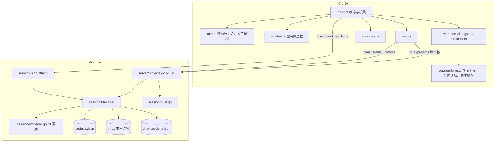

# 技术设计：按项目和 worktree 组织会话，并更换视觉风格

对应需求：spec.md（R1–R9，H1–H26）　更新：2026-11-18

文中的决定编号（6–13、d5–d18、c1–c3）见 decisions.md；实验输出在 `evidence/`。任务编号（T1–T20）见 tasks.md。

## 1. 方案

三个地方有真正不同的做法，其余都只有一种合理做法。

| 问题 | 方案 | 好处 | 代价 | 结论 |
|------|------|------|------|------|
| 项目和 worktree 怎么下发 | A 新端点 `GET /api/v1/projects`，返回 项目 → worktree → 会话 id；`/api/v1/sessions` 和所有 S→C 帧不加字段 | 终端会话的帧逐字节不变，现有 golden 测试不用改；会话列表接口耗时不变 | 每轮轮询多一个请求 | 选用（#6） |
| | B 给 `sessions[]` 每条加归属字段，再加一个顶层 `projects` | 一个请求 | `sessions` 帧的字节变了，要改 golden 测试（放松检查）；没有会话的 worktree 仍需要另一个结构 | 放弃 |
| 新建命名 worktree | A attach 加 `worktreeName`，对话框的即时校验走 `GET /api/v1/worktrees/plan` | 复用现有的幂等重放、失败回滚、信任检查；旧客户端的路径本来就要保留 | 确认之后才出现的竞态错误只能显示在状态栏 | 选用（d8） |
| | B 先 `POST` 建 worktree，再发普通 attach | 出错天然留在对话框里 | 要另做一套幂等；会话没起来时留下空 worktree | 放弃 |
| 删除 worktree | A 先 `GET /worktrees/status` 拿数字，再 `POST /worktrees/remove` 带上用户看到的 HEAD 和同意项，daemon 删除前重查，不一致返回 409 | 用户同意了什么 daemon 就只做什么；状态变了会重新确认 | 两个请求 | 选用（d9） |
| | B 一次请求带 `force` | 一个请求 | 确认框上的数字没有来源；检查与删除之间状态变了无从发现 | 放弃 |

## 2. 总体结构



- daemon 是项目、worktree、会话归属的唯一来源。桌面端只在连着旧 daemon 时自己从会话字段推导（R9.1）。
- 每个会话在创建时算出归属（项目 id、所在 worktree 的根目录）并存下来，之后不再变（H19）。
- 列表里每个项目只读一次 git 的 worktree 列表；改动数和未合并提交数只在删除确认时查（#7）。

## 3. 技术选型

| 选型项 | 选定 | 理由 | 放弃的备选 | 放弃原因 |
|--------|------|------|------------|----------|
| 读 worktree | `git worktree list --porcelain` | git 的稳定输出；第一项恒为主目录，路径是规范路径（V1） | 直接读 `.git/worktrees/*` | reftable 仓库的 `HEAD` 文件是占位符，读不出分支 |
| 未合并提交数 | `git rev-list --count <ref> --not --exclude=<分支> --branches --remotes` | 与 H9 的定义一致（V2） | `git branch --merged` | 只和一个基准比，已推送未合并的分支会被误报 |
| 未提交文件数 | `git -c core.fsmonitor=false status --porcelain --untracked-files=all` 的行数 | 不含被忽略的文件（H10，V2）；`core.fsmonitor` 是 status 唯一会执行外部程序的配置，关掉 | 现有的 `--ignored` | 与 H10 相反 |
| 归属的持久化 | 终端：tmux 用户选项；对话：`chat-sessions.json` 的记录 | 跟随各自已有的事实来源 | 全放进 `projects.json` | 会话没了记录还在，要另做清理 |
| 项目清单与创建记录 | `<state_dir>/projects.json`（d6） | 沿用现有的原子写做法 | 仓库的 git 配置 | 会改用户仓库的配置 |
| 识别旧 daemon | `/api/v1/projects` 返回 404（d7） | 每轮自带判断，没有缓存过期 | 缓存 `/info.proto` | daemon 原地升级后缓存会过期 |
| 快捷键拦截 | `window` 的 keydown 捕获阶段（#10） | 实测先于 xterm 和输入框收到（V7） | 主进程 `before-input-event` | 会话顺序在渲染进程，要多一层 IPC |

不加新的 npm 或 Go 依赖。

## 4. 接口

协议版本从 3 升到 4（c1 已同意）。`protocol.Version`、`PROTOCOL_VERSION` 改为 4；`docs/protocol.md` 的版本表加一行：「4：`attach.worktreeName`，`GET /api/v1/projects`，`POST /api/v1/projects/remove`，`GET /api/v1/worktrees/plan`，`GET /api/v1/worktrees/status`，`POST /api/v1/worktrees/remove`，`DELETE /api/v1/sessions/{id}` 不再清理 worktree（不再返回 409 `worktree_preserved`），`/api/v1/fs.chatTrust` 的 worktree 规则，错误码 `invalid_worktree_name` / `worktree_branch_exists` / `worktree_path_exists` / `worktree_path_not_allowed`。所有 S→C 帧的字段与 v3 相同」。

新增的 REST 端点都要求 `Authorization: Bearer <token>`（沿用 `checkToken`），请求体上限沿用 `maxRESTBody`。出错时的响应体统一为 `{"error":"<代码>","message":"<给人看的说明>"}`。

### 4.1 attach 帧新增 `worktreeName`（C→S）

| 字段 | 类型 | 必填 | 说明 |
|------|------|------|------|
| `worktreeName` | string | 否 | 只在新建（`sessionId` 为空）且 `mode:"worktree"` 时有效，其余情况忽略（含 `handoffFrom`）。非空：新分支名就是它，目录是 `<项目主目录的父目录>/<主目录名>-worktrees/<名字，/ 换成 ->`，基于 `workdir` 当前的 HEAD。空或缺省：旧行为，分支 `vibe/<会话id>`，目录 `<workdir 所在 worktree 根的父目录>/<根目录名>-worktrees/<会话id>`（R9.2） |

Go：`AttachFrame.WorktreeName string json:"worktreeName,omitempty"`。TS：`AttachFrame.worktreeName?: string`。`ready`、`sessions` 不变：命名 worktree 的会话用已有的 `mode/sourceWorkdir/sourceRepo/worktreeRoot/branch` 字段，`branch` 的值是名字。

名字的规则（daemon 为准，桌面端 `worktree-name.ts` 做同样的预检；两边共用测试向量 `vibe-remoted/internal/session/testdata/worktree-names.json`）：

1. 非空；不含空白和控制字符；不含 `..`；不以 `-` 开头。
2. 通过以上后，`git check-ref-format --branch <名字>` 退出码为 0。

新增的 error 帧代码，全部 `fatal:true`（原样重试不可能成功）：

| 代码 | 什么时候 | 桌面端怎么处理 |
|------|----------|----------------|
| `invalid_worktree_name` | 名字不满足规则 | 状态栏显示对应文案；正常情况下对话框已经拦住 |
| `worktree_branch_exists` | 仓库已有同名本地分支 | 同上 |
| `worktree_path_exists` | 目标目录已存在（空目录也算） | 同上 |
| `worktree_path_not_allowed` | 目标目录不在 `allowed_roots` 内，`message` 含完整路径 | 同上 |
| `create_failed`（已有） | 不是 git 仓库、git 执行失败，`message` 含 git 的错误输出 | 同上（现有行为） |

这些错误发生时不留下目录和分支（见 6.1）。同一个 `newSessionId` 的重放仍然接入第一次创建的会话（现有 `beginCreate`，R3.7）。

### 4.2 `GET /api/v1/projects`

返回这台机器的项目树。

```json
{
  "proto": 4,
  "projects": [
    {
      "id": "/Users/mac/github/devflow",
      "name": "devflow",
      "git": true,
      "worktrees": [
        { "path": "/Users/mac/github/devflow", "branch": "main", "head": "a1b2c3d", "main": true, "sessions": ["1794824025040-12b763ac"] },
        { "path": "/Users/mac/github/devflow-worktrees/fix-login", "branch": "fix-login", "head": "9f8e7d6", "managed": true, "sessions": [] },
        { "path": "/Users/mac/github/devflow/.devflow-tmp/worktrees/general-skills", "branch": "change/general-skills", "head": "0c1d2e3", "sessions": [] },
        { "path": "/Users/mac/github/devflow-worktrees/tmp", "head": "5a6b7c8", "detached": true, "sessions": [] }
      ],
      "sessions": []
    },
    { "id": "/Users/mac/notes", "name": "notes", "git": false, "worktrees": [], "sessions": ["1794824099999-aabbccdd"] }
  ]
}
```

| 字段 | 类型 | 说明 |
|------|------|------|
| `proto` | number | daemon 的协议版本 |
| `projects[].id` | string | git 项目：`git worktree list` 第一项的路径（主目录；裸仓库时是裸仓库目录）。非 git：会话的工作目录。都是规范路径 |
| `projects[].name` | string | `id` 的最后一段 |
| `projects[].git` | bool | 是否 git 项目 |
| `projects[].error` | string，可缺省 | `repo_missing`（`id` 目录不存在）或 `git_failed`（git 执行失败或超过 5 秒）；有值时 `worktrees` 为空，该项目的会话全部在 `sessions` 里（R2.7） |
| `projects[].errorMessage` | string，可缺省 | git 错误输出的第一行 |
| `projects[].worktrees[]` | 数组 | 只有 git 项目有。不含 `prunable`（目录已被删）、裸仓库本身、不在 `allowed_roots` 内的（R2.6） |
| `…worktrees[].path` | string | worktree 根目录 |
| `…worktrees[].branch` | string，可缺省 | 去掉 `refs/heads/` 的分支名；detached 时缺省 |
| `…worktrees[].head` | string | 提交哈希的前 7 位 |
| `…worktrees[].detached` | bool，可缺省 | 不在任何分支上（R1.8） |
| `…worktrees[].main` | bool，可缺省 | 是主目录 |
| `…worktrees[].managed` | bool，可缺省 | 由 vibe-remote 创建（见 5.3）。既不是 `main` 也不是 `managed` 的，界面标「外部」 |
| `…worktrees[].sessions` | string[] | 归属这个 worktree 的会话 id |
| `projects[].sessions` | string[] | 直接挂在项目下的会话 id：非 git 项目的全部会话；git 项目里所在 worktree 已不在列表中的会话（R2.5）；`error` 时的全部会话 |

顺序由 daemon 定，桌面端照着渲染（R1.5）：项目按 `name` 的小写形式，相同再按 `id`；worktree 主目录在前，其余按 `branch`，detached 的排在有分支的之后按 `head`，相同再按 `path`；会话按创建时间，相同再按 id。

项目集合 = 项目清单（5.2）∪ 现存会话的归属项目。非 git 项目只来自现存会话（H18）。

`git` 和 `error` 的判定（每个项目 id 跑一次 `ListWorktrees(id)`）：

| 情况 | 结果 |
|------|------|
| 成功 | `git:true`，`worktrees` 照列表生成 |
| 失败，id 在项目清单里，目录不存在 | `git:true`，`error:"repo_missing"` |
| 失败，id 在项目清单里，目录存在（含超时） | `git:true`，`error:"git_failed"`，`errorMessage` 是 git 错误输出的第一行 |
| 失败，id 不在项目清单里（只来自现存会话） | `git:false`，没有 `error`，会话全部在项目级 `sessions` 里 |

「创建时间」用的是 `/api/v1/sessions` 下发的同一个 `created`。daemon 重启后找回的终端会话，`created` 是找回的时刻（现有行为，不改）；同一批找回的会话时间相同，靠 id 排出先后（id 以创建时的毫秒时间戳开头）。顺序在没有新建和删除期间不变（d16）。

错误：401 未授权。旧 daemon 没有这个路径，返回 404（V5）。

### 4.3 `POST /api/v1/projects/remove`

请求体 `{"id":"/Users/mac/github/devflow"}`。从项目清单里删掉这条记录，不碰磁盘上的任何东西（R2.3）。

| 响应 | 什么时候 |
|------|----------|
| 204 | 已移除 |
| 404 `project_not_found` | 清单里没有这个 id |
| 409 `project_has_sessions` | 还有会话归属这个项目（R2.4）；桌面端平时就把菜单项置灰，这是并发时的兜底 |

### 4.4 `GET /api/v1/worktrees/plan?workdir=<目录>&name=<名字>`

新建 worktree 之前的只读预检，不创建任何东西。`workdir` 是发起处：项目行上发起时是项目主目录，机器概览的 Worktree 模式里是目录选择器当前的目录。`name` 可以为空（对话框刚打开时用它拿 `base`）。

```json
{ "ok": true,
  "project": "/Users/mac/github/devflow", "projectName": "devflow",
  "base": { "branch": "main", "head": "a1b2c3d" },
  "branch": "fix-login",
  "path": "/Users/mac/github/devflow-worktrees/fix-login" }
```

| 字段 | 说明 |
|------|------|
| `ok` | 以当前状态用这个名字新建是否会成功 |
| `error` / `message` | `ok:false` 时的原因：`not_git`（`workdir` 不在 git 仓库里，此时没有 `project/base`）、`invalid_worktree_name`（含名字为空）、`worktree_branch_exists`、`worktree_path_exists`、`worktree_path_not_allowed`（`message` 含路径） |
| `base` | 发起处所在 worktree 当前的分支和提交前 7 位；detached 时 `branch` 缺省、`detached:true`（R3.6） |
| `branch`、`path` | 名字合法时给出将要创建的分支和目录（R3.1、R3.2） |

HTTP 错误：403 `workdir` 不在 `allowed_roots` 内（响应体同 `/api/v1/fs`）；400 缺 `workdir`。

### 4.5 `GET /api/v1/worktrees/status?path=<worktree 根目录>`

删除确认框上的数字从这里来。

```json
{ "path": "/Users/mac/github/devflow-worktrees/fix-login",
  "project": "/Users/mac/github/devflow",
  "branch": "fix-login", "head": "9f8e7d6c5b4a39281706f5e4d3c2b1a098765432",
  "main": false, "managed": true,
  "dirtyFiles": 3, "unmergedCommits": 2,
  "sessions": ["1794824025040-12b763ac", "1794824031111-0a1b2c3d"] }
```

| 字段 | 说明 |
|------|------|
| `head` | 完整的 40 位提交哈希，删除时原样带回 |
| `branch` / `detached` | 同 4.2 |
| `dirtyFiles` | 未提交或未跟踪的文件数，不含被忽略的（H10） |
| `unmergedCommits` | 有分支：该分支上不被任何其他本地分支或远程跟踪分支包含的提交数（H9）。detached：`HEAD` 上不被任何本地分支或远程跟踪分支包含的提交数（R5.11） |
| `sessions` | 归属这个 worktree 的会话 id（含已结束的对话会话） |

错误：404 `worktree_not_found`（`path` 不是 daemon 从它所属仓库读到的 worktree，或不在 `allowed_roots` 内）；500 `git_failed`。

### 4.6 `POST /api/v1/worktrees/remove`

```json
{ "path": "/Users/mac/github/devflow-worktrees/fix-login",
  "head": "9f8e7d6c5b4a39281706f5e4d3c2b1a098765432",
  "sessions": ["1794824025040-12b763ac", "1794824031111-0a1b2c3d"],
  "discardFiles": true,
  "deleteBranch": false,
  "dropCommits": false }
```

| 字段 | 类型 | 必填 | 说明 |
|------|------|------|------|
| `path` | string | 是 | 要删的 worktree |
| `head` | string | 是 | 确认框打开时 status 返回的 `head` |
| `sessions` | string[] | 是 | 确认框上告诉用户会被结束的会话 |
| `discardFiles` | bool | 否 | 用户同意丢弃未提交和未跟踪的文件 |
| `deleteBranch` | bool | 否 | 用户选择连分支一起删。只有 `managed` 且不是 detached 时 daemon 才照做，否则忽略（R5.8） |
| `dropCommits` | bool | 否 | 用户同意让未合并的提交不再属于任何分支 |

daemon 的处理顺序见 6.2。响应：

| 响应 | 什么时候 | 桌面端怎么处理 |
|------|----------|----------------|
| 200 `{"removed":true,"branchDeleted":true,"endedSessions":["…"]}` | 目录已删。`branchDeleted` 表示分支是否也删了；分支该删而没删成时为 `false` 并带 `branchError` | 关掉这些会话的视图，刷新侧边栏；`branchError` 显示在状态栏 |
| 400 `worktree_is_main` | `path` 是主目录（R5.7） | 状态栏报错（菜单里本来就没有这一项） |
| 404 `worktree_not_found` | 同 4.5 | 刷新侧边栏，状态栏提示已不存在 |
| 409 `worktree_changed`，响应体多一个 `status`（4.5 的结构） | 重查后与用户确认的不一致：`head` 变了；有不在 `sessions` 里的会话；有未提交文件而 `discardFiles` 不为真；会让未合并提交失去分支而 `dropCommits` 不为真；`git worktree remove` 因为新出现的文件而拒绝 | 用返回的 `status` 重新弹确认框，写明状态已变化 |
| 500 `worktree_remove_failed` | git 删除失败（R5.9），`message` 是 git 的错误输出 | 对话框内显示错误，worktree 行不变 |

### 4.7 `DELETE /api/v1/sessions/{id}`（行为改变）

停会话、删记录，不再碰 worktree 目录和分支，成功一律 204（H16、R5.1、R5.10）。协议 4 的 daemon 不再返回 409 `worktree_preserved`。桌面端保留对 409 的处理，因为它还可能连着旧 daemon。

### 4.8 `/api/v1/fs` 的 `chatTrust`、`/api/v1/info`

- `chatTrust` 的取值不变，判定改为 7.3 的规则（多认「仓库主目录已被信任的 worktree 根目录」）。
- `/api/v1/info.proto` 为 4，其余字段不变。

### 4.9 daemon 内部接口（`internal/session`）

```go
// worktree.go
type Worktree struct { Path, Branch, Head string; Detached, Bare, Prunable bool } // Head 是 40 位
func ListWorktrees(dir string) ([]Worktree, error)        // git -C dir worktree list --porcelain，第一项是主目录
type Home struct { Project, Path string; Git bool }       // 归属：项目 id、所在 worktree 根；非 git 时两者都是目录本身
func ResolveHome(dir string) Home
func ValidateWorktreeName(repoDir, name string) error     // errors.Is(err, ErrInvalidWorktreeName)
func WorktreeDirName(name string) string                  // "/" → "-"
func DirtyFiles(worktreeDir string) (int, error)
func UnmergedCommits(repoDir, branch string) (int, error) // branch 为空 = repoDir 的 HEAD（detached）
type WorktreeSpec struct { Source, SessionID, Name string; AllowPath func(string) error }
func CreateWorktree(spec WorktreeSpec) (meta WorktreeMetadata, workdir string, home Home, err error)
func RollbackWorktree(meta WorktreeMetadata) error        // 现有
var ErrInvalidWorktreeName, ErrWorktreeBranchExists, ErrWorktreePathExists,
    ErrWorktreePathNotAllowed, ErrWorktreeNotFound, ErrWorktreeIsMain error
type WorktreeChangedError struct { Status protocol.WorktreeStatus }

// trust.go
func ChatTrust(dir string) chat.TrustState                // 7.3

// projects_store.go
func OpenProjectStore(stateDir string) (*ProjectStore, error) // 出错时调用方改用 NewMemoryProjectStore()
func (s *ProjectStore) AddProject(id string)
func (s *ProjectStore) RemoveProject(id string) bool
func (s *ProjectStore) Projects() []string
func (s *ProjectStore) AddWorktree(project, path, branch string)
func (s *ProjectStore) RemoveWorktree(path string)
func (s *ProjectStore) Managed(project, path, branch string) bool

// projects.go（Manager 的方法；allow 是 allowed_roots 的检查，由 server 传入）
func (m *Manager) SetProjectStore(s *ProjectStore)
func (m *Manager) Projects(allow func(path string) bool) []protocol.Project
func (m *Manager) RemoveProject(id string) error          // ErrProjectNotFound / ErrProjectHasSessions
func (m *Manager) PlanWorktree(workdir, name string, allowPath func(string) error) protocol.WorktreePlan
func (m *Manager) WorktreeStatus(path string, allow func(string) bool) (protocol.WorktreeStatus, error)
func (m *Manager) RemoveWorktree(req protocol.WorktreeRemoveRequest, allow func(string) bool) (protocol.WorktreeRemoveResult, error)
```

`CreateOptions`、`ChatCreateOptions` 各加 `WorktreeName string`；`CreateOptions` 另加 `Home *Home`（交接时照抄对话会话的归属，非空就不再推导）；`RunnerConfig` 加 `Project, Home string`，读取用 `func (r *Runner) Home() (project, home string)`；`chat.Record` 加 `Project, Home`（5.1）。`CreateOptions.ValidateWorkdir`、`ChatCreateOptions.ValidateWorkdir` 的名字和签名不变，server 改为传 `cfg.ResolveAllowedNewPath`，`Manager` 把它包成 `WorktreeSpec.AllowPath`。读 worktree 列表和预检用的 git 调用走 `gitAtTimeout(dir, args...)`，超时取包级变量 `gitTimeout`（5 秒，测试里可以调小）。`config.Config` 加 `ResolveAllowedNewPath(path string) (string, error)`：对还不存在的路径，把最深的已存在祖先解析成规范路径后拼回剩余部分，再做与 `ResolveAllowedWorkdir` 相同的包含判断（R3.10 要在创建之前判断）。

`protocol.go` 新增类型 `ProjectsResponse`、`Project`、`ProjectWorktree`、`WorktreePlan`、`WorktreeBase`、`WorktreeStatus`、`WorktreeRemoveRequest`、`WorktreeRemoveResult`，字段名即 4.2–4.6 的 JSON 名；可缺省的字段用 `omitempty`，数组字段输出 `[]` 而不是 `null`。

### 4.10 桌面端内部接口

```ts
// shared/protocol.ts
export const PROTOCOL_VERSION = 4;
export const CHAT_MIN_PROTO = 3;        // chat/availability.ts 用它判断，不再用 PROTOCOL_VERSION
// 以及与 4.2–4.6 同名的类型：Project、ProjectWorktree、WorktreePlan、WorktreeStatus、WorktreeRemoveRequest、WorktreeRemoveResult

// rest.ts
listProjects(): Promise<Project[] | null>          // 404 → null（旧 daemon）；其他失败抛错
removeProject(id: string): Promise<void>
planWorktree(workdir: string, name: string): Promise<WorktreePlan>
worktreeStatus(path: string): Promise<WorktreeStatus>
removeWorktree(req: WorktreeRemoveRequest): Promise<WorktreeRemoveResult>
class RestError extends Error { status: number; code: string; body: unknown }   // 4.3–4.6 的非 2xx

// client.ts
type AttachOptions = { ui?: SessionUI; handoffFrom?: string; worktreeName?: string }  // 进 AttachIntent，重放时原样带上

// tree.ts（纯函数，无 DOM）
interface TreeSession { id: string; info: SessionInfo; name: string; gone: boolean }
interface TreeWorktree { path: string; label: string; branch?: string; detached: boolean; main: boolean; managed: boolean; sessions: TreeSession[] }
interface TreeProject { id: string; name: string; git: boolean; flat: boolean; branchLabel?: string;
                        error?: { code: string; message: string }; worktrees: TreeWorktree[]; sessions: TreeSession[] }
function buildTree(sessions: SessionInfo[], projects: Project[] | null): TreeProject[]
function visibleSessions(machines: { key: string; collapsed: boolean; tree: TreeProject[] }[], collapsedProjects: Set<string>): { machineKey: string; id: string }[]
function projectRollup(project: TreeProject, dotOf: (id: string) => Dot): 'waiting' | 'none'
function sessionContext(tree: TreeProject[], id: string): { project: string; branch?: string; name: string } | null
function notificationTitle(machineName: string, ctx: { project: string; branch?: string; name: string }): string
type Capability = 'v4' | 'legacy' | 'unknown'
function nextCapability(prev: Capability, result: Project[] | null | Error): Capability   // 数组 → v4；null → legacy；Error → prev

// worktree-name.ts
function validateWorktreeName(name: string): null | 'empty' | 'whitespace' | 'dotdot' | 'leading_dash' | 'invalid'
function worktreeDirName(name: string): string
// attach 收到 4.1 的四个新错误码时状态栏用的文案；不认识的 code 返回 null（沿用现有的通用报错）
function worktreeErrorText(code: string, ctx: { branch?: string; path?: string }): string | null

// shortcuts.ts
type ShortcutAction = { kind: 'index'; n: number } | { kind: 'prev' } | { kind: 'next' }
function matchShortcut(e: Pick<KeyboardEvent, 'metaKey' | 'ctrlKey' | 'altKey' | 'shiftKey' | 'code'>): ShortcutAction | null
function pickTarget(count: number, activeIndex: number, action: ShortcutAction): number | null   // activeIndex = -1 表示当前没有打开会话
function installShortcuts(target: Window, deps: { blocked(): boolean; count(): number; activeIndex(): number; open(index: number): void }): () => void   // 返回卸载函数

// sidebar.ts
function renderSidebar(container: HTMLElement, model: SidebarModel, actions: SidebarActions): void
function renderToolbarTitle(container: HTMLElement, ctx: { project: string; branch?: string; name: string } | null, fallback: string): void

// chat/availability.ts（第 4 个参数是新加的，可缺省）
function chatAvailability(info?: MachineInfo, error?: unknown, trust?: ChatTrust, opts?: { mainPath?: string }): ChatAvailability

// worktree-dialogs.ts
function openNewWorktreeDialog(machine, project: TreeProject): Promise<(PickedSession & { worktreeName: string; worktreePath: string }) | null>   // worktreePath 是 plan 返回的 path；dirpicker 的 PickedSession 同样多这两个可选字段
function openWorktreeSessionDialog(machine, project: TreeProject, worktree: TreeWorktree): Promise<PickedSession | null>
function confirmDeleteSession(opts: { name: string; worktreeLabel?: string; legacyWorktree: boolean }): Promise<boolean>
function confirmDeleteWorktree(status: WorktreeStatus, opts: { label: string; changed: boolean; error?: string }): Promise<WorktreeRemoveRequest | null>
// 查状态 → 确认 → 删除；409 用返回的 status 重新确认（changed:true）；500 带着 error 重新打开同一个确认框；返回 null = 用户取消或 worktree 已不存在
function deleteWorktreeFlow(rest: Pick<VibeRemoteRest, 'worktreeStatus' | 'removeWorktree'>, target: { path: string; label: string }, notify: (text: string) => void): Promise<WorktreeRemoveResult | null>

// theme.ts
function terminalTheme(): ITheme     // 底色、前景、光标、选区读 CSS 变量；16 个 ANSI 色是这里的常量（d14）
```

`buildTree` 的规则：

- `projects` 非空（新 daemon）：照 daemon 的顺序生成；`label` 是 `branch`，detached 时是 `head`。树里引用了、但会话列表里没有的 id 跳过（两个请求之间被删掉的）；会话列表里有、但没有被任何节点引用的会话（两个请求之间新建的）按下一条旧版规则临时归位。
- `projects` 为 `null`（旧 daemon，R9.1）：`mode:"worktree"` 的会话归到项目 `sourceRepo` 下的 worktree `worktreeRoot`（`label` = `branch`，`managed:true`）；其余会话，`workdir` 等于某个已知项目 id 或在它下面的归到该项目的主目录行，在某个已知 `worktreeRoot` 下面的归到那个 worktree，否则自成一个项目（id = `workdir`）。顺序规则同 4.2，在桌面端排。
- `flat` = git 项目且 `worktrees.length <= 1`：不显示 worktree 层，`branchLabel` 取那一个 worktree 的 `label`（R1.2）。非 git 项目 `flat` 恒为真、没有 `branchLabel`（R1.3）。
- `gone`：git 项目、没有 `error`、会话在项目级 `sessions` 里（R2.5）。
- `name`：`info.title`；同一个 worktree 节点（或同一个项目级列表）里按创建顺序，第二个起同名的加序号，如 `fix-login 2`（H12、d12、R1.4）。

## 5. 数据

没有已有数据需要迁移；下面三处都是加字段或加文件，旧数据缺字段时按 5.4 补一次。

### 5.1 会话归属

| 会话类型 | 存在哪 | 字段 |
|----------|--------|------|
| 终端（tmux） | tmux 用户选项，和现有的 `@vibe_remote_mode` 等一起在 `start` 里写 | `@vibe_remote_project`（项目 id）、`@vibe_remote_home`（所在 worktree 根；非 git 时是工作目录） |
| 终端（`use_tmux:false`） | 只在内存（这种会话断线即结束） | 同上 |
| 对话 | `chat-sessions.json` 的记录，`version` 仍是 1 | `project`、`home`（`omitempty`） |

`tmux list-sessions` 的格式串在末尾加这两列，共 11 列；`parseTmuxSessionLine` 接受 8、9、11 列。

归属在创建时算一次：普通模式是 `ResolveHome(workdir)`；worktree 模式的 `home` 是新 worktree 的根，`project` 来自 `CreateWorktree` 的返回；交接出来的终端会话照抄对话会话的归属。之后不随 `cd` 变（H19）。

### 5.2 `<state_dir>/projects.json`

```json
{ "version": 1,
  "projects": [ { "id": "/Users/mac/github/devflow", "addedAt": "2026-11-18T10:00:00Z" } ],
  "worktrees": [ { "project": "/Users/mac/github/devflow", "path": "/Users/mac/github/devflow-worktrees/fix-login", "branch": "fix-login", "createdAt": "2026-11-18T10:05:00Z" } ] }
```

- `projects`：开过会话的 git 项目。新建会话（任何模式、任何界面）成功后加入；`POST /projects/remove` 删除；之后在该仓库新建会话会再加回来（R2.3）。非 git 项目不进清单（H18）。
- `worktrees`：vibe-remote 创建的 worktree（H17）。`git worktree add` 成功后立刻加入（命名的和旧式自动命名的都记）；创建回滚、经 4.6 删除成功时删掉；`Projects()` 成功读到某项目的列表而记录的 `path` 不在其中时也删掉（别人已经把它删了，之后同一路径上再出现的 worktree 不该被认成自己的）。
- 文件 0600，目录沿用 `state_dir`（0700）。写法与 `chat-sessions.json` 相同：临时文件、fsync、rename。`ProjectStore` 自己有一把互斥锁，每次修改在锁内同步写盘（修改只发生在新建项目里的第一个会话、建删 worktree、移除项目时）；这把锁是叶子锁，调用方不得在持有 `Manager.mu` 时调用它（现有规则：`Manager.mu` 下不做文件 IO）。
- 文件读不出来或 `version` 不是 1：改名为 `projects.json.corrupt-<unix 时间>`，按空清单启动，记一行日志（与对话会话表相同）。
- `state_dir` 不可写（`chat.NewStore` 已经报错）：用 `NewMemoryProjectStore()`，清单只在内存；项目只从现存会话推导，不报错（H18）。此时重启后命名 worktree 的创建记录会丢，它们按「外部」处理：仍能删目录，不会删分支，方向是安全的。

### 5.3 `managed` 的判定

满足任一条即为真，否则为假（宁可判成「外部」，H17）：

1. `projects.json` 里有 `path` 相同且 `branch` 等于该 worktree 当前分支的记录。用户在里面切了分支或 detached 后不再满足。
2. 升级前留下的：`path` 等于 `<主目录的父目录>/<主目录名>-worktrees/<X>`、当前分支等于 `vibe/<X>`，且 `X` 满足 `ValidSessionID`。这一条每次现算，不写文件。

### 5.4 升级时补归属

- 终端会话的 tmux 选项里没有 `@vibe_remote_project`：第一次 `Projects()` 时在 `Manager.mu` 之外补。worktree 模式用已有的 `@vibe_remote_worktree_root` 作 `home`，项目取 `ResolveHome(该目录).Project`，目录已不存在时取 `ResolveHome(@vibe_remote_source_repo).Project`；其余用当时的 `pane_current_path` 调 `ResolveHome`（「按当时的工作目录推导一次」）。补完写回 tmux 选项和内存；写失败只留在内存，下次再试。
- 对话记录没有 `project`：`LoadChats` 里同样补，随后落盘。
- 补出来的 git 项目加入项目清单（H18「升级时已有会话所在的项目自动进入清单」）。

## 6. 状态和流程

### 6.1 新建 worktree（`CreateWorktree`）

同一个项目的新建和删除 worktree 在 daemon 内串行：`Manager` 持有按项目 id 取的互斥锁（#8）。锁的先后固定为：创建占位（`beginCreate`）→ 项目锁 → `chat.Session.opMu` → `Manager.mu`；持有 `opMu` 或 `Manager.mu` 时不取项目锁。交接（`Handoff`）不建 worktree，不取项目锁。

锁内步骤，任何一步失败都返回对应错误并停止：

1. `ResolveHome(Source)`；不是 git → `create_failed`。
2. 有名字：`ValidateWorktreeName` → `invalid_worktree_name`；分支 = 名字，目录 = `<dirname(项目)>/<basename(项目)>-worktrees/<WorktreeDirName(名字)>`。没有名字：分支 `vibe/<会话id>`，目录按现有算法。
3. `AllowPath(目录)` → `worktree_path_not_allowed`（此前是建好再检查再回滚；现在对两条路径都先检查）。
4. `git show-ref --verify --quiet refs/heads/<分支>` 成功 → `worktree_branch_exists`。
5. `os.Lstat(目录)` 存在 → `worktree_path_exists`。
6. `git -C <发起处所在 worktree 根> worktree add -b <分支> <目录> HEAD`。
7. 第 6 步失败：因为第 4、5 步在锁内确认过分支和目录原本不存在，所以清掉本次留下的东西：`RollbackWorktree`（注销 worktree、删分支）、`os.RemoveAll(目录)`、容器目录是本次新建且为空则删掉；返回 `create_failed` 和 git 的错误输出（R3.8）。
8. 成功：`ProjectStore.AddWorktree`；源目录是子目录时在新 worktree 里建出对应子目录（现有行为）。

之后（锁外）启动会话；启动失败时照现有逻辑 `RollbackWorktree`，并删掉第 8 步的记录。

并发创建同名：第二个请求在锁内第 4 步得到 `worktree_branch_exists`，不会碰第一个请求的分支。daemon 之外有人同时手动跑 git 的情况不在锁的范围内，由 git 自己的引用锁保证只有一个成功。

已知的窄窗口：daemon 在第 6 步之后、会话登记之前崩溃，重放会得到 `worktree_branch_exists`；那个 worktree 会以「没有会话」的行出现在侧边栏，可以在其中新建会话或删除。

### 6.2 删除 worktree（`RemoveWorktree`）

持有项目锁，步骤：

1. 先 `allow(path)`，不通过直接 404 `worktree_not_found`，不对这个路径运行 git（`WorktreeStatus` 同样）。通过后 `ResolveHome(path)`；`path` 必须与 daemon 读到的列表里的一项完全相等 → 否则 404 `worktree_not_found`；是主目录 → 400 `worktree_is_main`。
2. 重查状态 S（同 4.5）。
3. 与请求比对，任一不符 → 409 `worktree_changed` + S，不做任何改动：`S.head != head`；S 的会话不全在请求的 `sessions` 里；`S.dirtyFiles > 0` 且 `discardFiles` 不为真；设「要删分支」= `deleteBranch && S.managed && 有分支`，「要删分支且 `S.unmergedCommits > 0`」或「detached 且 `S.unmergedCommits > 0`」而 `dropCommits` 不为真。
4. 逐个结束并删除 S 的会话（等同 `DELETE /sessions/{id}`）。
5. `git -C <主目录> worktree remove <path>`，仅当 `discardFiles` 为真时加 `--force`。git 因「contains modified or untracked files」拒绝（第 2 步之后才出现的文件）→ 409 `worktree_changed` + 新状态；其他失败 → 500 `worktree_remove_failed`（R5.9）。
6. 「要删分支」时 `git branch -D <分支>`（分支名取自 daemon 自己读到的列表）。失败不回滚目录，在结果里带 `branchError`。
7. `ProjectStore.RemoveWorktree(path)`；容器目录为空则删掉。

第 4 步之后才失败时，会话已经结束而 worktree 还在：这是用户确认过的动作的一部分，响应里如实报错，侧边栏刷新后该行显示「没有会话」。

桌面端按 status 选确认框（默认按钮见 H22）：

| status | 确认框 | 请求里的同意项 |
|--------|--------|----------------|
| `managed`，`dirtyFiles=0`，`unmergedCommits=0` | 「目录和分支都会删除」，按钮 取消 / 删除（R5.2） | `deleteBranch:true` |
| `dirtyFiles>0`（任何类型） | 警告「有 N 个文件未提交或未跟踪，删除会丢弃」，默认按钮是取消，另一个是「仍然删除」（R5.3） | `discardFiles:true`，再加上该 worktree 按本表其余各行应带的同意项（例如 `managed` 且没有未合并提交时还有 `deleteBranch:true`） |
| `managed`，有分支，`unmergedCommits>0` | 「有 N 个未合并的提交」，两个单选：「只删目录、保留分支」（预选）、「目录和分支都删」（R5.5） | 前者无；后者 `deleteBranch:true, dropCommits:true` |
| 非 `managed`、有分支 | 标明不是由 vibe-remote 创建，只删目录、分支保留（R5.8） | 无 |
| detached，`unmergedCommits>0` | 警告「这 N 个提交删除后不再属于任何分支」，默认按钮是取消，另一个是「仍然删除」（R5.11） | `dropCommits:true` |
| detached，`dirtyFiles=0`，`unmergedCommits=0` | 「工作区是干净的，只删除目录」，按钮 取消 / 删除（R5.11 后半句） | 无 |
| `sessions` 非空（叠加在以上任一种上） | 多一句「会先结束这 N 个会话」（R5.6） | `sessions` 原样带回 |

几种情况同时成立时（例如有未提交文件，分支又有未合并提交），确认框把各自的那一段都显示出来，同意项取并集。`data-variant` 按 `files` > `detached` > `commits` > `external` > `clean` 取第一个成立的。只要显示了 `files` 或 `detached`（有提交）的警告，默认按钮就是取消、确认按钮是「仍然删除」；`commits` 的两个单选在这种情况下照常显示、仍预选「只删目录、保留分支」。不是 `managed` 也不是主目录的 worktree 一律显示「不是由 vibe-remote 创建」这一行。

### 6.3 删除会话

`Manager.Delete`、`deleteChat` 去掉对 `CleanupWorktree` 的调用，`handleDeleteSession` 里的 409 分支删除（T12）。`CleanupWorktree` 和 `WorktreePreservedError` 在 `RemoveWorktree` 落地时删除（T13），它们的测试在那时改成 `RemoveWorktree` 的测试（7.1）；测试里当清理用的 `defer CleanupWorktree(meta)` 改为 `RollbackWorktree(meta)`。

先行修复（T1，单独提交，H8）是过渡状态，只改 `CleanupWorktree`：它有两处会执行 `git branch -D`，两处之前都先查 `UnmergedCommits(meta.SourceRepo, meta.Branch)`。

- 工作区干净的判断之后：大于 0 时与「不干净」同样处理，返回 `WorktreePreservedError`，目录和分支都保留（d5）。
- worktree 目录已经不存在的那条路径（现在直接 `RollbackWorktree`，分支被删）：大于 0 时同样返回 `WorktreePreservedError`，分支保留。
- `UnmergedCommits` 本身失败时返回错误、什么都不删（与现有的「查工作区状态失败」相同）。

### 6.4 桌面端每轮轮询

每台机器并行请求 `listSessions()` 和 `listProjects()`，各自独立发布结果（沿用现有的 generation 机制）。机器的能力状态：`listProjects()` 返回数组 → `v4`；返回 `null` → `legacy`；抛错 → 保持上一轮的状态和树；从未成功过是 `unknown`。`legacy` 和 `unknown` 下，新建 worktree、删除 worktree 的入口置灰；`legacy` 另外在机器行下显示一条说明（R9.1）。

### 6.5 快捷键

`index.ts` 启动时在 `window` 上注册一个捕获阶段的 keydown 监听：

1. `matchShortcut(e)` 为空 → 不管。匹配条件：只按了 ⌘（没有 ⌃、⌥），且（没按 ⇧ 且 `code` 是 `Digit1`–`Digit9`）或（按了 ⇧ 且 `code` 是 `BracketLeft` / `BracketRight`）。
2. 有对话框开着（`document.querySelector('.modal-overlay')` 存在）或侧边栏正在内联重命名 → 不切换，也不拦截（R7.4）。
3. 否则 `preventDefault()` + `stopPropagation()`，按键因此不会到达 xterm 和输入框（R7.3）。
4. 目标：`visibleSessions()` 给出侧边栏从上到下可见的会话（跨机器；折叠的机器和折叠的项目里的跳过，R7.5）。⌘n 取第 n 个，没有就不动（R7.1）；⌘⇧] / ⌘⇧[ 取当前会话的下一个 / 上一个，循环（R7.2）；当前没有打开会话时，下一个 = 第一个，上一个 = 最后一个。然后 `openExisting`。

## 7. 错误处理和安全

- 新接口都要 Bearer token，常量时间比较（现有 `checkToken`）。
- 客户端传来的字符串怎么用：
  - `worktreeName`：先过 4.1 的规则（以 `-` 开头的在任何 git 调用之前就被拒绝），之后只作为 `exec.Command` 的一个参数传给 git，不经过 shell（V3：`$(touch${IFS}PWNED)` 原样成为分支名）。
  - `path`（status / remove）：只用来和 daemon 自己读到的 worktree 路径做相等比较；之后传给 git 的是 daemon 读到的那个字符串。分支名同理，取自 daemon 读到的列表。
  - `workdir`：过 `ResolveAllowedWorkdir`。新 worktree 的目标目录过 `ResolveAllowedNewPath`。
  - 项目 `id`：只和项目清单里的键做相等比较。
- git 调用用 `exec.CommandContext`，列表和预检的超时是 5 秒（卡住的 git 会让每 5 秒一轮的轮询无限堆积进程）；超时按 `git_failed` 处理。
- 错误分类：attach 的新错误都是 fatal（4.1）。REST 的 409 `worktree_changed` 是可恢复的（重新确认）；其余 4xx 是请求本身的问题；500 带 git 的原始错误。
- 日志不记录 token；git 的错误输出可以进日志和响应（只含路径和分支名）。

## 7.1 不变的规则

`.devflow.yml` 现有的 11 条逐条核对：

| 规则 | 是否受影响 | 自动检查（命令） |
|------|------------|------------------|
| 终端模式纯字节透传 | 不受影响；终端只换 4 个主题色 | `cd desktop && npm test` |
| 协议三处一致 | 受影响：三处都要加 v4 的内容 | `/protocol-sync` skill（它的核对清单要补 v4，属于 c3） |
| 终端会话的帧除 proto 外逐字节不变 | 守住：S→C 帧不加字段；测试文件和 golden 一个字不改，`proto` 的值本来就被测试归一化 | `cd vibe-remoted && go test -race ./internal/server -run TestTerminalFramesUnchangedV3` |
| 同一 claude 会话 id 最多一个进程 | 不受影响；新 worktree 没有历史对话，走现有的新建路径 | 现有命令 |
| 客户端断开不停对话进程 | 不受影响 | 现有命令 |
| 待答请求不被缓冲淘汰 | 不受影响 | 现有命令 |
| 「不再询问」规则只能来自 claude | 不受影响 | 现有命令 |
| 启动命令只由服务端配置拼成 | 不受影响；`worktreeName` 不进启动命令 | 现有命令 |
| 模型输出不以原始 HTML 进入 DOM | 不受影响；新文件都用 `textContent`，对话视图只改 CSS | 现有命令 |
| 主 token 不进 claude 环境 | 不受影响 | 现有命令 |
| 不读取 claude 凭据 | 不受影响；信任规则仍只读 `hasTrustDialogAccepted` 一个字段 | 现有命令 |

本次新增 6 条。检查随对应任务写好；加进 `.devflow.yml` 的 `invariants` 属于改规则文件，等 c3（T20）。

| 规则 | 自动检查（命令） | 写在哪个任务 |
|------|------------------|--------------|
| 删会话不删 worktree 目录和分支，协议 4 的 daemon 不返回 `worktree_preserved` | `cd vibe-remoted && go test -race ./internal/session ./internal/server -run 'TestDeleteSessionKeepsWorktreeAndBranch\|TestDeleteSessionNeverReturnsPreserved'` | T12 |
| 只删 daemon 自己读到的、在 `allowed_roots` 内的、不是主目录的 worktree | `cd vibe-remoted && go test -race ./internal/session ./internal/server -run 'TestRemoveOnlyListedWorktrees\|TestRemoveMainRefused'` | T13 |
| 不是 vibe-remote 创建的 worktree，分支永远不删 | `cd vibe-remoted && go test -race ./internal/session -run 'TestRemoveExternalNeverDeletesBranch\|TestManagedRequiresPathAndBranch'` | T3、T13 |
| 未经同意不丢文件和提交：删除前重查，与确认的不一致就 409 | `cd vibe-remoted && go test -race ./internal/session -run 'TestRemoveDirtyNeedsConsent\|TestRemoveUnmergedNeedsConsent\|TestRemoveChangedSinceStatus'` | T13 |
| 客户端传的 worktree 名字不经 shell，以 `-` 开头的在调用 git 前被拒 | `cd vibe-remoted && go test -race ./internal/session -run 'TestWorktreeNameNeverReachesShell\|TestValidateWorktreeName'` | T7 |
| 对话界面的信任只认：目录本身，或「仓库自己列出的 worktree 根 + 主目录这一个路径被信任」 | `cd vibe-remoted && go test -race ./internal/session -run TestChatTrust` | T10 |

按 spec 改写断言的现有测试（#11，不是放松）：

| 测试 | 旧断言 | 新断言 | 依据 |
|------|--------|--------|------|
| `session.TestChatWorktreeAndFlags`（末段） | 删会话后干净的 worktree 目录不存在 | 目录和分支 `vibe/<id>` 都存在 | H16 |
| `session.TestManagerDeleteRecoveredCleanWorktreeRemovesGitResources`（改名 `…KeepsGitResources`） | 目录和分支都被删 | 都存在 | H16 |
| `session.TestManagerDeleteDirtyWorktreeStopsSessionAndPreservesGitResources` | 返回 `WorktreePreservedError` | 返回 nil，会话已停，目录和分支都在 | H16 |
| `server.TestDeleteDirtyWorktreeReturnsStructuredConflict`（改名 `TestDeleteSessionNeverReturnsPreserved`） | 409 `worktree_preserved` | 204，目录和分支都在 | H16、R5.10 |
| `session.TestWorktreeDirtyCleanupPreservesBoth`（改为 `TestRemoveDirtyNeedsConsent`） | `CleanupWorktree` 保留并报错 | 不带 `discardFiles` → 409 且都在；带上 → 目录被删 | R5.3 |
| `session.TestWorktreeIgnoredFileIsPreserved`（改为 `TestRemoveIgnoredOnlyIsClean`） | 只有被忽略的文件也保留 | `dirtyFiles=0`，不带 `discardFiles` 就能删 | H10、R5.4 |
| `server.TestInfoAndReadyProto3`（改名 `…Proto4`） | proto 为 3 | proto 为 4 | c1 |

`session.TestWorktreeCleanCleanupRemovesWorktreeAndBranch` 改为 `TestRemoveCleanMergedWorktree`（断言不变：目录和分支都被删）。T1 不改任何现有测试。

另外两类跟着改、但断言不变的：

- `CreateWorktree` 换成 4.9 的签名后，直接调用它的现有测试（`worktree_test.go` 9 处、`manager_test.go` 1 处）只改调用写法。
- 协议冒烟脚本 `.claude/skills/verify/scripts/ws-chat-smoke.mjs:416` 写死了 `info.proto !== 3`，随版本号改为 `!== 4`（c1）。
- T1 为过渡行为新写的测试，在最终行为落地时换掉：`server.TestDeleteCleanWorktreeWithUnmergedCommitsReturns409` 在 T12 删除（由 `TestDeleteSessionNeverReturnsPreserved` 取代，后者同样断言目录、分支、提交都在）；`session.TestCleanupKeepsCleanWorktreeWithUnmergedCommits`、`TestCleanupKeepsBranchWhenWorktreeDirMissing` 在 T13 随 `CleanupWorktree` 删除（由 `TestRemoveUnmergedNeedsConsent` 取代）。`TestUnmergedCommits` 一直保留。

## 7.2 外部影响和开关

无。所有操作都在 daemon 所在机器的本地 git 仓库和文件系统上，不发消息、不调用外部服务。

## 7.3 对话界面的信任规则（H7，安全边界）

`claude -p` 不弹信任确认并会执行项目里的 hook，所以 daemon 只在 claude 已信任的地方开对话会话。`session.ChatTrust(dir)`（`dir` 是规范路径）：

1. `chat.WorkdirTrusted(dir)`（现有函数：读 `$CLAUDE_CONFIG_DIR/.claude.json`，否则 `~/.claude.json`，只读 `projects[<dir>].hasTrustDialogAccepted`）。结果是 `trusted` 或 `unknown`（文件缺失或损坏）→ 直接返回。
2. `ListWorktrees(dir)`；失败、为空、第一项是裸仓库 → `untrusted`。
3. 设主目录 M = 第一项的路径。`dir == M` → `untrusted`（主目录只认自己的记录，第 1 步已经查过）。
4. `dir` 必须与列表里某个不是 `prunable` 的后续项的路径完全相等，否则 `untrusted`。
5. `chat.WorkdirTrusted(M) == trusted` → `trusted`，否则 `untrusted`。

不放宽的部分：

- 只认 `hasTrustDialogAccepted === true`；文件读不了时一律拒绝。
- 只认主目录这一个路径：它的父目录、子目录、别的 worktree 被信任都不算。
- `dir` 必须是 worktree 的根。主目录和任何 worktree 里的子目录仍只查自己。
- 「是不是这个仓库的 worktree」由仓库自己的列表决定。那份列表来自主目录 `.git/worktrees/*/gitdir` 的反向指针，目录自己伪造一个 `.git` 文件进不了列表（V4）。
- 裸仓库没有主目录，它的 worktree 只查自己。
- 仍只读这一个字段；daemon 不写 claude 的配置。

使用处：`wsCreateChat`（普通模式查 `workdir`；worktree 模式查所选的源目录，与现在相同）和 `/api/v1/fs` 的 `chatTrust`，两处用同一个函数。对话框的置灰原因：`dir` 是某个项目的非主目录 worktree、且这台机器的能力状态是 `v4` 时，文案写明要先用终端界面在项目主目录（给出路径）打开一次 claude（R4.4）；其余沿用现有文案。连着旧 daemon 时仍用现有文案：旧 daemon 只查目录本身，让用户去主目录打开 claude 并不能解决问题。

## 7.4 界面结构

### 侧边栏

`index.ts` 现有约 1500 行，不重写。改法：

- `renderSidebar`（现 1100–1282 行）、`startInlineRename`（1288–1334）和 `rendererIcon` 搬到新文件 `sidebar.ts`。`index.ts` 里留一个同名的薄函数：`renamingActive` 为真时直接返回（现有保护），否则用模块状态拼出 `SidebarModel` 并传入回调（打开、重命名、重载、删除会话、折叠、在 worktree 里新建会话、新建 worktree、删除 worktree、移除项目）。
- 新增模块状态：`machineTrees: Map<machineKey, TreeProject[]>`、`machineCaps: Map<machineKey, Capability>`、`collapsedProjects: Set<string>`（元素是 `<machineKey>|<项目 id>`，存 `localStorage` 的 `vibe-remote.collapsed-projects`，与现有的 `vibe-remote.collapsed-machines` 并列）。
- 其余函数原地做小改：`refreshAllMachines` 多一个 `listProjects()` 请求；`setActive` 在展开机器的同时展开当前会话所在的项目；`updateStatusBar` 的标题；三处 `notifyDesktop` 的标题；`closeSession`（留在 `index.ts` 原位置，继续处理 409 `worktree_preserved`，`package.json` 里的 `test:preserved-notice` 不动）；`makeTerminal` 的 theme 改为 `terminalTheme()`。

DOM（现有 class 保留，gui 冒烟脚本的选择器因此大多不用动）：

```
.machine-group
  .machine-group-header > .machine-toggle + .machine-name(.machine-name-label, .machine-session-count)
  .machine-note                      旧 daemon 的说明（data-testid="machine-legacy-note"）
  .session-list                      现在装项目
    .project-group[data-project-id]
      .project-row                   data-testid="project-row"
        .project-toggle  .project-tag  .project-name
        .project-branch              data-testid="project-branch"（flat 且是 git 时）
        .project-status              data-testid="project-error"（读取失败及原因）
        .session-unread.waiting      data-testid="project-dot"（折叠且里面有会话在等你处理时）
        .row-actions > button        data-testid="project-new-session"（flat 时）/ "project-new-worktree"（git 时）/ "project-menu"（git 时）
      .worktree-group[data-path]     flat 时没有这一层
        .worktree-row                data-testid="worktree-row"
          .worktree-label  .worktree-tag[data-testid="worktree-tag-main" | "worktree-tag-external"]
          .row-actions > button      data-testid="worktree-new-session" / "worktree-menu"（主目录没有菜单）
        .worktree-empty              data-testid="worktree-empty"：「没有会话」+ 新建会话
        .session-item …
      .session-item                  data-testid="session-row" data-session-id data-ui data-dot（现有属性保留）
        .session-label > .session-kind-icon + .session-label-text
        .session-meta                第二行：「对话 / 终端」 · 状态文字；gone 时是「目录已不存在」（data-testid="session-gone"）
        .session-unread  .session-reload  .session-close
```

菜单用新文件 `menu.ts`（一个定位在按钮下方的列表，Esc 和点外面关闭）：项目菜单一项「从侧边栏移除」（`data-testid="project-remove"`，有会话时置灰并写明要先结束会话，R2.4）；worktree 菜单一项「删除 worktree」（`data-testid="worktree-delete"`，`legacy` / `unknown` 时置灰并提示升级）。

项目行的两个字母标签取项目名的前两个字符（大写），色相由项目 id 的哈希对 360 取模得到。

状态上卷（R1.6、d11）：项目折叠时，里面任何会话的点是 `waiting`，项目行就显示 `waiting` 的点。

标题（R1.7、H21）：`#toolbar-title` 里依次是 `[data-testid="title-project"]`、`[data-testid="title-branch"]`（非 git 时没有）、`[data-testid="title-session"]`，中间用 `/` 分隔，数据来自 `sessionContext()`；机器概览页仍显示机器名。通知标题：`<机器名> · <项目> / <分支> · <会话名>`（非 git：`<机器名> · <项目> · <会话名>`）。

### 对话框

- 新文件 `session-form.ts`：把 `dirpicker.ts` 里的「界面」卡片（含对话可用性与置灰原因）和「启动选项」抽成两个可复用的段，另加「名字」段（输入框、即时校验、`base` 说明、目标目录；输入停顿 250 ms 后调 `planWorktree`，以最后一次请求的结果为准）。启动选项段多一个参数「目标 worktree 已有的会话数」：勾选了 id 为 `continue` 的选项且会话数 > 0 时显示 R6.1 的说明（d13），确认按钮不置灰（H20）。这个数的来源（d17）：`openWorktreeSessionDialog` 传该 worktree 节点的会话数；`dirpicker.ts` 在普通模式下传这台机器上 `workdir` 等于当前所列目录的会话数（`-c` 续的是这一个目录最近的对话），Worktree 模式和 `openNewWorktreeDialog` 恒为 0（新 worktree 里没有会话）。
- `dirpicker.ts` 改用这两个段，行为不变；选了 Worktree 模式且 `info.proto >= 4` 时在模式卡片下方出现「名字」段，名字无效或 plan 不通过时确认按钮不可用（R3.9）；`info.proto < 4` 时没有名字段，保持旧行为（R9.1）。
- 新文件 `worktree-dialogs.ts`：
  - `openNewWorktreeDialog`（R3）：标题「在 <项目> 新建 worktree」，副标题「<机器> · 从 <分支> 发起」；名字段、界面段、启动选项段。发起处是项目的主目录行；主目录不在列表里（被白名单滤掉）时项目行的按钮置灰。点确认时再调一次 `planWorktree`，不通过就把原因显示在名字下方、对话框保持打开（R3.4、R3.5、R3.10）；通过才关闭并发 attach（`mode:"worktree"`，`workdir` = 主目录，带 `worktreeName`）。
  - `openWorktreeSessionDialog`（R4.1）：标题「在 <worktree 名> 新建会话」，副标题「<项目名> · <完整路径>」；只有界面段和启动选项段。信任状态来自 `rest.listDir(路径)` 的 `chatTrust`。确认后发普通 attach（`mode:"normal"`，`workdir` = worktree 路径）。
  - `confirmDeleteSession`（d15）：初始焦点在「取消」（d18）。`worktreeLabel` 只在会话挂在非主目录的 worktree 行下时传，对应 `session.delete.keepsWorktree`；`legacyWorktree` = 这台机器的能力状态不是 `v4` 且会话的 `mode` 是 `worktree`，对应 `session.delete.legacyWorktree`（R9.1），两句不同时出现，`legacyWorktree` 优先。
  - `confirmDeleteWorktree`（6.2 的表）。
- 所有对话框沿用 `.modal-overlay > .modal > 标题 + .modal-body + .modal-footer` 的结构和 `activateModal`，所以现有的「矮窗口下按钮不被挤出」的样式保证对它们同样成立。

新对话框的 `data-testid`：`wt-name-input`、`wt-name-error`、`wt-base-info`、`wt-target-path`、`session-dialog-path`、`continue-note`、`dialog-confirm`、`dialog-cancel`、`delete-session-dialog`、`delete-session-note`、`delete-wt-dialog`（另带 `data-variant`：`clean` / `files` / `commits` / `external` / `detached`）、`delete-wt-files`、`delete-wt-commits`、`delete-wt-sessions`、`delete-wt-external`、`delete-wt-keep-branch`、`delete-wt-delete-branch`、`delete-wt-force`、`delete-wt-changed`、`delete-wt-error`。

### 文案

`i18n.ts` 中英文各加一份（`test-i18n-parity` 守着键和占位符一致）。新增的键：

| 键 | 中文 |
|----|------|
| `sidebar.project.newSession` / `newWorktree` / `more` / `remove` | 新建会话 / 新建 worktree / 更多 / 从侧边栏移除 |
| `sidebar.project.removeBlocked` | 这个项目下还有会话，先结束会话才能移除 |
| `sidebar.project.readFailed` | 读取失败：{msg} |
| `sidebar.project.repoMissing` | 仓库目录不存在 |
| `sidebar.worktree.main` / `external` / `externalTitle` | 主目录 / 外部 / 不是由 vibe-remote 创建 |
| `sidebar.worktree.empty` / `delete` | 没有会话 / 删除 worktree |
| `sidebar.session.kind.chat` / `kind.terminal` | 对话 / 终端 |
| `sidebar.session.state.output` / `idle` / `waiting` | 有新消息 / 回合结束 / 等你处理 |
| `sidebar.session.gone` | 目录已不存在 |
| `sidebar.legacy.note` | vibe-remoted 版本较旧：不能新建或删除 worktree，没有会话的 worktree 不会列出。升级 vibe-remoted 后可用。 |
| `sidebar.legacy.needUpgrade` | 需要升级这台机器的 vibe-remoted |
| `wt.new.title` / `subtitle` | 在 {project} 新建 worktree / {machine} · 从 {branch} 发起（主目录 detached 时 {branch} 填提交的短哈希） |
| `wt.new.nameLabel` / `confirm` | 名字（就是新分支名） / 创建并打开 |
| `wt.new.base` | 基于 {branch} @ {head}，不包含未提交的改动 |
| `wt.new.baseDetached` | 基于提交 {head}（当前不在任何分支上），不包含未提交的改动 |
| `wt.new.target` | 将创建目录 |
| `wt.name.empty` / `whitespace` / `dotdot` / `leading_dash` / `invalid` | 请填写名字 / 名字不能包含空格 / 名字不能包含 .. / 名字不能以 - 开头 / git 不接受这个分支名 |
| `wt.error.worktree_branch_exists` / `worktree_path_exists` / `worktree_path_not_allowed` / `not_git` | 分支 {branch} 已存在 / 目录已存在：{path} / 目录不在允许的范围内：{path} / 这个目录不在 git 仓库里 |
| `wt.session.title` / `subtitle` / `confirm` | 在 {worktree} 新建会话 / {project} · {path} / 新建会话 |
| `wt.session.continueNote` | 这个 worktree 已有会话正在用最近那段对话：对话界面会切到已有的那个会话，终端界面可能无法启动。不勾选即可开一段新对话。 |
| `picker.ui.chat.reason.worktree_untrusted` | 先用终端界面在项目主目录 {path} 打开一次 claude，信任这个项目后才能用对话界面。 |
| `session.delete.title` / `confirm` | 删除会话「{name}」？ / 删除会话 |
| `session.delete.body` | 会话会结束，远程进程会被终止，无法撤销。 |
| `session.delete.keepsWorktree` | worktree {worktree} 的目录和分支都会保留，之后可以在侧边栏继续使用，或者单独删除。 |
| `session.delete.legacyWorktree` | 这台机器的 vibe-remoted 是旧版：工作区干净时，worktree 的目录和分支会被一并删除；有未提交改动时会保留。 |
| `wt.delete.title.clean` / `files` / `commits` / `detached` | 删除 worktree {name}？ / {name} 里有还没提交的文件 / {name} 有 {n} 个未合并的提交 / {name} 有 {n} 个不属于任何分支的提交 |
| `wt.delete.clean` | 工作区是干净的，分支上的提交都已包含在其他分支里。目录和分支都会删除。 |
| `wt.delete.cleanDetached` | 工作区是干净的，没有不属于任何分支的提交。只删除目录。 |
| `wt.delete.files` | 有 {n} 个文件未提交或未跟踪。删除 worktree 会丢弃它们，无法恢复。 |
| `wt.delete.commits` | 这 {n} 个提交不在其他任何本地分支或远程分支上。 |
| `wt.delete.keepBranch` / `keepBranchDesc` | 只删目录、保留分支 / 提交还在分支 {branch} 上，以后可以再检出 |
| `wt.delete.deleteBranch` / `deleteBranchDesc` | 目录和分支都删 / 这 {n} 个提交将不再属于任何分支 |
| `wt.delete.detached` | 这 {n} 个提交删除后不再属于任何分支，无法恢复。 |
| `wt.delete.external` | 这个 worktree 不是由 vibe-remote 创建：只删目录，分支 {branch} 保留。 |
| `wt.delete.externalDetached` | 这个 worktree 不是由 vibe-remote 创建。 |
| `wt.delete.sessions` | 会先结束这 {n} 个会话。 |
| `wt.delete.changed` | 状态刚刚发生了变化，请按最新的情况重新确认。 |
| `wt.delete.confirm` / `force` / `cancelDefault` | 删除 / 仍然删除 / 回车 = 取消 |
| `wt.delete.failed` / `gone` / `branchKept` | 删除失败：{msg} / 这个 worktree 已经不存在 / 目录已删除，分支没删掉：{msg} |
| `label.dir` / `label.branch` | 目录 / 分支 |

改写的现有文案（原文对协议 3 的 daemon 说的是协议 1 才有的问题）：`terminal.oldDaemon` 改为「远程 daemon 的协议版本 {proto} 低于桌面端 {want}，部分功能不可用，请更新 vibe-remoted」；`picker.oldDaemon` 改为「这台机器的 vibe-remoted（{version}，协议 {proto}）比桌面端（协议 {want}）旧，部分功能不可用。建议先更新 daemon。」；`picker.modeNote` 在有名字段时不显示。其余现有文案不变（H25）。`session.deleteConfirm` 不再被使用，删除。

## 7.5 视觉 M1 的落地

外观以效果页 `pages/prototype/index.html` 的 M1（`.app{…}` 的变量和不带 `[data-variant=m2|m3]` 前缀的规则）为准。

CSS 变量：保留现有变量名（`styles.css` 里到处在用），换成 M1 的值，再补上缺的。全部定义在 `:root`：

| 变量 | 值 | 效果页里的名字 |
|------|-----|----------------|
| `--bg-app`、`--bg-sidebar` | `#EFEFF4` | `--app`、`--sb` |
| `--bg-primary`、`--bg-canvas`、`--bg-elevated` | `#FFFFFF` | `--surface` |
| `--bg-secondary` | `#F6F6FA` | `--sunk` |
| `--bg-hover` | `#E5E4EE` | `--hover` |
| `--bg-selected`（新） | `#DDD7F5` | `--sel` |
| `--text-primary` / `--text-secondary` / `--text-muted` | `#1C1B22` / `#565365` / `#6A6779` | `--text` / `--text2` / `--text3` |
| `--accent` / `--accent-hover` | `#6B54D3` / `#5942BF` | `--accent` / `--accent-h` |
| `--accent-soft` / `--accent-softer`（新） | `#E3DEF7` / `#F3F0FC` | `--soft` / `--softer` |
| `--on-accent`（新） | `#FFFFFF` | 按钮上的白字 |
| `--border` / `--border-strong` | `#E4E3EB` / `#D2D0DC` | `--border` / `--border2` |
| `--success` / `--warning` / `--error` | `#1B7F52` / `#9A5A0A` / `#BB382E` | `--ok` / `--warn` / `--err` |
| `--dot-new` / `--dot-idle` / `--dot-wait`（新） | `#6F6C86` / `#1A8F58` / `#C2710A` | 同名 |
| `--diff-add-bg` / `--diff-add-fg` / `--diff-del-bg` / `--diff-del-fg`（新） | `#E3F4EA` / `#155C3A` / `#FBE7E4` / `#972A22` | `--add-*` / `--del-*` |
| `--term-bg` / `--term-fg` / `--term-cursor` / `--term-selection`（新） | `#FFFFFF` / `#1C1B22` / `#6B54D3` / `#D9D2F4` | `--term-*` |
| `--sidebar-glow`（新） | `#C3B8EC` | 侧边栏顶部 124px 渐变的起始色 |
| `--scrim`（新） | `rgba(28, 27, 44, .24)` | `--scrim` |
| `--radius` / `--radius-card` / `--radius-item`（后两个新） | `10px` / `14px` / `9px` | `--r-ctl` / `--r-card` / `--r-item` |
| `--sidebar-width` | `284px` | `.sb` 的宽度 |
| `--shadow-card` | `0 1px 2px rgba(24, 20, 48, .04), 0 10px 28px rgba(24, 20, 48, .07)` | `--sh` |
| `--shadow-lift` | `0 2px 6px rgba(20, 18, 40, .08), 0 22px 54px rgba(20, 18, 40, .2)` | `.dlg` 的阴影 |
| `--shadow-inset` | `none` | M1 没有内高光 |

- 写死的颜色：`styles.css` 在 `:root` 之外现有 59 处十六进制或 `rgba()`。全部换成上表的变量或 `color-mix(in srgb, var(--…) N%, var(--…))`；`test-theme-tokens.mjs` 断言 `:root` 块之外不再出现颜色字面量。
- xterm：`index.ts` 里写死的 theme 换成 `terminalTheme()`，它在建终端时用 `getComputedStyle(document.documentElement)` 读 `--term-*` 四个变量；16 个 ANSI 色照搬现值（d14）。
- 主进程窗口底色（R8.6）：`main/index.ts` 的 `backgroundColor` 改为 `#EFEFF4`；主进程读不到 CSS，所以 `test-theme-tokens.mjs` 断言它与 `styles.css` 的 `--bg-app` 相等。
- 状态点（H23）：`.session-unread.output` 空心（`border: 2px solid var(--dot-new)`，背景透明）；`.idle` 实心 `var(--dot-idle)`；`.waiting` 实心 `var(--dot-wait)` 加 3px 光圈；直径 8px。`test-theme-tokens.mjs` 断言三条规则的形状属性各不相同。
- 形态：主区域是浮起的圆角卡片（`#main-area` 外边距 10px、`--radius-card`、边框、`--shadow-card`，标题栏在卡片里、没有底边线）；侧边栏顶部有淡紫渐变；会话行两行；用户消息是右对齐气泡（`--accent-soft`，圆角 17px）；输入框是圆角 17px 的卡片，发送按钮是圆形；权限卡片、工具行、代码块、diff 按效果页。对话视图只改 `styles.css` 里 `.chat-instance` 一段，不改 `chat/` 下的 TypeScript（行为不变，R8.1）。
- 对比度（R8.4）自动化分两层：
  - `test-theme-tokens.mjs`（进 `npm test`）：从 `styles.css` 解析 `:root`，对一张「前景变量、背景变量、最低比值」的表算 WCAG 对比度。正文和按钮文字 ≥ 4.5，次要文字 ≥ 3，状态点对侧边栏底色 ≥ 3。表的内容和现值见 `evidence/contrast-m1.txt`（全部达标；状态点压在选中行底色上不达标，但当前打开的会话不显示状态点，这个组合不会出现，不进表）。
  - 浏览器层（dev-test）：在运行中的应用里读真实元素的 `color` 和实际背景色，覆盖用 `color-mix` 算出来的底色。
- 800×500 双语布局（R8.5）自动化：dev-test 新写 `.claude/skills/verify/scripts/shell-layout.mjs`，做法同 `picker-layout.mjs`：用 `Emulation.setDeviceMetricsOverride` 把视口设成 800×500，中英文各一遍，打开侧边栏（含三层和长分支名）、新建会话对话框、新建 worktree 对话框、删除确认框的每种形态、斜杠菜单，断言：对话框整体在窗口内；主按钮在窗口内且 `elementFromPoint` 命中它；没有设省略号的文字元素 `scrollWidth <= clientWidth`；同一行内相邻元素的矩形不相交。实现任务这边用 `test-dialog-layout.mjs` 守住结构（每个对话框只往 `.modal` 里放标题、`.modal-body`、`.modal-footer`）。
- `CLAUDE.md` 第 12 行里「（侧边栏/状态栏对标 Claude Desktop）」改为「（侧边栏、标题、状态栏，外观以 `docs/changes/2026-11-16-project-worktrees` 选定的 M1 方案为准）」，`styles.css` 开头的两处 `Claude Desktop-inspired` 注释同步改（c2 已同意，只改这一处表述）。

## 8. 对需求的覆盖

| 需求 | 由哪部分实现 |
|------|--------------|
| R1.1–R1.3、R1.8 | 4.2 的树 + `buildTree` + 7.4 侧边栏 |
| R1.4 | `buildTree` 的 `name` 序号（H12） |
| R1.5 | 4.2 的排序规则 |
| R1.6 | `projectRollup` + 项目行的点 |
| R1.7 | `sessionContext` + 标题和通知标题 |
| R2.1 | 4.2 列出没有会话的和外部的 worktree；`worktree-empty` 行 |
| R2.2 | 5.2 项目清单 |
| R2.3、R2.4 | 4.3 + 项目菜单 |
| R2.5 | 4.2 跳过 `prunable`、项目级 `sessions`、`gone` |
| R2.6 | `Projects(allow)` 过滤 |
| R2.7 | `projects[].error` |
| R3.1–R3.5、R3.8、R3.10 | 4.1、4.4、6.1、`openNewWorktreeDialog` |
| R3.6 | 4.4 的 `base` + `wt.new.base` |
| R3.7 | 现有 `beginCreate` + `AttachIntent` 带 `worktreeName` 重放 |
| R3.9 | `dirpicker.ts` 的名字段 |
| R4.1、R4.2、R4.5 | `openWorktreeSessionDialog` + 普通 attach（daemon 的 attach 本来就不过滤隐藏目录） |
| R4.3、R4.4、R4.6 | 7.3 |
| R5.1、R5.10 | 4.7、6.3、`confirmDeleteSession` |
| R5.2–R5.9、R5.11 | 4.5、4.6、6.2 |
| R6.1、R6.2 | `session-form.ts` 启动选项段（d13） |
| R7.1–R7.5 | 6.5 |
| R8.1–R8.6 | 7.5 |
| R9.1 | 6.4、`buildTree` 的旧版规则、`CHAT_MIN_PROTO`、`session.delete.legacyWorktree`、保留 409 处理 |
| R9.2 | 4.1 的缺省行为、4.7、S→C 帧不变 |
| 性能 | #7：列表只跑 `git worktree list`，8 路并发；`/api/v1/sessions` 不变 |
| 安全、可靠性 | 7、6.1、6.2 |

## 9. 前置验证

环境：macOS（Darwin 25.6），git 2.50.1，Go 1.26.2，Node 22.22，tmux 3.6a，Electron 44.7。git 实验都在 `mktemp -d` 的临时仓库里；daemon 和调试实例用独立端口、`state_dir`、`TMUX_TMPDIR`、`CLAUDE_CONFIG_DIR`、userData。

| # | 假设 | 验证方法 | 通过标准 | 结果 |
|---|------|----------|----------|------|
| V1 | `git worktree list --porcelain` 第一项是主目录，路径是规范路径，能区分 detached、目录已删、裸仓库，隐藏目录下的 worktree 照常列出 | `.devflow-tmp/git-probe.sh` 的 V1、bare、symlink 段 | 输出含 `detached`、`prunable`、`bare` 行；从链接 worktree 和符号链接路径执行时第一项仍是 `/private/tmp/…/repo` | ✅ `evidence/git-probe.txt` |
| V2 | H9、H10、R5.11 的判定命令 | 同脚本 V2 段 | 2 个独有提交 → `2`；被另一个本地分支或远程跟踪引用包含后 → `0`；detached 上 2 个 → `2`；只有 `node_modules/` → status 为空；改 1、暂存 1、未跟踪 1 → 3 行 | ✅ 同上 |
| V3 | `git worktree add -b` 的失败方式与残留；名字规则；名字不经 shell | 同脚本 V3 段、`evidence/git-probe-2.txt` | 记录各情况的输出和退出码 | ✅ 有两处与预想不同：(1) 目标目录已存在（非空）或父目录不可写时，git 先建出分支再失败，分支 `brand-new`、`rofail` 留在了仓库里 → 设计改为先自查、按仓库串行、失败后清理（#8，6.1）；(2) 空目录已存在时 git 会直接用它 → 设计按 R3.5 自己拒绝。分支已存在：退出码 255，不留目录。`check-ref-format --branch` 拒绝 R3.3 列的全部情况；`@` 和 `refs/heads/x` 被接受，不特判。同名并发两次：一个成功，另一个 `cannot lock ref`，不留东西。`-x` 传给 `worktree add -b` 会被当成选项 → 必须先校验 |
| V4 | 伪造 `.git` 文件不能冒充受信任仓库的 worktree | 同脚本 V5 段 | 仓库的 `worktree list` 不含伪造目录 | ✅ 同时证实 `rev-parse --git-common-dir` 会被骗（指向受信任仓库），所以规则不能用它（#9） |
| V5 | 协议 3 的 daemon 对新端点返回 404；`/api/v1/sessions` 的基线耗时 | `.devflow-tmp/shortcut-probe.mjs` A 段（由本分支改动前的代码构建） | 5 个新路径都是 404 | ✅ `evidence/shortcut-probe.txt`；`/api/v1/sessions` 中位数 7.5 ms |
| V6 | 20 项目 × 5 worktree 时列表的 git 调用不超过 200 ms | `.devflow-tmp/perf/main.go`，每组 15 次 | 中位数 ≤ 200 ms | ✅ 8 路并发 116 ms（最大 132 ms）。顺序执行 477 ms，不达标 → 定为并发。若把 `git status` 放进列表：顺序 2646 ms、8 路并发 536 ms → 改动数只在删除确认时查（单个 worktree 的 status + rev-list 共 49 ms）。`evidence/perf-list.txt`。本机 `/usr/bin/git` 是 xcrun 转发壳，单次 23 ms（真实二进制 12.8 ms），Linux 上更快 |
| V7 | ⌘1–9、⌘⇧[、⌘⇧] 在 xterm 聚焦时能被应用层拿到且不发往 PTY | 同 V5 的脚本 B、C 段：调试实例里注入捕获监听，CDP 发键，统计发往 daemon 的 `data` 帧；从主进程读应用菜单 | 监听收到 5 个键；发往 PTY 的字节为 0；菜单没有占用这些键 | ✅ 不拦截时 xterm 本来也不发字节；拦截后一样是 0，普通键 `a` 照常到 PTY；textarea 聚焦时同样收到且内容不变；菜单的 36 项里没有这些加速键。剩余风险：CDP 注入的按键不经过 macOS 的原生菜单分发，真实按键这一层只有菜单清单作为依据 → T16 的完成定义里加一次真实键盘确认 |
| V8 | M1 的配色满足 R8.4 | `.devflow-tmp/contrast.mjs` | 表内每对达到各自的最低比值 | ✅ 35 对达标；另有 2 对（绿点、黄点压在选中行底色上）不达标但不会出现，见 7.5。`evidence/contrast-m1.txt` |
| V9 | 现有代码事实 | 读代码 | — | ✅ `/api/v1/sessions` 下发的 worktree 字段：`protocol.go:75-81`（`mode/sourceWorkdir/sourceRepo/worktreeRoot/branch`），拼装在 `manager.go:721-727`，golden 在 `server/testdata/v2-golden/sessions.json`。`beginCreate` 幂等：`manager.go:334-359`，调用处 `manager.go:202` 和 `chat_manager.go:214`。信任检查：`ws_chat.go:81`（新建对话）、`server.go:468`（`/fs`）、实现 `chat/trust.go:34`。attach 忽略未知字段：`ws.go:130` 用的是不严格解码，所以旧 daemon 会静默忽略 `worktreeName`，桌面端必须先判断版本。删会话清理 worktree：`manager.go:486-495`、`chat_manager.go:460-463`。隐藏目录只在 `/fs` 列表里被过滤（`server.go:442`），attach 不过滤。对话可用性用 `proto < PROTOCOL_VERSION` 判断（`chat/availability.ts:41`）→ 版本升到 4 后会把协议 3 的 daemon 误判为不支持对话，改用 `CHAT_MIN_PROTO` |

## 10. 变更

（实现中对设计的调整记在这里。）

## 11. 方案验证（机器关口 B）
