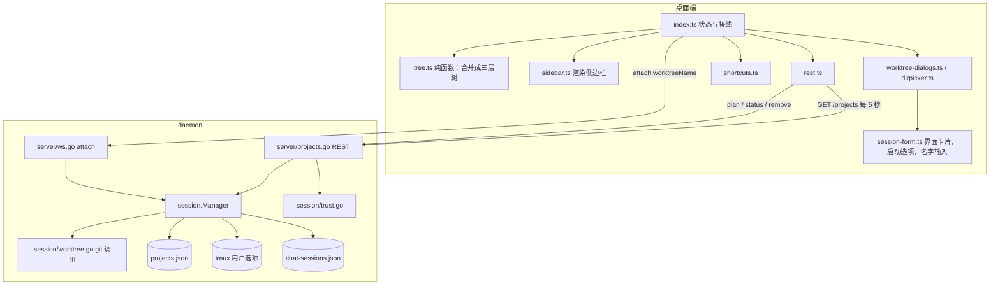

# 技术设计：按项目和 worktree 组织会话，并更换视觉风格

对应需求：spec.md（R1–R9，H1–H27）　更新：2026-11-19

文中的决定编号（6–40、d5–d31、c1–c5）见 decisions.md；实验输出在 `evidence/`。任务编号（T1–T20，其中 T6 拆成 T6a 和 T6b）见 tasks.md。2026-11-18 按工程评审（3 个严重、12 个一般）修订，依据见第 9 节 V10–V17。2026-11-19 按第二轮工程评审（1 个严重、12 个一般）和用户的三个决定（c3 同意、c4 采纳、R5.9 改写）修订，依据见 V18–V24。

## 1. 方案

三个地方有真正不同的做法，其余都只有一种合理做法。

| 问题 | 方案 | 好处 | 代价 | 结论 |
|------|------|------|------|------|
| 项目和 worktree 怎么下发 | A 新端点 `GET /api/v1/projects`，返回 项目 → worktree → 会话 id；`/api/v1/sessions` 和所有 S→C 帧不加字段 | 终端会话的帧逐字节不变，现有 golden 测试不用改；会话列表接口耗时不变 | 每轮轮询多一个请求 | 选用（#6） |
| | B 给 `sessions[]` 每条加归属字段，再加一个顶层 `projects` | 一个请求 | `sessions` 帧的字节变了，要改 golden 测试（放松检查）；没有会话的 worktree 仍需要另一个结构 | 放弃 |
| 新建命名 worktree | A attach 加 `worktreeName`，对话框的即时校验走 `GET /api/v1/worktrees/plan` | 复用现有的幂等重放、失败回滚、信任检查；旧客户端的路径本来就要保留 | 确认之后才出现的竞态错误只能显示在状态栏 | 选用（d8） |
| | B 先 `POST` 建 worktree，再发普通 attach | 出错天然留在对话框里 | 要另做一套幂等；会话没起来时留下空 worktree | 放弃 |
| 删除 worktree | A 先 `GET /worktrees/status` 拿数字，再 `POST /worktrees/remove` 带上用户看到的 HEAD 和同意项，daemon 删除前重查，不一致返回 409 | 用户同意了什么 daemon 就只做什么；状态变了会重新确认 | 两个请求 | 选用（d9） |
| | B 一次请求带 `force` | 一个请求 | 确认框上的数字没有来源；检查与删除之间状态变了无从发现 | 放弃 |

## 2. 总体结构



- daemon 是项目、worktree、会话归属的唯一来源。桌面端只在连着旧 daemon 时自己从会话字段推导（R9.1）。
- 每个会话在创建时算出归属（项目 id、所在 worktree 的根目录）并存下来，之后不再变（H19）。创建时 git 失败的会话先不写归属，之后补上（5.1）。
- 列表里每个项目只读一次 git 的 worktree 列表；改动数和未合并提交数只在删除确认时查（#7）。

## 3. 技术选型

| 选型项 | 选定 | 理由 | 放弃的备选 | 放弃原因 |
|--------|------|------|------------|----------|
| 读 worktree | `git worktree list --porcelain` | git 的稳定输出；普通仓库第一项是主目录、裸仓库第一项标 `bare`，路径是规范路径（V1）。子模块和 `--separate-git-dir` 的仓库第一项是 git 目录，单独处理（V11，4.9） | 直接读 `.git/worktrees/*` | reftable 仓库的 `HEAD` 文件是占位符，读不出分支 |
| 未合并提交数 | `git rev-list --count refs/heads/<分支> --not --exclude=<分支> --branches --remotes`；detached 时在该 worktree 里执行 `git rev-list --count HEAD --not --branches --remotes` | 与 H9 的定义一致（V2）。分支写完整引用名：短名遇到同名 tag 会被解析成 tag，数成 0（V10） | `git branch --merged` | 只和一个基准比，已推送未合并的分支会被误报 |
| 建分支、删分支 | `git update-ref refs/heads/<名字> <提交> ""`（不存在才创建）、`git update-ref -d refs/heads/<名字> <旧值>`（仍指向旧值才删） | 完整引用名不会被展开成别的分支，也不会被当成选项；每一步都知道是不是自己建的（V10、V14） | `git worktree add -b <名字>`、`git branch -D <名字>` | `@{-1}` 会被展开成上一个检出的分支，`-D` 强删的是那个分支（V10）；`worktree add -b` 失败时分不清留下的分支是谁建的（V3） |
| 未提交文件数 | `git -c core.fsmonitor=false status --porcelain --untracked-files=all` 的行数 | 不含被忽略的文件（H10，V2）；`core.fsmonitor` 是 status 唯一会执行外部程序的配置，关掉 | 现有的 `--ignored` | 与 H10 相反 |
| 被忽略的文件数 | `git -c core.fsmonitor=false ls-files --others --ignored --exclude-standard` 的行数 | 只用来在确认框里多说一句（R5.4，c4），不参与「干净」的判定。逐个文件数，目录不折叠；嵌在被忽略目录里的另一个 git 仓库算 1 行；3 万个文件约 0.1 秒（V23）。它要走遍被忽略的目录，这些目录可以比受跟踪的内容大得多（数据集、构建缓存），所以超时或失败时不让查状态失败，只把这个数记成「没数出来」（4.5，d31） | `git status --porcelain --ignored` | 不带 `--untracked-files=all` 时整个 `node_modules/` 折叠成 1 行，「N 个文件」就成了 1 |
| 归属的持久化 | 终端：tmux 用户选项；对话：`chat-sessions.json` 的记录 | 跟随各自已有的事实来源 | 全放进 `projects.json` | 会话没了记录还在，要另做清理 |
| 项目清单与创建记录 | `<state_dir>/projects.json`（d6） | 沿用现有的原子写做法 | 仓库的 git 配置 | 会改用户仓库的配置 |
| 识别旧 daemon | `/api/v1/projects` 返回 404（d7） | 每轮自带判断，没有缓存过期 | 缓存 `/info.proto` | daemon 原地升级后缓存会过期 |
| 快捷键拦截 | `window` 的 keydown 捕获阶段（#10） | 实测先于 xterm 和输入框收到（V7） | 主进程 `before-input-event` | 会话顺序在渲染进程，要多一层 IPC |

不加新的 npm 或 Go 依赖。

## 4. 接口

协议版本从 3 升到 4（c1 已同意）。`protocol.Version`、`PROTOCOL_VERSION` 改为 4；`docs/protocol.md` 的版本表加一行：「4：`attach.worktreeName`，`GET /api/v1/projects`，`POST /api/v1/projects/remove`，`GET /api/v1/worktrees/plan`，`GET /api/v1/worktrees/status`，`POST /api/v1/worktrees/remove`，`DELETE /api/v1/sessions/{id}` 不再清理 worktree（不再返回 409 `worktree_preserved`），`/api/v1/fs.chatTrust` 的 worktree 规则，错误码 `invalid_worktree_name` / `worktree_branch_exists` / `worktree_path_exists` / `worktree_path_not_allowed`。所有 S→C 帧的字段与 v3 相同」。

新增的 REST 端点都要求 `Authorization: Bearer <token>`（沿用 `checkToken`），请求体上限沿用 `maxRESTBody`。出错时的响应体统一为 `{"error":"<代码>","message":"<给人看的说明>"}`。

### 4.1 attach 帧新增 `worktreeName`（C→S）

| 字段 | 类型 | 必填 | 说明 |
|------|------|------|------|
| `worktreeName` | string | 否 | 只在新建（`sessionId` 为空）且 `mode:"worktree"` 时有效，其余情况忽略（含 `handoffFrom`）。非空：新分支名就是它，目录是 `<项目主目录的父目录>/<主目录名>-worktrees/<名字，/ 换成 ->`，基于 `workdir` 当前的 HEAD。空或缺省：旧行为，分支 `vibe/<会话id>`，目录 `<workdir 所在 worktree 根的父目录>/<根目录名>-worktrees/<会话id>`（R9.2） |

Go：`AttachFrame.WorktreeName string json:"worktreeName,omitempty"`。TS：`AttachFrame.worktreeName?: string`。`ready`、`sessions` 不变：命名 worktree 的会话用已有的 `mode/sourceWorkdir/sourceRepo/worktreeRoot/branch` 字段，`branch` 的值是名字。

名字的规则（daemon 为准，桌面端 `worktree-name.ts` 做同样的预检；两边共用测试向量 `vibe-remoted/internal/session/testdata/worktree-names.json`）：

1. 非空；不含空白和控制字符；不含 `..`；不以 `-` 开头；不含 `@{`（git 用它引用「上一个分支」「上游分支」）。
2. 通过以上后，`git check-ref-format --branch <名字>` 退出码为 0，而且它输出的名字与输入逐字相等。只看退出码不够：`@{-1}` 的退出码是 0，输出却是上一个检出的分支名（V10）。

桌面端的预检把「含 `@{`」归到 `invalid`（文案「git 不接受这个分支名」）。向量里每条是 `{name, ok, reason, local}`：`local:true` 表示桌面端不问 daemon 也必须得到同一个 `reason`；`@{-1}`、`@{-2}`、`a@{b` 都是 `ok:false, reason:"invalid", local:true`。

校验只是第一道。daemon 里凡是把分支交给 git 的地方，一律写成完整引用名 `refs/heads/<名字>`，并且只用不做展开的命令（6.1、6.2、7.1 的新规则），所以即使校验有漏网的名字，也不会动到别的分支。

新增的 error 帧代码，全部 `fatal:true`（原样重试不可能成功）：

| 代码 | 什么时候 | 桌面端怎么处理 |
|------|----------|----------------|
| `invalid_worktree_name` | 名字不满足规则 | 状态栏显示对应文案；正常情况下对话框已经拦住 |
| `worktree_branch_exists` | 仓库已有同名本地分支；或名字与已有分支有「目录/文件」冲突，git 不允许两者同时存在（已有 `fix` 时建 `fix/login`，已有 `change/foo` 时建 `change`，V21）。`message` 写明与哪个分支冲突 | 同上 |
| `worktree_path_exists` | 目标目录已存在（空目录也算） | 同上 |
| `worktree_path_not_allowed` | 目标目录不在 `allowed_roots` 内；或 worktree 建好之后，会话实际的工作目录（源目录是子目录时映射出来的那个）解析符号链接后不在 `allowed_roots` 内（6.1 第 10 步，此时已建的东西全部撤销）。`message` 含完整路径 | 同上 |
| `create_failed`（已有） | 不是 git 仓库、git 执行失败（`message` 含 git 的错误输出）；带名字而仓库认不出主目录（子模块、`--separate-git-dir`，见 4.9） | 同上（现有行为） |

这些错误发生时不留下目录和分支（见 6.1）。同一个 `newSessionId` 的重放仍然接入第一次创建的会话（现有 `beginCreate`，R3.7）。

### 4.2 `GET /api/v1/projects`

返回这台机器的项目树。

```json
{
  "proto": 4,
  "projects": [
    {
      "id": "/Users/mac/github/devflow",
      "name": "devflow",
      "git": true,
      "worktrees": [
        { "path": "/Users/mac/github/devflow", "branch": "main", "head": "a1b2c3d", "main": true, "sessions": ["1794824025040-12b763ac"] },
        { "path": "/Users/mac/github/devflow-worktrees/fix-login", "branch": "fix-login", "head": "9f8e7d6", "managed": true, "sessions": [] },
        { "path": "/Users/mac/github/devflow/.devflow-tmp/worktrees/general-skills", "branch": "change/general-skills", "head": "0c1d2e3", "sessions": [] },
        { "path": "/Users/mac/github/devflow-worktrees/tmp", "head": "5a6b7c8", "detached": true, "sessions": [] }
      ],
      "sessions": []
    },
    { "id": "/Users/mac/notes", "name": "notes", "git": false, "worktrees": [], "sessions": ["1794824099999-aabbccdd"] }
  ]
}
```

| 字段 | 类型 | 说明 |
|------|------|------|
| `proto` | number | daemon 的协议版本 |
| `projects[].id` | string | git 项目：`git worktree list` 第一项的路径（主目录；裸仓库时是裸仓库目录）。认不出主目录的仓库（子模块、`--separate-git-dir`，见 4.9 的 `Home.Single`）：会话所在工作目录的顶层，项目只有这一个 worktree，标 `main`；这类仓库的每个链接 worktree（包括旧 Worktree 模式在其中建出来的）各自是一个这样的项目（H27）。非 git：会话的工作目录。都是规范路径 |
| `projects[].name` | string | `id` 的最后一段 |
| `projects[].git` | bool | 是否 git 项目 |
| `projects[].error` | string，可缺省 | `repo_missing`（`id` 目录不存在）或 `git_failed`（git 执行失败或超过 5 秒）；有值时 `worktrees` 为空，该项目的会话全部在 `sessions` 里（R2.7） |
| `projects[].errorMessage` | string，可缺省 | git 错误输出的第一行 |
| `projects[].worktrees[]` | 数组 | 只有 git 项目有。不含 `prunable`（目录已被删）、裸仓库本身、不在 `allowed_roots` 内的（R2.6） |
| `…worktrees[].path` | string | worktree 根目录 |
| `…worktrees[].branch` | string，可缺省 | 去掉 `refs/heads/` 的分支名；detached 时缺省 |
| `…worktrees[].head` | string | 提交哈希的前 7 位 |
| `…worktrees[].detached` | bool，可缺省 | 不在任何分支上（R1.8） |
| `…worktrees[].main` | bool，可缺省 | 是主目录 |
| `…worktrees[].managed` | bool，可缺省 | 由 vibe-remote 创建（见 5.3）。既不是 `main` 也不是 `managed` 的，界面标「外部」 |
| `…worktrees[].sessions` | string[] | 归属这个 worktree 的会话 id |
| `projects[].sessions` | string[] | 直接挂在项目下的会话 id：非 git 项目的全部会话；git 项目里所在 worktree 已不在列表中的会话（R2.5）；`error` 时的全部会话 |

顺序由 daemon 定，桌面端照着渲染（R1.5）：项目按 `name` 的小写形式，相同再按 `id`；worktree 主目录在前，其余按 `branch`，detached 的排在有分支的之后按 `head`，相同再按 `path`；会话按创建时间，相同再按 id。

项目集合 = 项目清单（5.2）∪ 现存会话的归属项目。非 git 项目只来自现存会话（H18）。

`git` 和 `error` 的判定（每个项目 id 跑一次 `ListWorktrees(id)`）：

| 情况 | 结果 |
|------|------|
| 成功 | `git:true`，`worktrees` 照列表生成 |
| 成功，但认不出主目录（第一项没标 `bare`，它的路径下也没有 `.git`；子模块、`--separate-git-dir`，V11） | `git:true`，`worktrees` 只有一项：`path` = 项目 id，`main:true`，分支和提交取列表里路径等于项目 id 的那一项（没有就取第一项） |
| 失败，id 在项目清单里，目录不存在 | `git:true`，`error:"repo_missing"` |
| 失败，id 在项目清单里，目录存在（含超时） | `git:true`，`error:"git_failed"`，`errorMessage` 是 git 错误输出的第一行 |
| 失败，id 不在项目清单里（只来自现存会话） | `git:false`，没有 `error`，会话全部在项目级 `sessions` 里 |

「创建时间」用的是 `/api/v1/sessions` 下发的同一个 `created`（内存里的精度是纳秒，排序用它）。终端会话的创建时间在启动时写进 tmux 用户选项 `@vibe_remote_created`（RFC 3339，纳秒，UTC），daemon 重启后找回会话时读回并转成本地时区（现有代码输出的 `created` 是本地时区的 `…+08:00`，直接用 UTC 的值会输出 `…Z`，同一个会话重启前后的字符串就不同了，5.1），所以重启前后的顺序、H12 的序号、通知标题都不变（d23，推翻 d16；V15）。升级前建的会话没有这个选项，用 tmux 自带的 `#{session_created}`（秒）；两个都读不出来才用找回的时刻。对话会话的创建时间本来就在 `chat-sessions.json` 里。`/api/v1/sessions` 里 `created` 的格式不变，只是找回的终端会话的值从「找回的时刻」变成真实的创建时间；golden 测试对这个值做了归一化，不受影响。

错误：401 未授权。旧 daemon 没有这个路径，返回 404（V5）。

### 4.3 `POST /api/v1/projects/remove`

请求体 `{"id":"/Users/mac/github/devflow"}`。从项目清单里删掉这条记录，不碰磁盘上的任何东西（R2.3）。

| 响应 | 什么时候 |
|------|----------|
| 204 | 已移除 |
| 404 `project_not_found` | 清单里没有这个 id |
| 409 `project_has_sessions` | 还有会话归属这个项目（R2.4）；桌面端平时就把菜单项置灰，这是并发时的兜底 |

### 4.4 `GET /api/v1/worktrees/plan?workdir=<目录>&name=<名字>`

新建 worktree 之前的只读预检，不创建任何东西。`workdir` 是发起处：项目行上发起时是项目主目录，机器概览的 Worktree 模式里是目录选择器当前的目录。`name` 可以为空（对话框刚打开时用它拿 `base`）。

```json
{ "ok": true,
  "project": "/Users/mac/github/devflow", "projectName": "devflow",
  "base": { "branch": "main", "head": "a1b2c3d" },
  "branch": "fix-login",
  "path": "/Users/mac/github/devflow-worktrees/fix-login" }
```

| 字段 | 说明 |
|------|------|
| `ok` | 以当前状态用这个名字新建，6.1 的第 1–5 步是否都能通过（第 6 步之后的失败，如磁盘满、发起处还没有提交，预检不覆盖） |
| `error` / `message` | `ok:false` 时的原因：`not_git`（`workdir` 不在 git 仓库里，此时没有 `project/base`）、`unsupported_repo`（仓库认不出主目录：子模块、`--separate-git-dir`；有 `project/base`，没有 `branch/path`）、`invalid_worktree_name`（含名字为空）、`worktree_branch_exists`、`worktree_path_exists`、`worktree_path_not_allowed`（`message` 含路径） |
| `conflict` | string，可缺省。只在 `worktree_branch_exists` 时有：挡住这个名字的那个已有分支。等于 `branch` 时是同名分支已存在；不等时是「目录/文件」冲突（名字 `fix/login` 被已有的 `fix` 挡住，名字 `change` 被已有的 `change/foo` 挡住），桌面端用它显示「已有分支 X」 |
| `base` | 发起处所在 worktree 当前的分支和提交前 7 位；detached 时 `branch` 缺省、`detached:true`（R3.6） |
| `branch`、`path` | 名字合法时给出将要创建的分支和目录（R3.1、R3.2） |

HTTP 错误：403 `workdir` 不在 `allowed_roots` 内（响应体同 `/api/v1/fs`）；400 缺 `workdir`；500 `git_failed`（`workdir` 在 git 仓库里但 git 执行失败或超时）。

### 4.5 `GET /api/v1/worktrees/status?path=<worktree 根目录>`

删除确认框上的数字从这里来。

```json
{ "path": "/Users/mac/github/devflow-worktrees/fix-login",
  "project": "/Users/mac/github/devflow",
  "branch": "fix-login", "head": "9f8e7d6c5b4a39281706f5e4d3c2b1a098765432",
  "main": false, "managed": true,
  "dirtyFiles": 3, "unmergedCommits": 2, "ignoredFiles": 1204,
  "sessions": ["1794824025040-12b763ac", "1794824031111-0a1b2c3d"] }
```

| 字段 | 说明 |
|------|------|
| `head` | 完整的 40 位提交哈希，删除时原样带回 |
| `branch` / `detached` | 同 4.2 |
| `dirtyFiles` | 未提交或未跟踪的文件数，不含被忽略的（H10） |
| `ignoredFiles` | 被 git 忽略、会随目录一起删除的文件数（R5.4，c4 已采纳）。口径见第 3 节：逐个文件数，`node_modules/` 里有 1200 个文件就是 1200；嵌在被忽略目录里的另一个 git 仓库算 1。恒有值，没有时是 0。它只是给人看的说明：不参与「干净」的判定，不需要同意项，删除时 daemon 不拿它做比对。这一项查询失败或超过 `gitTimeout` 时 status 照常返回，`ignoredFiles` 是 `-1`（没数出来），确认框改用不带数字的一句；不能因为一句说明数不出来，就让这个 worktree 从界面上删不掉（d31） |
| `unmergedCommits` | 有分支：该分支上不被任何其他本地分支或远程跟踪分支包含的提交数（H9）。detached：`HEAD` 上不被任何本地分支或远程跟踪分支包含的提交数（R5.11） |
| `sessions` | 归属这个 worktree 的会话 id（含已结束的对话会话），以及还没有归属、工作目录在它下面的会话 |

`status` 不带「是否锁定」「有没有子模块」「里面有没有别的 worktree」：这几种情况在删除时由 daemon 在结束会话之前拦下（6.2 第 6 步，R5.9），错误显示在同一个确认框里。

错误：404 `worktree_not_found`（`path` 不是 daemon 从它所属仓库读到的 worktree，或解析符号链接后不在 `allowed_roots` 内，或它所在的仓库认不出主目录）；500 `git_failed`。

### 4.6 `POST /api/v1/worktrees/remove`

```json
{ "path": "/Users/mac/github/devflow-worktrees/fix-login",
  "head": "9f8e7d6c5b4a39281706f5e4d3c2b1a098765432",
  "sessions": ["1794824025040-12b763ac", "1794824031111-0a1b2c3d"],
  "discardFiles": true,
  "deleteBranch": false,
  "dropCommits": false }
```

| 字段 | 类型 | 必填 | 说明 |
|------|------|------|------|
| `path` | string | 是 | 要删的 worktree |
| `head` | string | 是 | 确认框打开时 status 返回的 `head` |
| `sessions` | string[] | 是 | 确认框上告诉用户会被结束的会话 |
| `discardFiles` | bool | 否 | 用户同意丢弃未提交和未跟踪的文件 |
| `deleteBranch` | bool | 否 | 用户选择连分支一起删。只有 `managed` 且不是 detached 时 daemon 才照做，否则忽略（R5.8） |
| `dropCommits` | bool | 否 | 用户同意让未合并的提交不再属于任何分支 |

daemon 的处理顺序见 6.2。响应：

| 响应 | 什么时候 | 桌面端怎么处理 |
|------|----------|----------------|
| 200 `{"removed":true,"branchDeleted":true,"endedSessions":["…"]}` | 目录已删。`branchDeleted` 表示分支是否也删了；分支该删而没删成时为 `false` 并带 `branchError` | 关掉这些会话的视图，刷新侧边栏；`branchError` 显示在状态栏 |
| 400 `worktree_is_main` | `path` 是主目录（R5.7） | 状态栏报错（菜单里本来就没有这一项） |
| 404 `worktree_not_found` | 同 4.5 | 刷新侧边栏，状态栏提示已不存在 |
| 409 `worktree_changed`，响应体多 `status`（4.5 的结构，最新状态）和 `endedSessions` | 重查后与用户确认的不一致。结束会话之前发现的（`endedSessions` 是 `[]`，什么都没动）：`head` 变了；有不在 `sessions` 里的会话（包括删除请求等锁期间在这个 worktree 里建成的会话，和正在其中创建的会话）；有未提交文件而 `discardFiles` 不为真；会让未合并提交失去分支而 `dropCommits` 不为真。结束会话之后才发现的（`endedSessions` 是已经结束的会话，目录和分支都还在）：会话在被结束之前又提交了一次，`head` 变了；`git worktree remove` 被 git 拒绝后再查，出现了没被同意丢弃的文件 | 用返回的 `status` 重新弹确认框，写明状态已变化；`endedSessions` 非空时另写明已结束几个会话；流程结束时关掉它们的视图 |
| 500 `worktree_remove_failed`，响应体多 `endedSessions` | 结束会话之前就能确定删不了或删了会多丢东西（R5.9；`endedSessions` 是 `[]`，会话、目录、分支都没动）：worktree 被 `git worktree lock` 锁定；里面有子模块或嵌入式仓库的检出；里面还嵌着这个仓库的别的 worktree。已经动手之后的失败（R5.12；`endedSessions` 是已经结束的会话）：某个会话没能结束；git 删除失败。`message` 是原因或 git 的错误输出 | 再查一次状态，按实际剩下的情况显示（6.2 的表）：worktree 还在 → 带着错误重新打开确认框；已经不在列表里（目录只删了一部分）→ 显示失败说明 |

409 和 500 的响应体例子：`{"error":"worktree_changed","message":"…","status":{…},"endedSessions":["1794824025040-12b763ac"]}`、`{"error":"worktree_remove_failed","message":"…","endedSessions":[]}`。`endedSessions` 恒为数组；`session not found`（会话在轮到它之前自己退出了）也算已结束。

这个请求可能比别的 REST 请求慢得多：daemon 逐个结束会话，一个对话会话停进程最长约 4 秒（V16），大目录的删除也要时间。桌面端给它单独的超时 `10 秒 + 5 秒 × sessions 的个数`，上限 60 秒（4.10）；超时后 daemon 仍会做完，桌面端按「结果未知」处理（6.2 末尾）。

### 4.7 `DELETE /api/v1/sessions/{id}`（行为改变）

停会话、删记录，不再碰 worktree 目录和分支，成功一律 204（H16、R5.1、R5.10）。协议 4 的 daemon 不再返回 409 `worktree_preserved`。桌面端保留对 409 的处理，因为它还可能连着旧 daemon。

### 4.8 `/api/v1/fs` 的 `chatTrust`、`/api/v1/info`

- `chatTrust` 的取值不变，判定改为 7.3 的规则（多认「仓库主目录已被信任的 worktree 根目录」）。
- `/api/v1/info.proto` 为 4，其余字段不变。

### 4.9 daemon 内部接口（`internal/session`）

```go
// worktree.go
type Worktree struct {            // Head 是 40 位
    Path, Branch, Head string
    Detached, Bare, Prunable, Locked bool
    LockReason string             // `locked <原因>` 行里的原因，可为空
}
func ListWorktrees(dir string) ([]Worktree, error)   // git -C dir worktree list --porcelain

// 归属。非 git 时 Project 和 Path 都是目录本身，Repo 为空。
type Home struct {
    Project string   // 项目 id
    Path    string   // 所在 worktree 的根
    Repo    string   // 对这个仓库执行 git -C 用的目录 = 列表第一项的路径
    Git     bool
    Single  bool     // 认不出主目录（子模块、--separate-git-dir）：项目只有 Path 这一个 worktree
}
// 不是 git 仓库 → Home{Git:false}, nil；git 执行失败或超时 → error（调用方此时不写归属）
func ResolveHome(dir string) (Home, error)

func ValidateWorktreeName(repoDir, name string) error     // errors.Is(err, ErrInvalidWorktreeName)
func WorktreeDirName(name string) string                  // "/" → "-"
func BranchConflict(repoDir, name string) (string, error) // 挡住这个名字的已有分支：同名的、它的某个 "/" 前缀、或 refs/heads/<name>/ 下的第一个；没有则 ""（6.1 第 4 步）
func DirtyFiles(worktreeDir string) (int, error)
func IgnoredFiles(worktreeDir string) (int, error)        // 被忽略的文件数，口径见第 3 节（c4）；走 gitAtTimeout，出错时由 WorktreeStatus 记成 -1
func UnmergedCommits(dir, branch string) (int, error)     // branch 非空：数 refs/heads/<branch>；为空：数 dir 的 HEAD（detached）
// 与 git 自己拒绝删除时的两段判断相同（builtin/worktree.c 的 validate_no_submodules）：
// 该 worktree 的 git 目录下有 modules/（初始化过的子模块，V13）；
// 或索引里有 gitlink（ls-files --stage 里模式 160000 的条目）且 <worktreeDir>/<该路径>/.git 存在（嵌入式仓库，V19）
func HasSubmoduleCheckouts(worktreeDir string) (bool, error)

type WorktreeSpec struct { Source, SessionID, Name string; AllowPath func(string) error }
type CreatedWorktree struct {
    Meta    WorktreeMetadata   // 现有结构：SourceWorkdir、SourceRepo、WorktreeRoot、Branch
    Workdir string             // 会话的工作目录（源目录是子目录时映射到新 worktree 里）
    Home    Home
    OID     string             // 分支建出来时指向的提交
    NewContainer bool          // 容器目录是本次建的
}
func CreateWorktree(spec WorktreeSpec) (CreatedWorktree, error)
func (c CreatedWorktree) Undo() error   // 只清本次建出来的目录、分支、容器目录（6.1）；取代 RollbackWorktree

var ErrInvalidWorktreeName, ErrWorktreeBranchExists, ErrWorktreePathExists,
    ErrWorktreePathNotAllowed, ErrUnsupportedRepo, ErrWorktreeNotFound, ErrWorktreeIsMain,
    ErrWorktreeBusy error            // ErrWorktreeBusy：工作目录所在的 worktree 正在被删除
type BranchExistsError struct { Branch, Conflict string }   // errors.Is(err, ErrWorktreeBranchExists)；Conflict 是挡住它的已有分支
type WorktreeChangedError struct { Status protocol.WorktreeStatus; EndedSessions []string }   // → 409 worktree_changed
type WorktreeRemoveError struct { Message string; EndedSessions []string }                     // → 500 worktree_remove_failed

// trust.go
func ChatTrust(dir string) chat.TrustState                // 7.3

// projects_store.go
type WorktreeRecord struct { Project, Path, Branch, CreatedAt string }
func OpenProjectStore(stateDir string) (*ProjectStore, error) // 出错时调用方改用 NewMemoryProjectStore()
func (s *ProjectStore) AddProject(id string)
func (s *ProjectStore) RemoveProject(id string) bool
func (s *ProjectStore) Projects() []string
func (s *ProjectStore) AddWorktree(project, path, branch string)   // 同一路径已有记录时替换，CreatedAt 取当前时间
func (s *ProjectStore) RemoveWorktree(path string)
func (s *ProjectStore) Worktrees() []WorktreeRecord                 // 快照
func (s *ProjectStore) RemoveWorktreeIfSame(rec WorktreeRecord) bool // 记录仍与 rec 逐字段相同时才删
func (s *ProjectStore) Managed(project, path, branch string) bool

// projects.go（Manager 的方法）
type AllowFunc func(path string) (canonical string, err error)   // server 传 cfg.ResolveAllowedWorkdir
func (m *Manager) SetProjectStore(s *ProjectStore)
func (m *Manager) Projects(allow AllowFunc) []protocol.Project
func (m *Manager) RemoveProject(id string) error          // ErrProjectNotFound / ErrProjectHasSessions
func (m *Manager) PlanWorktree(workdir, name string, allowPath func(string) error) (protocol.WorktreePlan, error)
func (m *Manager) WorktreeStatus(path string, allow AllowFunc) (protocol.WorktreeStatus, error)
func (m *Manager) RemoveWorktree(req protocol.WorktreeRemoveRequest, allow AllowFunc) (protocol.WorktreeRemoveResult, error)
```

几条约定：

- **`allow` 必须解析符号链接。** `AllowFunc` 就是现有的 `cfg.ResolveAllowedWorkdir`：把路径解析成规范路径后再判断是否在某个（同样解析过的）根内。不用 `cfg.IsAllowedWorkdir`，它只做字面比较、没有生产调用方（V16）：git 列出的是规范路径（`/private/tmp/…`），`allowed_roots` 常按解析前的写法配置（`/tmp`），字面比较会把所有 worktree 滤掉；路径字面在根内、经符号链接指向根外时它也拦不住。`Projects` 只用它的成功与否做过滤；`WorktreeStatus` / `RemoveWorktree` 还要求返回的规范路径与传入的 `path` 逐字相等，否则按 `ErrWorktreeNotFound` 处理。
- **认不出主目录的仓库（`Home.Single`）。** `ResolveHome` 先取 `git rev-parse --show-toplevel`（记作 T），再读 worktree 列表。第一项标了 `bare`，或第一项的路径下有 `.git`：正常情况，`Project` = `Repo` = 第一项的路径，`Path` = T。否则（子模块、`--separate-git-dir`：第一项是 git 目录，V11）：`Project` = `Path` = T，`Repo` = 第一项的路径，`Single` = 真。`Single` 的项目只有 T 这一个 worktree，按主目录对待（`main:true`，分支和提交取列表里路径等于 T 的那一项，没有就取第一项）：不能在其中新建命名 worktree（`ErrUnsupportedRepo`），不能删除（`ErrWorktreeIsMain`）；不带名字的旧 Worktree 模式照旧可用（它只依赖 T，R9.2）。旧 Worktree 模式在这类仓库里建出的 worktree，自己也是一个 `Single` 的项目：`CreateWorktree` 返回的 `Home` 是 `{Project: 新 worktree 的根, Path: 新 worktree 的根, Repo: 同一个 git 目录, Git: true, Single: true}`，与事后对它调 `ResolveHome` 的结果相同。这样它的会话挂在这个项目自己的那一行下，不会因为「所在 worktree 不在发起处那个项目的列表里」被标成「目录已不存在」。这个 worktree 和它的 `vibe/<会话id>` 分支不能从界面删除，要手动清理（H27）。
- **「不是仓库」和「git 失败」不靠匹配文字区分。** `rev-parse --show-toplevel` 失败（未超时）时，先看 `git rev-parse --is-inside-git-dir`：退出码 0 且输出是 `true`（目录在某个 `.git` 目录或裸仓库里面，没有工作目录可归）→ 按不是仓库处理。否则从 `dir` 逐级向上找名为 `.git` 的文件或目录：一个都没有 → 不是仓库，返回 `Home{Git:false}`；有 → 返回错误（仓库损坏、属主不被 git 信任等）。超时一律是错误。
- **先和 tmux 对账。** `Projects`、`WorktreeStatus`、`RemoveWorktree` 开头都调现有的 `syncFromTmux()`（`Manager.List`、`Manager.Delete` 也是这样做的；它在 `Manager.mu` 之外查 tmux，再在锁内对账）。否则 daemon 刚重启、会话表还没从 tmux 找回时，「归属这个 worktree 的会话」会漏掉正在运行的终端会话，删除就不会先结束它们。`RemoveWorktree` 在取到项目锁之后、读会话之前调它（此时不持有 `Manager.mu`）。
- **git 的运行环境。** `gitAt` 和 `gitAtTimeout` 都设 `LC_ALL=C`，并从继承的环境里去掉 `GIT_DIR`、`GIT_WORK_TREE`、`GIT_INDEX_FILE`、`GIT_COMMON_DIR`、`GIT_OBJECT_DIRECTORY`、`GIT_NAMESPACE`（V12）。git 的错误输出可以原样转给用户，但 daemon 不靠匹配这些文字做判断：一律用退出码、重查状态或文件系统检查。

`CreateOptions`、`ChatCreateOptions` 各加 `WorktreeName string`；`CreateOptions` 另加 `Home *Home`（交接时照抄对话会话的归属，非空就不再推导）；`RunnerConfig` 加 `Project, Home string` 和 `Created time.Time`（零值取当前时间），读取用 `func (r *Runner) Home() (project, home string)`；`chat.Record` 加 `Project, Home`（5.1）。`CreateOptions.ValidateWorkdir`、`ChatCreateOptions.ValidateWorkdir` 的名字和签名不变，server 改为传 `cfg.ResolveAllowedNewPath`，`Manager` 把它包成 `WorktreeSpec.AllowPath`。`CreateWorktree` 调它两次：建之前查 worktree 根（还不存在，6.1 第 3 步，R3.10 要在创建之前判断）；建好之后查会话最终的工作目录（已存在，6.1 第 10 步）。对已存在的路径，`ResolveAllowedNewPath` 的结果与 `ResolveAllowedWorkdir` 相同（整条路径都解析符号链接），所以第二次检查与现有代码建好之后做的那次等价（`manager.go:243-255`、`chat_manager.go:268-282`），不比现在松。读 worktree 列表和预检用的 git 调用走 `gitAtTimeout(dir, args...)`，超时取包级变量 `gitTimeout`（5 秒，测试里可以调小）。`config.Config` 加 `ResolveAllowedNewPath(path string) (string, error)`：对还不存在的路径，把最深的已存在祖先解析成规范路径后拼回剩余部分，再做与 `ResolveAllowedWorkdir` 相同的包含判断（R3.10 要在创建之前判断）。

`Manager` 另有两张受 `Manager.mu` 保护的表，用来让「删除 worktree」和「在其中新建会话」互斥（6.2）：`startingDirs map[string]int`（正在创建、还没登记的会话的工作目录）和 `removingRoots map[string]struct{}`（正在删除的 worktree 根）。创建会话的两条路径（终端、对话；交接出来的终端会话也走终端这一条）在工作目录确定之后、启动进程之前调 `beginStart(workdir) (done func(), err error)`：工作目录等于某个 `removingRoots` 或在它下面 → `ErrWorktreeBusy`（attach 收到 fatal 的 `create_failed`，`message` 写明这个 worktree 正在被删除）；否则计数加一。Worktree 模式在放开项目锁之前对新 worktree 里的工作目录调它（6.1 第 10 步）。交接在停对话进程**之前**调它：被拒绝时对话会话原样继续运行，不会出现对话已停、终端没起来的中间状态。`beginStart` 成功之后（已放开 `Manager.mu`）再 `os.Stat` 一次工作目录：不存在（刚好在这之前被删完）→ 调 `done` 并返回 `create_failed`。`done` 在会话登记进会话表之后、或创建失败时调用（Worktree 模式创建失败时，要等项目锁内的撤销做完之后才调，6.1），所以删除方任何时刻看这个会话，要么在 `startingDirs` 里，要么在会话表里。这两张表只在 `Manager.mu` 内读写，不引入新的锁（#22）。

`protocol.go` 新增类型 `ProjectsResponse`、`Project`、`ProjectWorktree`、`WorktreePlan`、`WorktreeBase`、`WorktreeStatus`、`WorktreeRemoveRequest`、`WorktreeRemoveResult`，字段名即 4.2–4.6 的 JSON 名；可缺省的字段用 `omitempty`，数组字段输出 `[]` 而不是 `null`。

### 4.10 桌面端内部接口

```ts
// shared/protocol.ts
export const PROTOCOL_VERSION = 4;
export const CHAT_MIN_PROTO = 3;        // chat/availability.ts 用它判断，不再用 PROTOCOL_VERSION
// 以及与 4.2–4.6 同名的类型：Project、ProjectWorktree、WorktreePlan、WorktreeStatus、WorktreeRemoveRequest、WorktreeRemoveResult

// rest.ts
listProjects(): Promise<Project[] | null>          // 404 → null（旧 daemon）；其他失败抛错
removeProject(id: string): Promise<void>
planWorktree(workdir: string, name: string): Promise<WorktreePlan>
worktreeStatus(path: string): Promise<WorktreeStatus>
removeWorktree(req: WorktreeRemoveRequest): Promise<WorktreeRemoveResult>   // 超时 = removeTimeoutMs(req.sessions.length)
function removeTimeoutMs(sessionCount: number): number   // min(60_000, 10_000 + 5_000 * sessionCount)
function timedFetch(input: string, init?: RequestInit, timeoutMs?: number): Promise<Response>   // 第 3 个参数是新加的，缺省仍是 8 秒
class RestError extends Error { status: number; code: string; body: unknown }   // 4.3–4.6 的非 2xx；超时和网络错误不是 RestError。remove 的 409、500 的 body 里有 endedSessions（409 另有 status）

// client.ts
type AttachOptions = { ui?: SessionUI; handoffFrom?: string; worktreeName?: string }  // 进 AttachIntent，重放时原样带上

// tree.ts（纯函数，无 DOM）
interface TreeSession { id: string; info: SessionInfo; name: string; gone: boolean }
interface TreeWorktree { path: string; label: string; branch?: string; detached: boolean; main: boolean; managed: boolean; sessions: TreeSession[] }
interface TreeProject { id: string; name: string; git: boolean; flat: boolean; branchLabel?: string;
                        error?: { code: string; message: string }; worktrees: TreeWorktree[]; sessions: TreeSession[] }
function buildTree(sessions: SessionInfo[], projects: Project[] | null): TreeProject[]
function visibleSessions(machines: { key: string; collapsed: boolean; tree: TreeProject[] }[], collapsedProjects: Set<string>): { machineKey: string; id: string }[]
function projectRollup(project: TreeProject, dotOf: (id: string) => Dot): 'waiting' | 'none'
function sessionContext(tree: TreeProject[], id: string): { project: string; branch?: string; name: string } | null
function notificationTitle(machineName: string, ctx: { project: string; branch?: string; name: string }): string
type Capability = 'v4' | 'legacy' | 'unknown'
function nextCapability(prev: Capability, result: Project[] | null | Error): Capability   // 数组 → v4；null → legacy；Error → prev
function projectHue(id: string): number          // 项目 id 的 FNV-1a 32 位哈希（按 UTF-16 码元）对 360 取模，0–359
function countActiveSessionsAt(sessions: SessionInfo[], dir: string): number   // workdir 等于 dir 且 state 不是 'ended' 的会话数（-c 说明用，d24）

// worktree-name.ts
function validateWorktreeName(name: string): null | 'empty' | 'whitespace' | 'dotdot' | 'leading_dash' | 'invalid'   // 含 `@{` → 'invalid'
function worktreeDirName(name: string): string
// attach 收到 4.1 的四个新错误码时状态栏用的文案；不认识的 code 返回 null（沿用现有的通用报错）。
// code 是 worktree_branch_exists 且 ctx.conflict 有值、不等于 ctx.branch 时用 wt.error.branch_conflict
function worktreeErrorText(code: string, ctx: { branch?: string; path?: string; conflict?: string }): string | null

// shortcuts.ts
type ShortcutAction = { kind: 'index'; n: number } | { kind: 'prev' } | { kind: 'next' }
function matchShortcut(e: Pick<KeyboardEvent, 'metaKey' | 'ctrlKey' | 'altKey' | 'shiftKey' | 'code'>): ShortcutAction | null
function pickTarget(count: number, activeIndex: number, action: ShortcutAction): number | null   // activeIndex = -1 表示当前没有打开会话
function installShortcuts(target: Window, deps: { blocked(): boolean; count(): number; activeIndex(): number; open(index: number): void }): () => void   // 返回卸载函数

// sidebar.ts
function renderSidebar(container: HTMLElement, model: SidebarModel, actions: SidebarActions): void
function renderToolbarTitle(container: HTMLElement, ctx: { project: string; branch?: string; name: string } | null, fallback: string): void

// chat/availability.ts（第 4 个参数是新加的，可缺省）
function chatAvailability(info?: MachineInfo, error?: unknown, trust?: ChatTrust, opts?: { mainPath?: string }): ChatAvailability

// worktree-dialogs.ts
function openNewWorktreeDialog(machine, project: TreeProject): Promise<(PickedSession & { worktreeName: string; worktreePath: string }) | null>   // worktreePath 是 plan 返回的 path；dirpicker 的 PickedSession 同样多这两个可选字段
function openWorktreeSessionDialog(machine, project: TreeProject, worktree: TreeWorktree, opts?: { sessionCountAt?(workdir: string): number }): Promise<PickedSession | null>
function confirmDeleteSession(opts: { name: string; worktreeLabel?: string; legacyWorktree: boolean }): Promise<boolean>
// ended：这次流程里已经被结束的会话数，大于 0 时确认框多一行「已结束 N 个会话」
function confirmDeleteWorktree(status: WorktreeStatus, opts: { label: string; changed: boolean; error?: string; ended?: number }): Promise<WorktreeRemoveRequest | null>
// 500 之后 worktree 已经不在列表里（目录只删了一部分）时用：只有一个「关闭」按钮，写明 git 的错误、已结束几个会话、目录还剩一部分、分支保留（R5.12）
function showDeleteWorktreeFailure(opts: { label: string; message: string; ended: number; path: string }): Promise<void>
// 查状态 → 确认 → 删除；409 用返回的 status 重新确认（changed:true）；500 再查一次状态，按实际情况重新打开确认框或显示失败说明；
// 请求超时或断网 → 再查一次状态定结果（6.2 末尾的表）。
// 返回 null = 从未发出过删除请求（用户取消，或一开始 worktree 就已不存在）；只要发出过删除请求就不返回 null
type DeleteWorktreeOutcome = { removed: boolean; endedSessions: string[] }   // endedSessions：各次响应里已结束会话的并集
function deleteWorktreeFlow(rest: Pick<VibeRemoteRest, 'worktreeStatus' | 'removeWorktree'>, target: { path: string; label: string }, notify: (text: string) => void): Promise<DeleteWorktreeOutcome | null>

// theme.ts
function terminalTheme(): ITheme     // 底色、前景、光标、选区读 CSS 变量；16 个 ANSI 色是这里的常量（d14）
```

`buildTree` 的规则：

- `projects` 非空（新 daemon）：照 daemon 的顺序生成；`label` 是 `branch`，detached 时是 `head`。树里引用了、但会话列表里没有的 id 跳过（两个请求之间被删掉的）；会话列表里有、但没有被任何节点引用的会话（两个请求之间新建的）按下一条旧版规则临时归位。
- `projects` 为 `null`（旧 daemon，R9.1）：`mode:"worktree"` 的会话归到项目 `sourceRepo` 下的 worktree `worktreeRoot`（`label` = `branch`，`managed:true`）；其余会话，`workdir` 等于某个已知项目 id 或在它下面的归到该项目的主目录行，在某个已知 `worktreeRoot` 下面的归到那个 worktree，否则自成一个项目（id = `workdir`）。顺序规则同 4.2，在桌面端排。
- `flat` = git 项目且 `worktrees.length <= 1`：不显示 worktree 层，`branchLabel` 取那一个 worktree 的 `label`（R1.2）。非 git 项目 `flat` 恒为真、没有 `branchLabel`（R1.3）。
- `gone`：git 项目、没有 `error`、会话在项目级 `sessions` 里（R2.5）。
- `name`：`info.title`；同一个 worktree 节点（或同一个项目级列表）里按创建顺序，第二个起同名的加序号，如 `fix-login 2`（H12、d12、R1.4）。

## 5. 数据

没有已有数据需要迁移；下面三处都是加字段或加文件，旧数据缺字段时按 5.4 补一次。

### 5.1 会话归属

| 会话类型 | 存在哪 | 字段 |
|----------|--------|------|
| 终端（tmux） | tmux 用户选项，和现有的 `@vibe_remote_mode` 等一起在 `start` 里写 | `@vibe_remote_project`（项目 id）、`@vibe_remote_home`（所在 worktree 根；非 git 时是工作目录）、`@vibe_remote_created`（创建时间，RFC 3339 纳秒 UTC；d23） |
| 终端（`use_tmux:false`） | 只在内存（这种会话断线即结束） | 同上 |
| 对话 | `chat-sessions.json` 的记录，`version` 仍是 1 | `project`、`home`（`omitempty`） |

`tmux list-sessions` 的格式串在末尾加 4 列：`#{@vibe_remote_project}`、`#{@vibe_remote_home}`、`#{@vibe_remote_created}`、`#{session_created}`（tmux 自带，unix 秒），共 13 列；`parseTmuxSessionLine` 接受 8、9、13 列。找回会话时创建时间的取值顺序：`@vibe_remote_created` 能解析就用它；否则用 `session_created`；都没有才用找回的时刻（V15）。读回的时间一律转成本地时区（`t.Local()`）再放进 `Runner.Created`：现有代码里 `Created` 是 `time.Now()`（`runner.go:244`），`/api/v1/sessions` 用 `Format(time.RFC3339)` 输出（`manager.go:725`），在 UTC+8 的机器上是 `…+08:00`；不转的话重启后同一个会话会输出成 `…Z`。存的值用 UTC 只是为了让选项里的字符串不依赖时区。

归属在创建时算一次：普通模式是 `ResolveHome(workdir)`；worktree 模式的 `home` 是新 worktree 的根，`project` 来自 `CreateWorktree` 返回的 `Home.Project`（正常仓库是主目录；`Single` 的仓库是新 worktree 自己，4.9）；交接出来的终端会话照抄对话会话的归属。之后不随 `cd` 变（H19）。

`ResolveHome` 返回错误时（git 超时或失败）：会话照常创建，但这一次**不写归属**（两个字段留空），也不加进项目清单。否则一次超时就会把 git 仓库里的会话永久记成非 git 项目。留空的归属由 5.4 的补归属在之后每一次 `Projects()` 里重试；补上之前，这个会话在列表里临时自成一个项目（id = 它的工作目录，`git:false`）。

### 5.2 `<state_dir>/projects.json`

```json
{ "version": 1,
  "projects": [ { "id": "/Users/mac/github/devflow", "addedAt": "2026-11-18T10:00:00Z" } ],
  "worktrees": [ { "project": "/Users/mac/github/devflow", "path": "/Users/mac/github/devflow-worktrees/fix-login", "branch": "fix-login", "createdAt": "2026-11-18T10:05:00Z" } ] }
```

- `projects`：开过会话的 git 项目。新建会话（任何模式、任何界面）成功后加入；`POST /projects/remove` 删除；之后在该仓库新建会话会再加回来（R2.3）。非 git 项目不进清单（H18）。
- `worktrees`：vibe-remote 创建的 worktree（H17）。`git worktree add` 成功后立刻加入（命名的和旧式自动命名的都记）；创建回滚、经 4.6 删除成功时删掉；`Projects()` 发现记录的 `path` 已不在它所属项目的列表里时也删掉（别人已经把它删了，之后同一路径上再出现的 worktree 不该被认成自己的）。这一步的顺序是固定的，否则会和正在进行的新建抢跑（轮询在 `git worktree add` 完成前读了列表，新建随后写了记录，轮询再拿旧列表把新记录删掉）：`Projects()` **先**取记录的快照（`Worktrees()`），**再**读各项目的列表，最后只对快照里的记录用 `RemoveWorktreeIfSame` 删除（记录在这期间被重建过，`createdAt` 不同，就不删）。快照里有某条记录，说明它的 `git worktree add` 在读列表之前就已完成，列表里一定有它。
- 文件 0600，目录沿用 `state_dir`（0700）。写法与 `chat-sessions.json` 相同：临时文件、fsync、rename。`ProjectStore` 自己有一把互斥锁，每次修改在锁内同步写盘（修改只发生在新建项目里的第一个会话、建删 worktree、移除项目时）；这把锁是叶子锁，调用方不得在持有 `Manager.mu` 时调用它（现有规则：`Manager.mu` 下不做文件 IO）。
- 写盘失败（磁盘满、目录变成只读）：内存里的清单照常更新，本次运行期间行为不变；记一行日志 `projects store: write failed: <错误>`（与对话会话表的做法相同）；下一次修改会把整份清单重写一遍，所以磁盘恢复后自动补上。期间重启会丢掉没写下去的记录，后果与下面「`state_dir` 不可写」相同，方向是安全的。
- 文件读不出来或 `version` 不是 1：改名为 `projects.json.corrupt-<unix 时间>`，按空清单启动，记一行日志（与对话会话表相同）。
- `state_dir` 不可写（`chat.NewStore` 已经报错）：用 `NewMemoryProjectStore()`，清单只在内存；项目只从现存会话推导，不报错（H18）。此时重启后命名 worktree 的创建记录会丢，它们按「外部」处理：仍能删目录，不会删分支，方向是安全的。

### 5.3 `managed` 的判定

满足任一条即为真，否则为假（宁可判成「外部」，H17）：

1. `projects.json` 里有 `path` 相同且 `branch` 等于该 worktree 当前分支的记录。用户在里面切了分支或 detached 后不再满足。
2. 升级前留下的：`path` 等于 `<主目录的父目录>/<主目录名>-worktrees/<X>`、当前分支等于 `vibe/<X>`，且 `X` 是 vibe-remote 生成过的会话 id 的形态：`^[0-9]{13}-[0-9a-f]{8}$`（毫秒时间戳加 8 位十六进制；daemon 和桌面端自 worktree 功能出现以来都只生成这一种），或 `^[0-9]{19}$`（daemon 在取不到随机数时的退路）。这一条每次现算，不写文件。只满足 `ValidSessionID` 不够（d22）：别人手工建的 `devflow-worktrees/foo` 加分支 `vibe/foo` 也满足它，认领之后分支就可能被删。依据见 `evidence/git-probe-3.txt` G 段。

### 5.4 升级时补归属

- 终端会话的 tmux 选项里没有 `@vibe_remote_project`（升级前建的，或创建时 git 失败没写上）：每次 `Projects()` 时在 `Manager.mu` 之外对还没有归属的会话补一次，`ResolveHome` 仍然报错就继续留空、下一次再试。worktree 模式用已有的 `@vibe_remote_worktree_root` 作 `home`，项目取 `ResolveHome(该目录)` 的 `Project`，目录已不存在时取 `ResolveHome(@vibe_remote_source_repo)` 的 `Project`（它返回 `Single` 时取 `@vibe_remote_worktree_root` 自己，与创建时的规则一致）；其余用当时的 `pane_current_path` 调 `ResolveHome`（「按当时的工作目录推导一次」）。补完写回 tmux 选项和内存；写失败只留在内存，下次再试。
- 对话记录没有 `project`：`LoadChats` 里补一次，`Projects()` 里对仍然留空的再补，补上后落盘。
- 补出来的 git 项目加入项目清单（H18「升级时已有会话所在的项目自动进入清单」）。
- 成本：一直补不上的会话（仓库的属主不被 git 信任、上层有一个无关的 `.git` 文件）每一轮 `Projects()` 都会重试一次 `ResolveHome`，也就是每 5 秒最多 2 个 git 进程（`rev-parse --show-toplevel`、`rev-parse --is-inside-git-dir`，都有 5 秒超时）。不加退避和次数上限：没有证据表明需要，这种会话很少，而重试正是「git 恢复后自动归位」的来源。这些进程不算在「每个项目一次 `git worktree list`」里，`TestProjectsOneGitCallPerProject` 的环境里没有这种会话，它的计数说明写明了这一点（tasks T4）。

## 6. 状态和流程

### 6.1 新建 worktree（`CreateWorktree`）

同一个仓库的新建和删除 worktree 在 daemon 内串行：`Manager` 持有按仓库取的互斥锁（#8；键是 `Home.Repo`，正常情况下就是项目 id，下文仍叫项目锁）。锁的先后固定为：创建占位（`beginCreate`）→ 项目锁 → `chat.Session.opMu` → `Manager.mu` → `ProjectStore` 的锁；持有 `opMu` 或 `Manager.mu` 时不取项目锁。交接（`Handoff`）不建 worktree，不取项目锁。

做法的要点（V10、V14）：目录和分支都用「不存在才创建」的操作去占，占到了才算本次建的，失败时只撤销占到的东西；分支始终写成完整引用名，参数里不出现短分支名，也不用 `git branch`、`-b`。

锁外先做第 1 步（要靠它知道取哪把锁），其余在锁内。下面的 git 命令都在发起处所在的 worktree 根（`Home.Path`，记作 W）里执行：它一定是个可用的工作目录，分支和 worktree 的登记又是整个仓库共用的。任何一步失败都返回对应错误并停止：

1. `ResolveHome(Source)`：返回错误或不是 git → `create_failed`。有名字而 `Single` 为真 → `create_failed`，`message` 写明这个仓库是子模块或使用了独立的 git 目录、不支持命名 worktree（`ErrUnsupportedRepo`）。
2. 有名字：`ValidateWorktreeName` → `invalid_worktree_name`；分支 = 名字，目录 = `<dirname(项目)>/<basename(项目)>-worktrees/<WorktreeDirName(名字)>`。没有名字：分支 `vibe/<会话id>`，目录 `<dirname(Home.Path)>/<basename(Home.Path)>-worktrees/<会话id>`（现有算法）。两种目录都在某个 worktree 根的同级目录下：命名的固定在主目录旁边的 `<主目录名>-worktrees/` 里，不会落进这个仓库的另一个 worktree 里面；自动命名的在发起处那个 worktree 旁边，只有发起处本身已经嵌在别的 worktree 里时（别的工具把它建在了那里）才会跟着嵌进去。所以嵌套的 worktree 不会由命名 worktree 这个功能造出来；已经存在的嵌套在删除时由 6.2 第 6 步处理。
3. `AllowPath(目录)` → `worktree_path_not_allowed`（此前是建好再检查再回滚；现在对两条路径都先检查，建好之后在第 10 步再查一次最终的工作目录）。
4. `BranchConflict(W, 分支)` 返回非空 → `worktree_branch_exists`，`message` 写明挡住它的是哪个分支。它做三个只读检查（V21）：
   - `git -C W show-ref --verify --quiet refs/heads/<分支>` 退出码 0：同名分支已存在。
   - 对分支名的每个 `/` 前缀 P：`show-ref --verify --quiet refs/heads/<P>` 退出码 0（已有 `fix` 时建 `fix/login`）。
   - `git -C W for-each-ref --count=1 --format=%(refname) refs/heads/<分支>/` 有输出（已有 `change/foo` 时建 `change`）。通过了 4.1 校验的名字不含通配符，这个模式只会按前缀匹配。

   后两种是 git 不允许并存的「目录/文件」冲突。不查的话要到第 8 步才失败，预检（4.4）却会说可以建。
5. `os.Lstat(目录)` 存在 → `worktree_path_exists`。第 4、5 步只是为了按固定的先后给出错误（与 4.4 的预检一致）；真正保证不覆盖别人东西的是第 7、8 步。
6. 取发起处的提交：`git -C W rev-parse --verify HEAD^{commit}`，记作 OID；失败（例如仓库还没有提交）→ `create_failed`。
7. 占目录：容器目录不存在就 `os.MkdirAll`（记下「容器是本次建的」），然后 `os.Mkdir(目录)`。返回「已存在」→ `worktree_path_exists`；其他错误 → `create_failed`。两种失败都先清理本次占到的东西（这时最多是刚建的空容器目录，见「撤销」）。
8. 占分支：`git -C W update-ref -m 'branch: Created from HEAD' refs/heads/<分支> <OID> ""`（旧值为空 = 只在不存在时创建）。失败 → 清理本次占到的东西（空目录，和本次新建的空容器目录）；再调一次 `BranchConflict`，非空 → `worktree_branch_exists`（别人刚建的，原样不动），为空 → `create_failed` 和 git 的错误输出。
9. `git -C W worktree add --detach <目录> <OID>`，然后 `git -C <目录> symbolic-ref -m 'worktree: attached to refs/heads/<分支>' HEAD refs/heads/<分支>`。检出状态与 `git worktree add -b <分支> <目录> HEAD` 相同：该 worktree 检出在新分支上、工作区干净，列表里是 `branch refs/heads/<分支>`，在里面提交时分支跟着走（V14、V22）。任一条失败 → 撤销（见下），返回 `create_failed` 和 git 的错误输出（R3.8）。与 `-b` 有两处差别，都不影响 H9 的计数和删除流程（V22，d28）：
   - 不跟随 `branch.autoSetupMerge`：这个配置是 `always` 时，`-b` 会给新分支写上游（`branch.<分支>.remote`、`.merge`），本流程不写。默认配置下两者都不写。
   - `post-checkout` 钩子在 `worktree add --detach` 时运行，那一刻 HEAD 还是 detached；之后的 `symbolic-ref` 不触发钩子。按分支名做初始化的钩子拿不到分支名。

   两条命令的 `-m` 是 reflog 的说明文字，不带的话这两条记录的说明是空的。分支那一条与 `-b` 写的相同。HEAD 那一条故意不写成 `checkout: moving from … to …`：git 靠这种格式的记录解析 `@{-1}`，实测写了之后新 worktree 里的 `@{-1}` 会指向 OID，而 `-b` 建出来的 worktree 里 `@{-1}` 是没有的（V22）。
10. 成功：`ProjectStore.AddWorktree`；源目录是子目录时在新 worktree 里建出对应子目录（现有行为，失败同样撤销）；对会话最终的工作目录（`<目录>/<相对子目录>`，现在已经存在）再调一次 `AllowPath`，不通过 → 撤销并返回 `worktree_path_not_allowed`，`message` 含这个路径。这一步拦的是：发起处的提交里那一段路径是指向 `allowed_roots` 之外的符号链接（发起处工作区里同名处是个真目录，所以能从那里发起），建子目录时 `os.MkdirAll` 对已存在的链接目标不报错，不查的话会话就在链接指向的目录里启动（V20）。最后，放开项目锁之前调 `beginStart(新工作目录)`，把它登记为「正在创建会话」（6.2 第 4 步靠它拒绝这时进来的删除）。

撤销只清本次占到的东西，每一步靠状态判断、不看 git 的报错文字。第 7–10 步的失败和会话启动失败后的 `CreatedWorktree.Undo` 走同一个包内函数，按「本次已经占到了什么」（容器目录、目录、分支、worktree 登记）决定做下面的哪几步：

- worktree 登记：读 `ListWorktrees(W)`，这个目录的那一项**是本次的**才执行 `git -C W worktree remove --force <目录>`。「是本次的」= 它检出的分支就是本次的分支，或者它是 detached 且 HEAD 等于 OID（第 9 步两条命令之间的样子）。目录已被删、只剩登记时这条命令也能注销它（V14）。列表里有这个目录、但不是本次的 → 不动它，下一条也不删目录，把这一点写进返回的错误。会出现这种情况，是因为第 7 步占到的只是一个空目录：daemon 之外的 `git worktree add <同一路径> <别的分支>` 可以直接用它（V20），那就是别人的 worktree 了。
- 目录：`os.Remove(目录)`，不递归。目录是空的或已经不在都算成功；非空（上一条没有删它）→ 保留，写进返回的错误。
- 分支：`git -C W update-ref -d refs/heads/<分支> <OID>`，只在它仍指向 OID 时删除。分支已经不在（`show-ref` 退出码 1）视为已撤销；指向别的提交（有人在这期间提交过）则保留，并把这一点写进返回的错误。
- 容器目录是本次建的且为空 → `os.Remove`。
- 调用方（`Manager`）删掉第 10 步写的创建记录。

之后（锁外）启动会话。启动失败时的撤销要回到项目锁里做，次序固定：**重新取项目锁 → 锁内 `Undo` 并删创建记录 → 放开项目锁 → 调 `done()` 结束 `beginStart` 的登记**。这时调用方只持有创建占位，不在 `opMu`、`Manager.mu` 内，符合「占位 → 项目锁」的次序。不在锁外撤销，是因为它会和同一仓库正在进行的操作交错：本次的 `Undo` 删掉自己新建的空容器目录时，另一个名字的新建可能正处在「看到容器已存在」和 `os.Mkdir(目录)` 之间，随后得到一次莫名的 `create_failed`。`done()` 放在最后，是因为登记一结束，删除方就不再把这个目录当成「有会话正在创建」，可能和还没做完的 `Undo` 同时对同一路径操作。

并发创建同名：第二个请求在锁内第 4 步得到 `worktree_branch_exists`，不会碰第一个请求的分支。daemon 之外有人同时手动跑 git 时，分支这一侧只有一方成功：对方先建了同名分支，本次请求在第 4 步或第 8 步得到 `worktree_branch_exists`，对方的分支原样不动。目录这一侧，对方先建了同名目录时本次请求得到 `worktree_path_exists`；对方在第 7 步和第 9 步之间往我方占到的空目录里加了 worktree 时，第 9 步失败（`create_failed`），撤销认出那不是本次的、原样不动，只删本次的分支。

已知的窄窗口：

- daemon 在第 9 步之后、会话登记之前崩溃，重放会得到 `worktree_branch_exists`；那个 worktree 会以「没有会话」的行出现在侧边栏，可以在其中新建会话或删除。
- daemon 在第 7、8 步之间崩溃会留下一个空目录或一个与发起处同一提交的分支，都不含任何独有内容。
- daemon 在第 9 步的两条命令之间崩溃，会留下一个 detached 的 worktree 和一个没被检出、指向同一提交的分支（V23）。这时还没有创建记录，所以这一行按「外部」显示：从界面删除只删目录，分支留下，其中没有独有的提交。

### 6.2 删除 worktree（`RemoveWorktree`）

步骤（第 2 步起持有项目锁）。第 1–6 步的任何失败都不改任何东西（R5.9）；从第 7 步起的每一种 409、500 响应都带上已经结束的会话 `endedSessions`（R5.12）：

1. `allow(path)`：报错，或返回的规范路径与 `path` 不逐字相等 → 404 `worktree_not_found`，不对这个路径运行 git（`WorktreeStatus` 同样）。通过后 `ResolveHome(path)`：报错 → 500 `git_failed`；不是 git，或 `path` 不等于 `Home.Path`（是子目录）→ 404；`Single` 为真 → 400 `worktree_is_main`（这种仓库只有这一个 worktree，按主目录对待）。
2. 取项目锁，`ListWorktrees(Home.Repo)`：`path` 必须与列表里某个不是 `prunable` 的项完全相等 → 否则 404 `worktree_not_found`；是第一项（主目录）→ 400 `worktree_is_main`。
3. 先 `syncFromTmux()`（4.9：daemon 刚重启时会话表里可能还没有正在运行的终端会话），再重查状态 S（同 4.5）。S 的 `sessions` 是归属等于 `path` 的会话，加上还没有归属（创建时 git 失败，5.1）而工作目录等于 `path` 或在它下面的会话：后一种同样会因为目录被删而失去脚下的目录。
4. 挡住正在这个 worktree 里创建的会话（它们还没登记，第 3 步看不到）：在 `Manager.mu` 内查 `startingDirs`，有工作目录等于 `path` 或在它下面的 → 409 `worktree_changed` + S，不做任何改动；没有 → 在同一个临界区里把 `path` 记进 `removingRoots`，此后在它下面新建会话会被拒绝（`ErrWorktreeBusy`），直到本次删除返回时移除这个标记。记好之后再读一次归属这个 worktree 的会话，作为 S 的 `sessions`（标记之前已经登记的会话都在里面）。
5. 与请求比对，任一不符 → 409 `worktree_changed` + S，不做任何改动：`S.head != head`；S 的会话不全在请求的 `sessions` 里；`S.dirtyFiles > 0` 且 `discardFiles` 不为真；设「要删分支」= `deleteBranch && S.managed && 有分支`，「要删分支且 `S.unmergedCommits > 0`」或「detached 且 `S.unmergedCommits > 0`」而 `dropCommits` 不为真。`S.ignoredFiles` 不参与比对（它只是确认框上的一句说明，4.5）。
6. 现在就能确定 git 会拒绝、或删了会丢掉确认框上没写的东西的情况，直接返回 500 `worktree_remove_failed`，不动任何会话（d26，V13、V18、V19）：
   - 列表里这一项标了 `locked` → `message` 写明已被 `git worktree lock` 锁定（带上原因），要先 `git worktree unlock`。
   - `HasSubmoduleCheckouts(path)` 为真（里面初始化过子模块，或有一个已提交为 gitlink、自带 `.git` 的嵌入式仓库，4.9）→ `message` 写明原因并给出手动命令 `git worktree remove --force <path>`。不带 `--force` 时 git 一定拒绝；带上虽然能删，但子模块的 git 目录（或嵌入式仓库自己的 `.git`）会跟着消失，其中只在本地的提交不在确认框的数字里，所以这种 worktree 不由 vibe-remote 删除，带不带 `discardFiles` 都拒绝。
   - 第 2 步读到的列表里另有不是 `prunable` 的项，路径在 `path` 下面（以 `path` 加 `/` 开头）→ `message` 写明里面还有哪个 worktree（路径和分支），要先删除它。这种嵌套通常是别的工具把 worktree 建在了被忽略的目录里（如 `<worktree>/.devflow-tmp/worktrees/<名>`）：外层的 `git status` 看不到它，`git worktree remove` 不带 `--force` 也会把它连同里面未提交的文件一起删掉，归属它的会话还不会被结束（V18）。
7. 逐个结束并删除 S 的会话（等同 `DELETE /sessions/{id}`），结束一个就记进 `endedSessions`：
   - 会话已经不存在（它刚好自己退出了，`Manager.Delete` 返回 `session not found`）→ 视为已结束，记进 `endedSessions`，继续。
   - 其它错误 → 500 `worktree_remove_failed`，`message` 写明哪个会话没能结束；不执行第 8 步。
   - 全部结束之后再核对一次 HEAD：`git -C <path> rev-parse HEAD` 与请求的 `head` 不相等 → 409 `worktree_changed` + 最新状态；这条命令自己失败 → 500 `worktree_remove_failed`。第 3 步重查时这些会话还在运行，停一个对话会话最长约 4 秒，它们正是最可能在这几秒里提交的东西。有分支时多出来的提交还在分支上；detached 时不核对的话，第 8 步会成功，那个提交不属于任何分支，reflog 也随管理目录一起删除，而用户没有看到 R5.11 的警告（V19）。
8. `git -C <Home.Repo> worktree remove <path>`，仅当 `discardFiles` 为真时加 `--force`。失败时不看 git 的报错文字，而是重读列表、重查状态 S2 来分类：
   - 这一项还在列表里，并且 `S2.head != head`，或 `S2.dirtyFiles > 0` 而 `discardFiles` 不为真（第 3 步之后才出现的文件）→ 409 `worktree_changed` + S2。
   - 其他 → 500 `worktree_remove_failed`，`message` 是 git 的错误输出。这一项已经不在列表里时（git 先注销了它，删目录删到一半失败，V13），`message` 另外写明目录还剩一部分和它的路径；分支不删，创建记录留给下一次 `Projects()` 清掉。
9. 「要删分支」时：重读列表，仍有别的 worktree 检出着这个分支 → 不删，`branchError` 写明是哪个路径；否则 `git -C <Home.Repo> update-ref -d refs/heads/<分支> <head>`，只在分支仍指向用户确认过的那个提交时删除（分支名取自 daemon 自己读到的列表，写成完整引用名，V10）。成功后 `git config --remove-section branch.<分支>` 清掉可能留下的跟踪配置（没有这一节时它的退出码非 0，忽略）。失败不回滚目录，在结果里带 `branchError`。
10. `ProjectStore.RemoveWorktree(path)`；`path` 的上一级正好是这个项目的容器目录（`<主目录名>-worktrees`）且已为空时删掉它，别的目录不动。

处理函数不把删除和请求的生命周期绑在一起：桌面端超时或断开后，daemon 照样把这次删除做完（做到一半停下更糟）。

哪些失败会留下改动（R5.9 对 R5.12）：第 1–6 步失败时会话、worktree 行、磁盘都不变。第 7 步起，会话已经被结束，这无法撤回（不能在会话还开着时删它脚下的目录，结束了也没法原样恢复）；第 8 步删到一半失败时 git 已经注销了这个 worktree，目录只剩一部分。这两种都如实报告：响应里带 `endedSessions` 和 git 的错误，桌面端再查一次状态后按实际情况显示。第 6 步把能提前发现的都拦在动手之前，剩下的中途失败只有目录权限这一类。不采用「先把目录改名、注销、再删」来把报错和动磁盘分开：那等于 daemon 自己删目录，放弃 git 删除前的最后一次检查，还多出临时目录和崩溃后的残留（c5）。

桌面端的 `deleteWorktreeFlow` 记着两个量：有没有发出过删除请求，和 `ended`（各次响应里 `endedSessions` 的并集）。对各种结果的处理：

| 结果 | 处理 | 返回 |
|------|------|------|
| 200 | `ended` 并上响应的 `endedSessions`；带 `branchError` 时 `notify(wt.delete.branchKept)` | `{removed:true, endedSessions: ended}` |
| 409 `worktree_changed` | `ended` 并上响应的 `endedSessions`；用响应里的 `status` 重新弹确认框（`changed:true`，`ended` 的个数） | 继续流程 |
| 500 `worktree_remove_failed` | `ended` 并上响应的 `endedSessions`；再调一次 `worktreeStatus(path)`。返回了状态（worktree 还在）→ 用这份最新状态重新打开确认框，带 `error`（响应的 `message`）和 `ended` 的个数。404（git 已经注销了它，目录只删了一部分）→ `showDeleteWorktreeFailure`，写明 git 的错误、已结束几个会话、目录还剩一部分和路径、分支保留。这次查询也失败 → `notify(wt.delete.failed)` | 重新打开确认框时继续流程；其余两种 `{removed:false, endedSessions: ended}` |
| 404（查状态时，还没发出过删除请求） | `notify(wt.delete.gone)` | `null` |
| 404（删除时） | `notify(wt.delete.gone)`；`ended` 并上这次请求里的 `sessions` | `{removed:true, endedSessions: ended}` |
| 请求超时或断网（不是 `RestError`） | 结果未知，再调一次 `worktreeStatus(path)`：404 → 已删除，`ended` 并上这次请求里的 `sessions`；仍返回状态或这次也失败 → `notify(wt.delete.timeout)` | 已删除：`{removed:true, endedSessions: ended}`；否则 `{removed:false, endedSessions: ended}` |
| 用户在确认框里取消 | — | 从未发出过删除请求：`null`；发出过：`{removed:false, endedSessions: ended}` |

返回不是 `null` 时，调用方关闭 `endedSessions` 里各会话的视图并立刻刷新这台机器（`listSessions` 和 `listProjects`）；被 daemon 结束而不在 `endedSessions` 里的会话（请求超时那一次的），由它们各自连接上的 `exit` 帧和下一轮轮询收尾（现有行为）。

桌面端按 status 选确认框（默认按钮见 H22）：

| status | 确认框 | 请求里的同意项 |
|--------|--------|----------------|
| `managed`，`dirtyFiles=0`，`unmergedCommits=0` | 「目录和分支都会删除」，按钮 取消 / 删除（R5.2） | `deleteBranch:true` |
| `dirtyFiles>0`（任何类型） | 警告「有 N 个文件未提交或未跟踪，删除会丢弃」，默认按钮是取消，另一个是「仍然删除」（R5.3） | `discardFiles:true`，再加上该 worktree 按本表其余各行应带的同意项（例如 `managed` 且没有未合并提交时还有 `deleteBranch:true`） |
| `managed`，有分支，`unmergedCommits>0` | 「有 N 个未合并的提交」，两个单选：「只删目录、保留分支」（预选）、「目录和分支都删」（R5.5） | 前者无；后者 `deleteBranch:true, dropCommits:true` |
| 非 `managed`、有分支 | 标明不是由 vibe-remote 创建，只删目录、分支保留（R5.8） | 无 |
| detached，`unmergedCommits>0` | 警告「这 N 个提交删除后不再属于任何分支」，默认按钮是取消，另一个是「仍然删除」（R5.11） | `dropCommits:true` |
| detached，`dirtyFiles=0`，`unmergedCommits=0` | 「工作区是干净的，只删除目录」，按钮 取消 / 删除（R5.11 后半句） | 无 |
| `sessions` 非空（叠加在以上任一种上） | 多一句「会先结束这 N 个会话」（R5.6） | `sessions` 原样带回 |
| `ignoredFiles>0`（叠加在以上任一种上） | 多一句「另有 N 个被 git 忽略的文件会一并删除」（R5.4，c4）。`ignoredFiles` 是 `-1`（没数出来）时换成不带数字的「被 git 忽略的文件也会一并删除」。只是说明：不改变形态（`data-variant`）、默认按钮和回车的行为；`ignoredFiles` 是 0 或缺省时没有这一句 | 无 |
| 本次流程里已经结束过会话（`ended>0`，叠加） | 多一句「已结束 N 个会话」（R5.12）；此时最新状态的 `sessions` 通常已经是空的 | 无 |

几种情况同时成立时（例如有未提交文件，分支又有未合并提交），确认框把各自的那一段都显示出来，同意项取并集。`data-variant` 按 `files` > `detached` > `commits` > `external` > `clean` 取第一个成立的。只要显示了 `files` 或 `detached`（有提交）的警告，默认按钮就是取消、确认按钮是「仍然删除」；`commits` 的两个单选在这种情况下照常显示、仍预选「只删目录、保留分支」。此时回车 = 取消：H22 对 R5.5 的约定（回车执行保留分支的删除）让位给 R5.3、R5.11 的约定，因为同一个确认框里只要有一项是不可恢复的丢失，回车就不应该执行删除（d25）。只有单独的 `commits` 形态回车才是「只删目录、保留分支」。不是 `managed` 也不是主目录的 worktree 一律显示「不是由 vibe-remote 创建」这一行。

### 6.3 删除会话

`Manager.Delete`、`deleteChat` 去掉对 `CleanupWorktree` 的调用，`handleDeleteSession` 里的 409 分支删除（T12）。`CleanupWorktree` 和 `WorktreePreservedError` 在 `RemoveWorktree` 落地时删除（T13），它们的测试在那时改成 `RemoveWorktree` 的测试（7.1）。`RollbackWorktree` 和它靠匹配报错文字的两个辅助函数（`isMissingBranchError`、`isMissingWorktreeError`）从 T7 起不再被创建路径调用（改用 `CreatedWorktree.Undo`），到 T13 随 `CleanupWorktree` 一起删除；测试里当清理用的 `defer CleanupWorktree(meta)` 那时改为 `defer created.Undo()`。T7 到 T13 之间，这几个旧函数里的 `git branch -D` 只会拿到 `vibe/<会话id>` 或通过了 4.1 校验的名字，不会被展开。

先行修复（T1，单独提交，H8）是过渡状态，只改 `CleanupWorktree`：它有两处会执行 `git branch -D`，两处之前都先查 `UnmergedCommits(meta.SourceRepo, meta.Branch)`（数的是 `refs/heads/<分支>`，见第 3 节）。

- 工作区干净的判断之后：大于 0 时与「不干净」同样处理，返回 `WorktreePreservedError`，目录和分支都保留（d5）。
- worktree 目录已经不存在的那条路径（现在直接 `RollbackWorktree`，分支被删）：大于 0 时同样返回 `WorktreePreservedError`，分支保留。
- `UnmergedCommits` 本身失败时返回错误、什么都不删（与现有的「查工作区状态失败」相同）。

### 6.4 桌面端每轮轮询

每台机器并行请求 `listSessions()` 和 `listProjects()`，各自独立发布结果（沿用现有的 generation 机制）。机器的能力状态：`listProjects()` 返回数组 → `v4`；返回 `null` → `legacy`；抛错 → 保持上一轮的状态和树；从未成功过是 `unknown`。`legacy` 和 `unknown` 下，新建 worktree、删除 worktree 的入口置灰；`legacy` 另外在机器行下显示一条说明（R9.1）。

### 6.5 快捷键

`index.ts` 启动时在 `window` 上注册一个捕获阶段的 keydown 监听：

1. `matchShortcut(e)` 为空 → 不管。匹配条件：只按了 ⌘（没有 ⌃、⌥），且（没按 ⇧ 且 `code` 是 `Digit1`–`Digit9`）或（按了 ⇧ 且 `code` 是 `BracketLeft` / `BracketRight`）。
2. 有对话框开着（`document.querySelector('.modal-overlay')` 存在）或侧边栏正在内联重命名 → 不切换，也不拦截（R7.4）。
3. 否则 `preventDefault()` + `stopPropagation()`，按键因此不会到达 xterm 和输入框（R7.3）。
4. 目标：`visibleSessions()` 给出侧边栏从上到下可见的会话（跨机器；折叠的机器和折叠的项目里的跳过，R7.5）。⌘n 取第 n 个，没有就不动（R7.1）；⌘⇧] / ⌘⇧[ 取当前会话的下一个 / 上一个，循环（R7.2）；当前没有打开会话时，下一个 = 第一个，上一个 = 最后一个。然后 `openExisting`。

## 7. 错误处理和安全

- 新接口都要 Bearer token，常量时间比较（现有 `checkToken`）。
- 客户端传来的字符串怎么用：
  - `worktreeName`：先过 4.1 的规则（以 `-` 开头、含 `@{` 的在任何 git 调用之前就被拒绝）。之后它在 git 的参数里只以这几种形式出现：`check-ref-format --branch <名字>`（只读的校验）；完整引用名 `refs/heads/<名字>`（`show-ref`、`update-ref`、`symbolic-ref`、`rev-list`），以及名字的各个 `/` 前缀的完整引用名 `refs/heads/<P>`（`show-ref`，6.1 第 4 步）；`for-each-ref` 的前缀模式 `refs/heads/<名字>/`；`rev-list` 的排除模式 `--exclude=<名字>`；删分支后清配置用的节名 `branch.<名字>`；`symbolic-ref -m` 的说明文字 `worktree: attached to refs/heads/<名字>`（它是 `-m` 的值，git 不解析）。除第一种外都带着固定的前缀，不会被 git 展开成别的分支，也不会被当成选项（V10）。daemon 不调用 `git branch`，不用 `worktree add -b` / `-B`。参数都经 `exec.Command` 逐个传递，不经过 shell（V3：`$(touch${IFS}PWNED)` 原样成为分支名）。
  - `path`（status / remove）：先过 `allow`（解析符号链接，4.9），再和 daemon 自己读到的 worktree 路径做相等比较；之后传给 git 的是 daemon 读到的那个字符串。要删的分支同样取自 daemon 读到的列表，并且也只写成 `refs/heads/<分支>`：git 输出的分支名一样可能以 `-` 开头或与 tag 同名。
  - `workdir`：过 `ResolveAllowedWorkdir`。新 worktree 的目标目录过 `ResolveAllowedNewPath`。worktree 模式有两个检查点：建之前查 worktree 根（还不存在）；建好之后查会话实际的工作目录（源目录是子目录时映射到新 worktree 里的那个），整条路径解析符号链接后必须仍在 `allowed_roots` 内，否则撤销已建的东西并返回 `worktree_path_not_allowed`（6.1 第 3、10 步）。后一个检查点是现有代码就有的，本次保留：只查 worktree 根的话，提交里的符号链接能让会话在白名单之外启动（V20）。
  - 项目 `id`：只和项目清单里的键做相等比较。
- git 调用用 `exec.CommandContext`，列表和预检的超时是 5 秒（卡住的 git 会让每 5 秒一轮的轮询无限堆积进程）；超时按 `git_failed` 处理。
- git 的运行环境固定：`LC_ALL=C`，去掉继承来的 `GIT_DIR` 等变量（4.9，V12）。daemon 不靠匹配 git 的报错文字做任何判断（分支在不在看 `show-ref` 的退出码，worktree 在不在看列表，删除为什么失败靠重查状态，是不是仓库看有没有 `.git`），所以远程机器装了 git 的翻译、locale 是中文时行为也一样。
- 不静默吞错：`ResolveHome` 把「不是仓库」和「git 失败」分开返回，失败时不写归属（5.1）；`ProjectStore` 写盘失败记日志（5.2）。
- daemon 自己写的 `message`（锁定、子模块、嵌套的 worktree、正在删除、不支持的仓库、与哪个分支冲突）用英文，与现有的 `message` 一致；桌面端对有专门文案的错误码用自己的文案（`wt.error.*`），其余原样显示。
- 错误分类：attach 的新错误都是 fatal（4.1）。REST 的 409 `worktree_changed` 是可恢复的（重新确认）；其余 4xx 是请求本身的问题；500 带 git 的原始错误。
- 日志不记录 token；git 的错误输出可以进日志和响应（只含路径和分支名）。

## 7.1 不变的规则

`.devflow.yml` 现有的 11 条逐条核对：

| 规则 | 是否受影响 | 自动检查（命令） |
|------|------------|------------------|
| 终端模式纯字节透传 | 不受影响；终端只换 4 个主题色 | `cd desktop && npm test` |
| 协议三处一致 | 受影响：三处都要加 v4 的内容 | `/protocol-sync` skill（它的核对清单要补 v4；c3 已同意，T20 做） |
| 终端会话的帧除 proto 外逐字节不变 | 守住：S→C 帧不加字段；测试文件和 golden 一个字不改，`proto` 的值本来就被测试归一化。找回的终端会话 `created` 的值换了来源（d23），它同样被测试归一化（`golden_test.go:33,50`），格式不变 | `cd vibe-remoted && go test -race ./internal/server -run TestTerminalFramesUnchangedV3` |
| 同一 claude 会话 id 最多一个进程 | 不受影响；新 worktree 没有历史对话，走现有的新建路径 | 现有命令 |
| 客户端断开不停对话进程 | 不受影响 | 现有命令 |
| 待答请求不被缓冲淘汰 | 不受影响 | 现有命令 |
| 「不再询问」规则只能来自 claude | 不受影响 | 现有命令 |
| 启动命令只由服务端配置拼成 | 不受影响；`worktreeName` 不进启动命令 | 现有命令 |
| 模型输出不以原始 HTML 进入 DOM | 不受影响；新文件都用 `textContent`，对话视图只改 CSS | 现有命令 |
| 主 token 不进 claude 环境 | 不受影响 | 现有命令 |
| 不读取 claude 凭据 | 不受影响；信任规则仍只读 `hasTrustDialogAccepted` 一个字段 | 现有命令 |

本次新增 7 条（第 7 条是工程评审之后加的，#16）。表里的命令实际执行和写进 `.devflow.yml` 时，前面都带独立的 `TMUX_TMPDIR=$(mktemp -d)`（tasks.md 的约定），不和本机正在用的 tmux 会话共用 socket。检查随对应任务写好；加进 `.devflow.yml` 的 `invariants` 属于改规则文件，用户已同意（c3，2026-11-19），由 T20 加。

| 规则 | 自动检查（命令） | 写在哪个任务 |
|------|------------------|--------------|
| 删会话不删 worktree 目录和分支，协议 4 的 daemon 不返回 `worktree_preserved` | `cd vibe-remoted && go test -race ./internal/session ./internal/server -run 'TestDeleteSessionKeepsWorktreeAndBranch\|TestDeleteSessionNeverReturnsPreserved'` | T12 |
| 只删 daemon 自己读到的、在 `allowed_roots` 内的、不是主目录的 worktree | `cd vibe-remoted && go test -race ./internal/session ./internal/server -run 'TestRemoveOnlyListedWorktrees\|TestRemoveMainRefused'` | T13 |
| 不是 vibe-remote 创建的 worktree，分支永远不删 | `cd vibe-remoted && go test -race ./internal/session -run 'TestRemoveExternalNeverDeletesBranch\|TestManagedRequiresPathAndBranch'` | T3、T13 |
| 未经同意不丢文件和提交：删除前重查，结束会话之后再核对一次 HEAD，与确认的不一致就 409；里面嵌着别的 worktree、子模块或嵌入式仓库的检出时拒绝删除 | `cd vibe-remoted && go test -race ./internal/session -run 'TestRemoveDirtyNeedsConsent\|TestRemoveUnmergedNeedsConsent\|TestRemoveChangedSinceStatus\|TestRemoveHeadMovedWhileEndingSessions\|TestRemoveRefusedWhenNestedWorktree\|TestRemoveSubmoduleCheckoutRefused'` | T13 |
| 客户端传的 worktree 名字不经 shell，以 `-` 开头的在调用 git 前被拒 | `cd vibe-remoted && go test -race ./internal/session -run 'TestWorktreeNameNeverReachesShell\|TestValidateWorktreeName'` | T7 |
| 对话界面的信任只认：目录本身，或「仓库自己列出的 worktree 根 + 主目录这一个路径被信任」 | `cd vibe-remoted && go test -race ./internal/session -run TestChatTrust` | T10 |
| daemon 交给 git 的分支只写成完整引用名 `refs/heads/<名字>`，不调用 `git branch`、不用 `-b` / `-B`；撤销创建只清本次建出来的目录和分支 | `cd vibe-remoted && go test -race ./internal/session -run 'TestGitNeverGetsShortBranchName\|TestValidateWorktreeNameRejectsExpansion\|TestUndoOnlyRemovesOwnArtifacts\|TestRemoveDeletesBranchByFullRef'` | T7、T13 |

会话工作目录的白名单是 CLAUDE.md 安全模型里的现有规则（不在 `.devflow.yml` 的 11 条里）。本次改了 worktree 模式下检查的时机，所以单独写明它由什么守着：建之前查 worktree 根（`TestCreateNamedWorktreePathNotAllowed`）；建好之后查映射出的最终工作目录（`TestCreateWorktreeMappedWorkdirEscapesViaSymlink`，T7；现有的 `TestManagerCreateWorktreeRollsBackWhenWorkdirRejected` 测不出只查根和两处都查的差别）。命令：`cd vibe-remoted && TMUX_TMPDIR=$(mktemp -d) go test -race ./internal/session -run 'TestCreateNamedWorktreePathNotAllowed|TestCreateWorktreeMappedWorkdirEscapesViaSymlink|TestManagerCreateWorktreeRollsBackWhenWorkdirRejected'`。

按 spec 改写断言的现有测试（#11，不是放松）：

| 测试 | 旧断言 | 新断言 | 依据 |
|------|--------|--------|------|
| `session.TestChatWorktreeAndFlags`（末段） | 删会话后干净的 worktree 目录不存在 | 目录和分支 `vibe/<id>` 都存在 | H16 |
| `session.TestManagerDeleteRecoveredCleanWorktreeRemovesGitResources`（改名 `…KeepsGitResources`） | 目录和分支都被删 | 都存在 | H16 |
| `session.TestManagerDeleteDirtyWorktreeStopsSessionAndPreservesGitResources` | 返回 `WorktreePreservedError` | 返回 nil，会话已停，目录和分支都在 | H16 |
| `server.TestDeleteDirtyWorktreeReturnsStructuredConflict`（改名 `TestDeleteSessionNeverReturnsPreserved`） | 409 `worktree_preserved` | 204，目录和分支都在 | H16、R5.10 |
| `session.TestWorktreeDirtyCleanupPreservesBoth`（改为 `TestRemoveDirtyNeedsConsent`） | `CleanupWorktree` 保留并报错 | 不带 `discardFiles` → 409 且都在；带上 → 目录被删 | R5.3 |
| `session.TestWorktreeIgnoredFileIsPreserved`（改为 `TestRemoveIgnoredOnlyIsClean`） | 只有被忽略的文件也保留 | `dirtyFiles=0`、`ignoredFiles` 是被忽略文件的个数，不带 `discardFiles` 就能删 | H10、R5.4 |
| `server.TestInfoAndReadyProto3`（改名 `…Proto4`） | proto 为 3 | proto 为 4 | c1 |

`session.TestWorktreeCleanCleanupRemovesWorktreeAndBranch` 改为 `TestRemoveCleanMergedWorktree`（断言不变：目录和分支都被删）。T1 不改任何现有测试。

另外两类跟着改、但断言不变的：

- `CreateWorktree` 换成 4.9 的签名后，直接调用它的现有测试（`worktree_test.go` 10 处、`manager_test.go` 1 处）只改调用写法。
- `session.TestWorktreeRollbackToleratesMissingWorktreeOrBranch` 在 T13 随 `RollbackWorktree` 的删除改名为 `TestUndoToleratesMissingWorktreeOrBranch`，改调 `Undo`，断言不变（目录已被删时连续撤销两次都不报错）。
- 协议冒烟脚本 `.claude/skills/verify/scripts/ws-chat-smoke.mjs:416` 写死了 `info.proto !== 3`，随版本号改为 `!== 4`（c1）。
- T6a 为「只搬不改」写的快照用例 `test-sidebar.mjs › flat_dom_snapshot_unchanged` 和它的快照文件，在 T6b 删除：侧边栏的 DOM 按 7.4 改成三层，由 T6b 的用例接替；T6a 的另外 3 个用例保留。
- T1 为过渡行为新写的测试，在最终行为落地时换掉：`server.TestDeleteCleanWorktreeWithUnmergedCommitsReturns409` 在 T12 删除（由 `TestDeleteSessionNeverReturnsPreserved` 取代，后者同样断言目录、分支、提交都在）；`session.TestCleanupKeepsCleanWorktreeWithUnmergedCommits`、`TestCleanupKeepsBranchWhenWorktreeDirMissing` 在 T13 随 `CleanupWorktree` 删除（由 `TestRemoveUnmergedNeedsConsent` 取代）。`TestUnmergedCommits` 一直保留。

## 7.2 外部影响和开关

无。所有操作都在 daemon 所在机器的本地 git 仓库和文件系统上，不发消息、不调用外部服务。

## 7.3 对话界面的信任规则（H7，安全边界）

`claude -p` 不弹信任确认并会执行项目里的 hook，所以 daemon 只在 claude 已信任的地方开对话会话。`session.ChatTrust(dir)`（`dir` 是规范路径）：

1. `chat.WorkdirTrusted(dir)`（现有函数：读 `$CLAUDE_CONFIG_DIR/.claude.json`，否则 `~/.claude.json`，只读 `projects[<dir>].hasTrustDialogAccepted`）。结果是 `trusted` 或 `unknown`（文件缺失或损坏）→ 直接返回。
2. `ListWorktrees(dir)`；失败、为空、第一项是裸仓库、或第一项认不出是主目录（它的路径下没有 `.git`：子模块、`--separate-git-dir`，这时第一项是 git 目录，V11）→ `untrusted`。
3. 设主目录 M = 第一项的路径。`dir == M` → `untrusted`（主目录只认自己的记录，第 1 步已经查过）。
4. `dir` 必须与列表里某个不是 `prunable` 的后续项的路径完全相等，否则 `untrusted`。
5. `chat.WorkdirTrusted(M) == trusted` → `trusted`，否则 `untrusted`。

不放宽的部分：

- 只认 `hasTrustDialogAccepted === true`；文件读不了时一律拒绝。
- 只认主目录这一个路径：它的父目录、子目录、别的 worktree 被信任都不算。
- `dir` 必须是 worktree 的根。主目录和任何 worktree 里的子目录仍只查自己。
- 「是不是这个仓库的 worktree」由仓库自己的列表决定。那份列表来自主目录 `.git/worktrees/*/gitdir` 的反向指针，目录自己伪造一个 `.git` 文件进不了列表（V4）。
- 裸仓库没有主目录，它的 worktree 只查自己。子模块和 `--separate-git-dir` 的仓库同样：列表给不出主目录的路径，它们的 worktree 只查自己。
- 仍只读这一个字段；daemon 不写 claude 的配置。

使用处：`wsCreateChat`（普通模式查 `workdir`；worktree 模式查所选的源目录，与现在相同）和 `/api/v1/fs` 的 `chatTrust`，两处用同一个函数。对话框的置灰原因：`dir` 是某个项目的非主目录 worktree、且这台机器的能力状态是 `v4` 时，文案写明要先用终端界面在项目主目录（给出路径）打开一次 claude（R4.4）；其余沿用现有文案。连着旧 daemon 时仍用现有文案：旧 daemon 只查目录本身，让用户去主目录打开 claude 并不能解决问题。

## 7.4 界面结构

### 侧边栏

`index.ts` 现有约 1500 行，不重写。分两步改（d27）：先原样搬家，行为和 DOM 一个字不变，两份 gui 冒烟脚本不改就通过（T6a）；再在搬好的文件里做三层结构（T6b）。这样出问题时能分清是搬坏了还是新结构的问题。改法：

- `renderSidebar`（现 1100–1282 行）、`startInlineRename`（1288–1334）和 `rendererIcon` 搬到新文件 `sidebar.ts`（T6a）。`sidebar.ts` 不从 `index.ts` 导入任何东西：状态经 `SidebarModel` 读，改动经 `SidebarActions` 发出。`index.ts` 里留一个同名的薄函数：`renamingActive` 为真时直接返回（现有保护），否则用模块状态拼出 `SidebarModel` 并传入回调（打开、重命名、重载、删除会话、折叠、在 worktree 里新建会话、新建 worktree、删除 worktree、移除项目）。
- 新增模块状态（T6b 起）：`machineTrees: Map<machineKey, TreeProject[]>`、`machineCaps: Map<machineKey, Capability>`、`collapsedProjects: Set<string>`（元素是 `<machineKey>|<项目 id>`，存 `localStorage` 的 `vibe-remote.collapsed-projects`，与现有的 `vibe-remote.collapsed-machines` 并列）。
- 其余函数原地做小改：`refreshAllMachines` 多一个 `listProjects()` 请求；`setActive` 在展开机器的同时展开当前会话所在的项目；`updateStatusBar` 的标题；三处 `notifyDesktop` 的标题；`closeSession`（留在 `index.ts` 原位置，继续处理 409 `worktree_preserved`，`package.json` 里的 `test:preserved-notice` 不动）；`makeTerminal` 的 theme 改为 `terminalTheme()`。

DOM（现有 class 保留，gui 冒烟脚本的选择器因此大多不用动）：

```
.machine-group
  .machine-group-header > .machine-toggle + .machine-name(.machine-name-label, .machine-session-count)
  .machine-note                      旧 daemon 的说明（data-testid="machine-legacy-note"）
  .session-list                      现在装项目
    .project-group[data-project-id]
      .project-row                   data-testid="project-row"
        .project-toggle  .project-tag  .project-name
        .project-branch              data-testid="project-branch"（flat 且是 git 时）
        .project-status              data-testid="project-error"（读取失败及原因）
        .session-unread.waiting      data-testid="project-dot"（折叠且里面有会话在等你处理时）
        .row-actions > button        data-testid="project-new-session"（flat 时）/ "project-new-worktree"（git 时）/ "project-menu"（git 时）
      .worktree-group[data-path]     flat 时没有这一层
        .worktree-row                data-testid="worktree-row"
          .worktree-label  .worktree-tag[data-testid="worktree-tag-main" | "worktree-tag-external"]
          .row-actions > button      data-testid="worktree-new-session" / "worktree-menu"（主目录没有菜单）
        .worktree-empty              data-testid="worktree-empty"：「没有会话」+ 新建会话
        .session-item …
      .session-item                  data-testid="session-row" data-session-id data-ui data-dot（现有属性保留）
        .session-label > .session-kind-icon + .session-label-text
        .session-meta                第二行：「对话 / 终端」 · 状态文字；gone 时是「目录已不存在」（data-testid="session-gone"）
        .session-unread  .session-reload  .session-close
```

菜单用新文件 `menu.ts`（一个定位在按钮下方的列表，Esc 和点外面关闭）：项目菜单一项「从侧边栏移除」（`data-testid="project-remove"`，有会话时置灰并写明要先结束会话，R2.4）；worktree 菜单一项「删除 worktree」（`data-testid="worktree-delete"`，`legacy` / `unknown` 时置灰并提示升级）。

项目行的两个字母标签取项目名的前两个字符（大写）。颜色只有色相随项目变：`sidebar.ts` 给标签元素设一个自定义属性 `el.style.setProperty('--tag-hue', String(projectHue(id)))`（一个 0–359 的整数，不是颜色），饱和度和亮度是 `:root` 里的四个变量，规则写成 `.project-tag { background: hsl(var(--tag-hue) var(--tag-bg-s) var(--tag-bg-l)); color: hsl(var(--tag-hue) var(--tag-fg-s) var(--tag-fg-l)); }`。这样 TS 里没有颜色，CSS 里 `:root` 之外也没有颜色字面量（T18 的检查放行「参数全部是 `var(--…)` 的 `hsl()`」这一种写法，见 7.5）。文字亮度取 30% 而不是效果页的 32%：0–359 逐个色相算过，32% 时最低对比度 4.15，30% 时 4.62（V17）。

状态上卷（R1.6、d11）：项目折叠时，里面任何会话的点是 `waiting`，项目行就显示 `waiting` 的点。

标题（R1.7、H21）：`#toolbar-title` 里依次是 `[data-testid="title-project"]`、`[data-testid="title-branch"]`（非 git 时没有）、`[data-testid="title-session"]`，中间用 `/` 分隔，数据来自 `sessionContext()`；机器概览页仍显示机器名。通知标题：`<机器名> · <项目> / <分支> · <会话名>`（非 git：`<机器名> · <项目> · <会话名>`）。

### 对话框

- 新文件 `session-form.ts`：把 `dirpicker.ts` 里的「界面」卡片（含对话可用性与置灰原因）和「启动选项」抽成两个可复用的段，另加「名字」段（输入框、即时校验、`base` 说明、目标目录；输入停顿 250 ms 后调 `planWorktree`，以最后一次请求的结果为准）。启动选项段多一个参数「目标 worktree 已有的会话数」：勾选了 id 为 `continue` 的选项且会话数 > 0 时显示 R6.1 的说明（d13），确认按钮不置灰（H20）。这个数在两个入口用同一个口径（d24，更正 d17）：这台机器上**工作目录等于将要启动的目录、且没有结束**的会话数，由 `countActiveSessionsAt(这台机器的会话, 目录)` 算出（`-c` 续的是这一个目录最近的对话；子目录里的会话、已结束的对话会话不算）。`openWorktreeSessionDialog` 的目录是 worktree 的根；`dirpicker.ts` 在普通模式下是当前所列的目录；Worktree 模式和 `openNewWorktreeDialog` 恒为 0（新 worktree 里没有会话）。两个对话框都通过可缺省的 `opts.sessionCountAt(workdir)` 向 `index.ts` 要这个数。
- `dirpicker.ts` 改用这两个段，行为不变；选了 Worktree 模式且 `info.proto >= 4` 时在模式卡片下方出现「名字」段，名字无效或 plan 不通过时确认按钮不可用（R3.9）；`info.proto < 4` 时没有名字段，保持旧行为（R9.1）。
- 新文件 `worktree-dialogs.ts`：
  - `openNewWorktreeDialog`（R3）：标题「在 <项目> 新建 worktree」，副标题「<机器> · 从 <分支> 发起」；名字段、界面段、启动选项段。发起处是项目的主目录行；主目录不在列表里（被白名单滤掉）时项目行的按钮置灰。对话框一打开就用空名字调一次 `planWorktree` 取 `base`；返回 `unsupported_repo`（子模块、`--separate-git-dir`）或 `not_git` 时，名字下方显示对应的 `wt.error.*`，输入框和确认按钮都不可用。点确认时再调一次 `planWorktree`，不通过就把原因显示在名字下方、对话框保持打开（R3.4、R3.5、R3.10）；通过才关闭并发 attach（`mode:"worktree"`，`workdir` = 主目录，带 `worktreeName`）。
  - `openWorktreeSessionDialog`（R4.1）：标题「在 <worktree 名> 新建会话」，副标题「<项目名> · <完整路径>」；只有界面段和启动选项段。信任状态来自 `rest.listDir(路径)` 的 `chatTrust`。确认后发普通 attach（`mode:"normal"`，`workdir` = worktree 路径）。
  - `confirmDeleteSession`（d15）：初始焦点在「取消」（d18）。`worktreeLabel` 只在会话挂在非主目录的 worktree 行下时传，对应 `session.delete.keepsWorktree`；`legacyWorktree` = 这台机器的能力状态不是 `v4` 且会话的 `mode` 是 `worktree`，对应 `session.delete.legacyWorktree`（R9.1），两句不同时出现，`legacyWorktree` 优先。
  - `confirmDeleteWorktree`（6.2 的表）：`status.ignoredFiles > 0` 时多一行 `delete-wt-ignored`（`wt.delete.ignored`），是 `-1` 时这一行的文字是 `wt.delete.ignoredUnknown`；`opts.ended > 0` 时多一行 `delete-wt-ended`（`wt.delete.ended`）。两行都只是说明，不影响形态和默认按钮。
  - `showDeleteWorktreeFailure`（R5.12）：删到一半失败、worktree 已经不在列表里时用。`data-testid="delete-wt-failed"`，标题 `wt.delete.failedTitle`，正文依次是 `delete-wt-error`（`wt.delete.failed`，git 的错误）、`delete-wt-ended`（`ended > 0` 时）、`delete-wt-partial`（`wt.delete.partial`，带路径）；只有一个按钮 `dialog-cancel`（文字 `wt.delete.close`）。
- 所有对话框沿用 `.modal-overlay > .modal > 标题 + .modal-body + .modal-footer` 的结构和 `activateModal`，所以现有的「矮窗口下按钮不被挤出」的样式保证对它们同样成立。

新对话框的 `data-testid`：`wt-name-input`、`wt-name-error`、`wt-base-info`、`wt-target-path`、`session-dialog-path`、`continue-note`、`dialog-confirm`、`dialog-cancel`、`delete-session-dialog`、`delete-session-note`、`delete-wt-dialog`（另带 `data-variant`：`clean` / `files` / `commits` / `external` / `detached`）、`delete-wt-files`、`delete-wt-commits`、`delete-wt-sessions`、`delete-wt-external`、`delete-wt-keep-branch`、`delete-wt-delete-branch`、`delete-wt-force`、`delete-wt-changed`、`delete-wt-error`、`delete-wt-ignored`、`delete-wt-ended`、`delete-wt-failed`、`delete-wt-partial`。

### 文案

`i18n.ts` 中英文各加一份（`test-i18n-parity` 守着键和占位符一致）。新增的键：

| 键 | 中文 |
|----|------|
| `sidebar.project.newSession` / `newWorktree` / `more` / `remove` | 新建会话 / 新建 worktree / 更多 / 从侧边栏移除 |
| `sidebar.project.removeBlocked` | 这个项目下还有会话，先结束会话才能移除 |
| `sidebar.project.readFailed` | 读取失败：{msg} |
| `sidebar.project.repoMissing` | 仓库目录不存在 |
| `sidebar.worktree.main` / `external` / `externalTitle` | 主目录 / 外部 / 不是由 vibe-remote 创建 |
| `sidebar.worktree.empty` / `delete` | 没有会话 / 删除 worktree |
| `sidebar.session.kind.chat` / `kind.terminal` | 对话 / 终端 |
| `sidebar.session.state.output` / `idle` / `waiting` | 有新消息 / 回合结束 / 等你处理 |
| `sidebar.session.gone` | 目录已不存在 |
| `sidebar.legacy.note` | vibe-remoted 版本较旧：不能新建或删除 worktree，没有会话的 worktree 不会列出。升级 vibe-remoted 后可用。 |
| `sidebar.legacy.needUpgrade` | 需要升级这台机器的 vibe-remoted |
| `wt.new.title` / `subtitle` | 在 {project} 新建 worktree / {machine} · 从 {branch} 发起（主目录 detached 时 {branch} 填提交的短哈希） |
| `wt.new.nameLabel` / `confirm` | 名字（就是新分支名） / 创建并打开 |
| `wt.new.base` | 基于 {branch} @ {head}，不包含未提交的改动 |
| `wt.new.baseDetached` | 基于提交 {head}（当前不在任何分支上），不包含未提交的改动 |
| `wt.new.target` | 将创建目录 |
| `wt.name.empty` / `whitespace` / `dotdot` / `leading_dash` / `invalid` | 请填写名字 / 名字不能包含空格 / 名字不能包含 .. / 名字不能以 - 开头 / git 不接受这个分支名 |
| `wt.error.worktree_branch_exists` / `worktree_path_exists` / `worktree_path_not_allowed` / `not_git` | 分支 {branch} 已存在 / 目录已存在：{path} / 目录不在允许的范围内：{path} / 这个目录不在 git 仓库里 |
| `wt.error.branch_conflict` | 不能用 {branch}：已有分支 {conflict}，git 不允许这两个名字同时存在 |
| `wt.error.unsupported_repo` | 这个仓库是子模块，或使用了独立的 git 目录，暂不支持在这里新建 worktree |
| `wt.session.title` / `subtitle` / `confirm` | 在 {worktree} 新建会话 / {project} · {path} / 新建会话 |
| `wt.session.continueNote` | 这个 worktree 已有会话正在用最近那段对话：对话界面会切到已有的那个会话，终端界面可能无法启动。不勾选即可开一段新对话。 |
| `picker.ui.chat.reason.worktree_untrusted` | 先用终端界面在项目主目录 {path} 打开一次 claude，信任这个项目后才能用对话界面。 |
| `session.delete.title` / `confirm` | 删除会话「{name}」？ / 删除会话 |
| `session.delete.body` | 会话会结束，远程进程会被终止，无法撤销。 |
| `session.delete.keepsWorktree` | worktree {worktree} 的目录和分支都会保留，之后可以在侧边栏继续使用，或者单独删除。 |
| `session.delete.legacyWorktree` | 这台机器的 vibe-remoted 是旧版：工作区干净时，worktree 的目录和分支会被一并删除；有未提交改动时会保留。 |
| `wt.delete.title.clean` / `files` / `commits` / `detached` | 删除 worktree {name}？ / {name} 里有还没提交的文件 / {name} 有 {n} 个未合并的提交 / {name} 有 {n} 个不属于任何分支的提交 |
| `wt.delete.clean` | 工作区是干净的，分支上的提交都已包含在其他分支里。目录和分支都会删除。 |
| `wt.delete.cleanDetached` | 工作区是干净的，没有不属于任何分支的提交。只删除目录。 |
| `wt.delete.files` | 有 {n} 个文件未提交或未跟踪。删除 worktree 会丢弃它们，无法恢复。 |
| `wt.delete.commits` | 这 {n} 个提交不在其他任何本地分支或远程分支上。 |
| `wt.delete.keepBranch` / `keepBranchDesc` | 只删目录、保留分支 / 提交还在分支 {branch} 上，以后可以再检出 |
| `wt.delete.deleteBranch` / `deleteBranchDesc` | 目录和分支都删 / 这 {n} 个提交将不再属于任何分支 |
| `wt.delete.detached` | 这 {n} 个提交删除后不再属于任何分支，无法恢复。 |
| `wt.delete.external` | 这个 worktree 不是由 vibe-remote 创建：只删目录，分支 {branch} 保留。 |
| `wt.delete.externalDetached` | 这个 worktree 不是由 vibe-remote 创建。 |
| `wt.delete.sessions` | 会先结束这 {n} 个会话。 |
| `wt.delete.ignored` | 另有 {n} 个被 git 忽略的文件会一并删除。 |
| `wt.delete.ignoredUnknown` | 被 git 忽略的文件也会一并删除（数量没有统计出来）。 |
| `wt.delete.ended` | 已结束 {n} 个会话。 |
| `wt.delete.failedTitle` / `close` | 删除 {name} 没有完成 / 关闭 |
| `wt.delete.partial` | git 已经不再登记这个 worktree，但目录没有删完，还剩一部分在 {path}。分支没有删除。 |
| `wt.delete.changed` | 状态刚刚发生了变化，请按最新的情况重新确认。 |
| `wt.delete.confirm` / `force` / `cancelDefault` | 删除 / 仍然删除 / 回车 = 取消 |
| `wt.delete.failed` / `gone` / `branchKept` | 删除失败：{msg} / 这个 worktree 已经不存在 / 目录已删除，分支没删掉：{msg} |
| `wt.delete.timeout` | 删除请求没有收到结果，这个 worktree 可能还在删除中，稍后以侧边栏显示的为准 |
| `label.dir` / `label.branch` | 目录 / 分支 |

改写的现有文案（原文对协议 3 的 daemon 说的是协议 1 才有的问题）：`terminal.oldDaemon` 改为「远程 daemon 的协议版本 {proto} 低于桌面端 {want}，部分功能不可用，请更新 vibe-remoted」；`picker.oldDaemon` 改为「这台机器的 vibe-remoted（{version}，协议 {proto}）比桌面端（协议 {want}）旧，部分功能不可用。建议先更新 daemon。」；`picker.modeNote` 在有名字段时不显示。其余现有文案不变（H25）。`session.deleteConfirm` 不再被使用，删除。

## 7.5 视觉 M1 的落地

外观以效果页 `pages/prototype/index.html` 的 M1（`.app{…}` 的变量和不带 `[data-variant=m2|m3]` 前缀的规则）为准。

CSS 变量：保留现有变量名（`styles.css` 里到处在用），换成 M1 的值，再补上缺的。全部定义在 `:root`：

| 变量 | 值 | 效果页里的名字 |
|------|-----|----------------|
| `--bg-app`、`--bg-sidebar` | `#EFEFF4` | `--app`、`--sb` |
| `--bg-primary`、`--bg-canvas`、`--bg-elevated` | `#FFFFFF` | `--surface` |
| `--bg-secondary` | `#F6F6FA` | `--sunk` |
| `--bg-hover` | `#E5E4EE` | `--hover` |
| `--bg-selected`（新） | `#DDD7F5` | `--sel` |
| `--text-primary` / `--text-secondary` / `--text-muted` | `#1C1B22` / `#565365` / `#6A6779` | `--text` / `--text2` / `--text3` |
| `--accent` / `--accent-hover` | `#6B54D3` / `#5942BF` | `--accent` / `--accent-h` |
| `--accent-soft` / `--accent-softer`（新） | `#E3DEF7` / `#F3F0FC` | `--soft` / `--softer` |
| `--on-accent`（新） | `#FFFFFF` | 按钮上的白字 |
| `--border` / `--border-strong` | `#E4E3EB` / `#D2D0DC` | `--border` / `--border2` |
| `--success` / `--warning` / `--error` | `#1B7F52` / `#9A5A0A` / `#BB382E` | `--ok` / `--warn` / `--err` |
| `--dot-new` / `--dot-idle` / `--dot-wait`（新） | `#6F6C86` / `#1A8F58` / `#C2710A` | 同名 |
| `--diff-add-bg` / `--diff-add-fg` / `--diff-del-bg` / `--diff-del-fg`（新） | `#E3F4EA` / `#155C3A` / `#FBE7E4` / `#972A22` | `--add-*` / `--del-*` |
| `--term-bg` / `--term-fg` / `--term-cursor` / `--term-selection`（新） | `#FFFFFF` / `#1C1B22` / `#6B54D3` / `#D9D2F4` | `--term-*` |
| `--sidebar-glow`（新） | `#C3B8EC` | 侧边栏顶部 124px 渐变的起始色 |
| `--tag-bg-s` / `--tag-bg-l` / `--tag-fg-s` / `--tag-fg-l`（新） | `62%` / `90%` / `48%` / `30%` | 项目行标签（效果页的 `.ptag`，这里是 `.project-tag`）的饱和度和亮度；色相由元素上的 `--tag-hue` 给（7.4）。效果页的文字亮度是 32%，这里改为 30%（V17） |
| `--scrim`（新） | `rgba(28, 27, 44, .24)` | `--scrim` |
| `--radius` / `--radius-card` / `--radius-item`（后两个新） | `10px` / `14px` / `9px` | `--r-ctl` / `--r-card` / `--r-item` |
| `--sidebar-width` | `284px` | `.sb` 的宽度 |
| `--shadow-card` | `0 1px 2px rgba(24, 20, 48, .04), 0 10px 28px rgba(24, 20, 48, .07)` | `--sh` |
| `--shadow-lift` | `0 2px 6px rgba(20, 18, 40, .08), 0 22px 54px rgba(20, 18, 40, .2)` | `.dlg` 的阴影 |
| `--shadow-inset` | `none` | M1 没有内高光 |

- 写死的颜色：`styles.css` 在 `:root` 之外现有 59 处十六进制或 `rgba()`。全部换成上表的变量或 `color-mix(in srgb, var(--…) N%, var(--…))`；`test-theme-tokens.mjs` 断言 `:root` 块之外不再出现颜色字面量。「颜色字面量」指十六进制颜色、`rgb()` / `rgba()`，以及参数里有任何数字的 `hsl()` / `hsla()`；参数全部是 `var(--…)` 的 `hsl()` 不算（只有项目行标签这一处这样写）。
- xterm：`index.ts` 里写死的 theme 换成 `terminalTheme()`，它在建终端时用 `getComputedStyle(document.documentElement)` 读 `--term-*` 四个变量；16 个 ANSI 色照搬现值（d14）。
- 主进程窗口底色（R8.6）：`main/index.ts` 的 `backgroundColor` 改为 `#EFEFF4`；主进程读不到 CSS，所以 `test-theme-tokens.mjs` 断言它与 `styles.css` 的 `--bg-app` 相等。
- 状态点（H23）：`.session-unread.output` 空心（`border: 2px solid var(--dot-new)`，背景透明）；`.idle` 实心 `var(--dot-idle)`；`.waiting` 实心 `var(--dot-wait)` 加 3px 光圈；直径 8px。`test-theme-tokens.mjs` 断言三条规则的形状属性各不相同。
- 形态：主区域是浮起的圆角卡片（`#main-area` 外边距 10px、`--radius-card`、边框、`--shadow-card`，标题栏在卡片里、没有底边线）；侧边栏顶部有淡紫渐变；会话行两行；用户消息是右对齐气泡（`--accent-soft`，圆角 17px）；输入框是圆角 17px 的卡片，发送按钮是圆形；权限卡片、工具行、代码块、diff 按效果页。对话视图只改 `styles.css` 里 `.chat-instance` 一段，不改 `chat/` 下的 TypeScript（行为不变，R8.1）。
- 对比度（R8.4）自动化分两层：
  - `test-theme-tokens.mjs`（进 `npm test`）：从 `styles.css` 解析 `:root`，对一张「前景变量、背景变量、最低比值」的表算 WCAG 对比度。正文和按钮文字 ≥ 4.5，次要文字 ≥ 3，状态点对侧边栏底色 ≥ 3。项目行标签不在这张表里（它的颜色不是变量），另有一个用例：用 `:root` 里的四个 `--tag-*` 值，对色相 0–359 逐个算标签文字对标签底色的对比度，最小值 ≥ 4.5（`evidence/contrast-tag.txt`）。表的内容和现值见 `evidence/contrast-m1.txt`（全部达标；状态点压在选中行底色上不达标，但当前打开的会话不显示状态点，这个组合不会出现，不进表）。
  - 浏览器层（dev-test）：在运行中的应用里读真实元素的 `color` 和实际背景色，覆盖用 `color-mix` 算出来的底色。
- 800×500 双语布局（R8.5）自动化：dev-test 新写 `.claude/skills/verify/scripts/shell-layout.mjs`，做法同 `picker-layout.mjs`：用 `Emulation.setDeviceMetricsOverride` 把视口设成 800×500，中英文各一遍，打开侧边栏（含三层和长分支名）、新建会话对话框、新建 worktree 对话框、删除确认框的每种形态、斜杠菜单，断言：对话框整体在窗口内；主按钮在窗口内且 `elementFromPoint` 命中它；没有设省略号的文字元素 `scrollWidth <= clientWidth`；同一行内相邻元素的矩形不相交。实现任务这边用 `test-dialog-layout.mjs` 守住结构（每个对话框只往 `.modal` 里放标题、`.modal-body`、`.modal-footer`）。
- `CLAUDE.md` 第 12 行里「（侧边栏/状态栏对标 Claude Desktop）」改为「（侧边栏、标题、状态栏，外观以 `docs/changes/2026-11-16-project-worktrees` 选定的 M1 方案为准）」，`styles.css` 开头的两处 `Claude Desktop-inspired` 注释同步改（c2 已同意，只改这一处表述）。

## 8. 对需求的覆盖

| 需求 | 由哪部分实现 |
|------|--------------|
| R1.1–R1.3、R1.8 | 4.2 的树 + `buildTree` + 7.4 侧边栏 |
| R1.4 | `buildTree` 的 `name` 序号（H12） |
| R1.5 | 4.2 的排序规则 |
| R1.6 | `projectRollup` + 项目行的点 |
| R1.7 | `sessionContext` + 标题和通知标题 |
| R2.1 | 4.2 列出没有会话的和外部的 worktree；`worktree-empty` 行 |
| R2.2 | 5.2 项目清单 |
| R2.3、R2.4 | 4.3 + 项目菜单 |
| R2.5 | 4.2 跳过 `prunable`、项目级 `sessions`、`gone` |
| R2.6 | `Projects(allow)` 过滤 |
| R2.7 | `projects[].error` |
| R3.1–R3.5、R3.8、R3.10 | 4.1、4.4、6.1、`openNewWorktreeDialog`（R3.4 含「目录/文件」冲突的分支名：`BranchConflict`、`plan.conflict`） |
| R3.6 | 4.4 的 `base` + `wt.new.base` |
| R3.7 | 现有 `beginCreate` + `AttachIntent` 带 `worktreeName` 重放 |
| R3.9 | `dirpicker.ts` 的名字段 |
| R4.1、R4.2、R4.5 | `openWorktreeSessionDialog` + 普通 attach（daemon 的 attach 本来就不过滤隐藏目录） |
| R4.3、R4.4、R4.6 | 7.3 |
| R5.1、R5.10 | 4.7、6.3、`confirmDeleteSession` |
| R5.2–R5.8、R5.11 | 4.5、4.6、6.2（R5.4 的说明：`status.ignoredFiles`、`wt.delete.ignored`） |
| R5.9 | 6.2 第 1–6 步：锁定、子模块或嵌入式仓库、嵌套的 worktree 都在结束会话之前拦下，什么都不变 |
| R5.12 | 6.2 第 7、8 步的失败：409 / 500 带 `endedSessions`；桌面端再查一次状态后重新打开确认框或 `showDeleteWorktreeFailure` |
| R6.1、R6.2 | `session-form.ts` 启动选项段（d13） |
| R7.1–R7.5 | 6.5 |
| R8.1–R8.6 | 7.5 |
| R9.1 | 6.4、`buildTree` 的旧版规则、`CHAT_MIN_PROTO`、`session.delete.legacyWorktree`、保留 409 处理 |
| R9.2 | 4.1 的缺省行为、4.7、S→C 帧不变 |
| 性能 | #7：列表只跑 `git worktree list`，8 路并发；`/api/v1/sessions` 不变 |
| 安全、可靠性 | 7、6.1、6.2；工程评审后补的：分支只用完整引用名（V10）、`allow` 解析符号链接、删除与新建会话互斥、git 环境固定、删除请求的超时；第二轮补的：嵌套 worktree 和嵌入式仓库不删（V18、V19）、结束会话后再核对 HEAD、建好后再查最终工作目录（V20）、撤销在项目锁内且只认本次的登记 |

## 9. 前置验证

环境：macOS（Darwin 25.6），git 2.50.1，Go 1.26.2，Node 22.22，tmux 3.6a，Electron 44.7。git 实验都在 `mktemp -d` 的临时仓库里；daemon 和调试实例用独立端口、`state_dir`、`TMUX_TMPDIR`、`CLAUDE_CONFIG_DIR`、userData。

| # | 假设 | 验证方法 | 通过标准 | 结果 |
|---|------|----------|----------|------|
| V1 | `git worktree list --porcelain` 第一项是主目录，路径是规范路径，能区分 detached、目录已删、裸仓库，隐藏目录下的 worktree 照常列出 | `.devflow-tmp/git-probe.sh` 的 V1、bare、symlink 段 | 输出含 `detached`、`prunable`、`bare` 行；从链接 worktree 和符号链接路径执行时第一项仍是 `/private/tmp/…/repo` | ✅ `evidence/git-probe.txt` |
| V2 | H9、H10、R5.11 的判定命令 | 同脚本 V2 段 | 2 个独有提交 → `2`；被另一个本地分支或远程跟踪引用包含后 → `0`；detached 上 2 个 → `2`；只有 `node_modules/` → status 为空；改 1、暂存 1、未跟踪 1 → 3 行 | ✅ 同上 |
| V3 | `git worktree add -b` 的失败方式与残留；名字规则；名字不经 shell | 同脚本 V3 段、`evidence/git-probe-2.txt` | 记录各情况的输出和退出码 | ✅ 有两处与预想不同：(1) 目标目录已存在（非空）或父目录不可写时，git 先建出分支再失败，分支 `brand-new`、`rofail` 留在了仓库里 → 设计改为先自查、按仓库串行、失败后清理（#8，6.1）；(2) 空目录已存在时 git 会直接用它 → 设计按 R3.5 自己拒绝。分支已存在：退出码 255，不留目录。`check-ref-format --branch` 拒绝 R3.3 列的全部情况；`@` 和 `refs/heads/x` 被接受，不特判。同名并发两次：一个成功，另一个 `cannot lock ref`，不留东西。`-x` 传给 `worktree add -b` 会被当成选项 → 必须先校验 |
| V4 | 伪造 `.git` 文件不能冒充受信任仓库的 worktree | 同脚本 V5 段 | 仓库的 `worktree list` 不含伪造目录 | ✅ 同时证实 `rev-parse --git-common-dir` 会被骗（指向受信任仓库），所以规则不能用它（#9） |
| V5 | 协议 3 的 daemon 对新端点返回 404；`/api/v1/sessions` 的基线耗时 | `.devflow-tmp/shortcut-probe.mjs` A 段（由本分支改动前的代码构建） | 5 个新路径都是 404 | ✅ `evidence/shortcut-probe.txt`；`/api/v1/sessions` 中位数 7.5 ms |
| V6 | 20 项目 × 5 worktree 时列表的 git 调用不超过 200 ms | `.devflow-tmp/perf/main.go`，每组 15 次 | 中位数 ≤ 200 ms | ✅ 8 路并发 116 ms（最大 132 ms）。顺序执行 477 ms，不达标 → 定为并发。若把 `git status` 放进列表：顺序 2646 ms、8 路并发 536 ms → 改动数只在删除确认时查（单个 worktree 的 status + rev-list 共 49 ms）。`evidence/perf-list.txt`。本机 `/usr/bin/git` 是 xcrun 转发壳，单次 23 ms（真实二进制 12.8 ms），Linux 上更快 |
| V7 | ⌘1–9、⌘⇧[、⌘⇧] 在 xterm 聚焦时能被应用层拿到且不发往 PTY | 同 V5 的脚本 B、C 段：调试实例里注入捕获监听，CDP 发键，统计发往 daemon 的 `data` 帧；从主进程读应用菜单 | 监听收到 5 个键；发往 PTY 的字节为 0；菜单没有占用这些键 | ✅ 不拦截时 xterm 本来也不发字节；拦截后一样是 0，普通键 `a` 照常到 PTY；textarea 聚焦时同样收到且内容不变；菜单的 36 项里没有这些加速键。剩余风险：CDP 注入的按键不经过 macOS 的原生菜单分发，真实按键这一层只有菜单清单作为依据 → T16 的完成定义里加一次真实键盘确认 |
| V8 | M1 的配色满足 R8.4 | `.devflow-tmp/contrast.mjs` | 表内每对达到各自的最低比值 | ✅ 35 对达标；另有 2 对（绿点、黄点压在选中行底色上）不达标但不会出现，见 7.5。`evidence/contrast-m1.txt` |
| V9 | 现有代码事实 | 读代码 | — | ✅ `/api/v1/sessions` 下发的 worktree 字段：`protocol.go:75-81`（`mode/sourceWorkdir/sourceRepo/worktreeRoot/branch`），拼装在 `manager.go:721-727`，golden 在 `server/testdata/v2-golden/sessions.json`。`beginCreate` 幂等：`manager.go:334-359`，调用处 `manager.go:202` 和 `chat_manager.go:214`。信任检查：`ws_chat.go:81`（新建对话）、`server.go:468`（`/fs`）、实现 `chat/trust.go:34`。attach 忽略未知字段：`ws.go:130` 用的是不严格解码，所以旧 daemon 会静默忽略 `worktreeName`，桌面端必须先判断版本。删会话清理 worktree：`manager.go:486-495`、`chat_manager.go:460-463`。隐藏目录只在 `/fs` 列表里被过滤（`server.go:442`），attach 不过滤。对话可用性用 `proto < PROTOCOL_VERSION` 判断（`chat/availability.ts:41`）→ 版本升到 4 后会把协议 3 的 daemon 误判为不支持对话，改用 `CHAT_MIN_PROTO` |
| V10 | 客户端传来的分支名不会被 git 展开成别的分支（工程评审第 1 条） | `evidence/git-probe-3.txt` A1–A3 | 记录 `@{-1}` 在校验、创建、删除三处各发生什么 | ✅ 评审的推断全部属实：仓库有「上一个检出的分支」`prev` 时，`git check-ref-format --branch '@{-1}'` 输出 `prev`、退出码 0；`git worktree add -b '@{-1}'` 以「a branch named 'prev' already exists」失败（退出码 255）；`git branch -D '@{-1}'` 删掉的是 `prev`（强删）。另外三处实测：(1) `git update-ref -d 'refs/heads/@{-1}'` 退出码 0、什么都不删；`git update-ref -d refs/heads/-x <旧值>` 能删掉以 `-` 开头的分支，而 `git branch -D -x` 把它当选项；(2) 短名遇到同名 tag 会被解析成 tag：分支 `topic` 有 2 个独有提交、另有同名 tag 指向 `main` 时，`git rev-list --count topic --not …` 得到 0，换成 `refs/heads/topic` 才是 2；(3) `git update-ref -d` 不检查分支是否被别的 worktree 检出（`git branch -D` 会拒绝），也不清 `branch.<名字>.*` 配置 → 4.1 的规则 2、6.1、6.2 第 6 步、7.1 的新规则 |
| V11 | 子模块和 `git init --separate-git-dir` 的仓库里，`git worktree list` 的第一项是什么（第 4 条） | 同上 B1、B2、C5 | 记录第一项和 `rev-parse --show-toplevel` | ✅ 与评审的推断一致：第一项是 git 目录（`<上层>/.git/modules/sub`、`<tmp>/sep-gitdir`），不标 `bare`，其下没有 `.git`；`rev-parse --show-toplevel` 给出真正的工作目录。它们的链接 worktree 照常列在后面。对照：普通仓库的子目录第一项是主目录，裸仓库第一项标 `bare`。从 git 目录执行 `git worktree remove` 可行 → 4.9 的 `Home.Repo` 和「认不出主目录」的规则 |
| V12 | git 的输出文字依赖 locale；继承来的 `GIT_DIR` 会盖过 `-C`（第 7 条） | 同上 B3、D2 | 能复现就记录差别 | ⚠️ 本机复现不了翻译：Apple 的 git 没有带翻译文件（`share/locale` 不存在），`LC_ALL=zh_CN.UTF-8` 下输出仍是英文。依据改为 git 的机制：给人看的消息都经 gettext，装了翻译的 Linux 上随 `LC_MESSAGES` 变，`LC_ALL=C` 时固定为英文。实测到的两点：`LC_ALL=C` 下非 ASCII 的分支名和路径照常工作（`功能/登录`）；环境里有 `GIT_DIR` 时 `git -C <别的目录> rev-parse --git-dir` 仍指向 `GIT_DIR` → 7 的 git 环境一条 |
| V13 | 哪些删除失败可以在结束会话之前发现（第 15 条） | 同上 B4、B5、B6、D1 | 记录 `locked` 行和 `git worktree remove` 的结果 | ✅ 锁定的 worktree 在 porcelain 输出里有一行 `locked` 或 `locked <原因>`；`git worktree remove` 带不带 `--force` 都失败（要 `-f -f`）。子模块：只有 gitlink、没初始化时照常能删；在该 worktree 里初始化过子模块后（它的 git 目录下出现 `modules/`），不带 `--force` 失败、带 `--force` 成功。另一类失败提前发现不了：某个子目录不可写时 git 报「failed to delete」，但此时它已经注销了这个 worktree（列表里没有了），目录剩下一部分，分支还在 → 6.2 第 3、5 步 |
| V14 | 新建 worktree 可以每一步都是「不存在才创建」，参数里不出现短分支名 | 同上 A4–A6、C1、C3、E | 记录每一步在已存在、失败时的行为 | ✅ `git update-ref refs/heads/<名字> <提交> ""` 只在分支不存在时成功，已存在时退出码 128、原分支不动；分支 `a` 存在时建 `a/b` 同样失败，随后 `show-ref --verify --quiet refs/heads/a/b` 退出码 1。`git worktree add --detach <已存在的空目录> <提交>` 加 `git -C <目录> symbolic-ref HEAD refs/heads/<名字>` 之后，列表里是 `branch refs/heads/<名字>`、工作区干净、在里面提交时分支跟着走。`git worktree add` 中途失败时，有时留下空目录（管理目录不可写），有时连目录一起删掉（检出失败）。目录已被删的 worktree，`git worktree remove --force <路径>` 仍能注销它（退出码 0），再执行一次退出码 128 |
| V15 | 终端会话的创建时间能存进 tmux 用户选项并读回（d16 的更正） | 同上 F（私有 socket 和 `TMUX_TMPDIR`）；读 `runner.go:411-425`、`golden_test.go:33,50` | 选项原样读回；`respawn-pane` 之后还在 | ✅ `@vibe_remote_created` 写入后由 `list-sessions -F` 原样读回，没写过的是空串，`respawn-pane -k`（重载用的命令）之后不变。现有的 6 个用户选项就是在 `start` 里用同一个 `setTmuxOption` 写的。golden 测试把 `"created":"…"` 整个替换成 `<TS>`，所以这个值的来源变了不影响 `TestTerminalFramesUnchangedV3` |
| V16 | 工程评审引用的其它代码事实 | 读代码、`git log`（同上 G） | — | ✅ `config.IsAllowedWorkdir` 只做字面的 `filepath.Rel`，没有生产调用方；`ResolveAllowedWorkdir` 先 `EvalSymlinks` 再比较（`config.go:257-311`）。`rest.ts:8` 所有请求 8 秒超时；对话会话停进程最长 2 + 1 + 1 秒（`chat/session.go:45-47`）。重命名成功返回 204，无 tmux 时 `SetName` 报错（`server.go:367`、`runner.go:784-787`）。`ValidSessionID` 是 `^[A-Za-z0-9_-]+$` 且不超过 64 字符。`worktree_test.go` 直接调用 `CreateWorktree` 10 处、`manager_test.go` 1 处。会话 id 自 worktree 功能出现（`76f02ea`）以来只有两种形态：`<13 位毫秒>-<8 位小写十六进制>` 和 crypto/rand 不可用时的 19 位数字。另外发现：`gui-smoke.mjs` 的终端 daemon 没有设 `TMUX_TMPDIR`（`startDaemon` 直接继承环境，只有对话 daemon 用了独立目录），不带这个变量运行时它和本机真实 daemon 共用 `tmux -L vibe-remote` → tasks.md 的约定改为所有 gui 冒烟命令前都带独立的 `TMUX_TMPDIR` |
| V17 | 项目行标签在任意色相下的对比度（第 11 条） | `evidence/contrast-tag.txt`（0–359 逐个算） | 最小值 ≥ 4.5 | ✅ 效果页的原值（文字 `48% 32%` 压 `62% 90%`）最小 4.15，不达标；文字亮度降到 30% 后最小 4.62（色相 60）→ 7.4 用 `48% 30%` |
| V18 | 嵌在被忽略目录里的另一个 worktree 会被 `git worktree remove` 一起删掉（第二轮 N1） | `evidence/git-probe-4.txt` N1 段 | 记录外层的状态数字和删除结果 | ✅ 与评审一致：`outer` 用 6.1 的流程建，`inner` 建在 `outer/.devflow-tmp/worktrees/inner`（被忽略），里面有 1 个未跟踪文件和 1 个只在 `inner` 上的提交。`outer` 的 `status --porcelain --untracked-files=all` 是 0 行、未合并提交数是 0；`git worktree remove outer` 不带 `--force` 退出码 0，`inner` 的目录和未跟踪文件一起消失，列表里 `inner` 变成 `prunable`。列表本身在删除前就有 `inner` 这一项，路径在 `outer` 下面 → 6.2 第 6 步用列表拦，不需要新的 git 调用 |
| V19 | 结束会话期间 detached 的 worktree 上多出的提交会丢；嵌入式仓库不在 `modules/` 里（N2、N3） | 同上 N2、N3 段 | 记录删除结果和能用来判断的命令 | ✅ N2：检查时未合并提交数是 0，之后提交一次（工作区干净），`git worktree remove` 不带 `--force` 成功，`git branch --contains <新提交>` 没有输出；删除前 `git -C <path> rev-parse HEAD` 已经不等于检查时的 HEAD。N3：在 worktree 里 `git init sub`、提交、再 `git add sub && git commit` 之后，`<git 目录>/modules` 不存在，`status --porcelain` 是 0 行，`ls-files --stage` 有一条 `160000 … sub`，`sub/.git` 存在；`worktree remove` 退出码 128（`working trees containing submodules cannot be moved or removed`），带 `--force` 退出码 0、`sub` 和它只在本地的提交一起消失。对照：只有 gitlink、目录里没有 `.git` 的，不带 `--force` 就能删 → `HasSubmoduleCheckouts` 的两段判断 |
| V20 | 提交里的符号链接能让映射出的工作目录落在 worktree 之外；占到的空目录会被外部的 `git worktree add` 用掉（N5、N7） | 同上 N5、N7 段 | 记录解析后的路径；记录列表里那一项的样子 | ✅ N5：HEAD 里 `linkdir` 是指向仓库外目录的符号链接，发起处工作区里它是真目录；新 worktree 里 `mkdir -p <新>/linkdir` 退出码 0，`cd <新>/linkdir && pwd -P` 是仓库外的那个目录。N7：我方 `mkdir` 加 `update-ref` 之后，外部 `git worktree add <同一目录> theirs` 退出码 0；我方的 `worktree add --detach` 退出码 128（`already exists`）；列表里这个路径的项是 `branch refs/heads/theirs`，既不是本次的分支也不是「detached 且 HEAD 等于 OID」；`rmdir` 因目录非空失败，对方的文件还在；旧的撤销做法 `git worktree remove --force` 会把对方的 worktree 删掉 → 6.1 第 10 步和「撤销」 |
| V21 | 分支名的「目录/文件」冲突能用只读命令提前查出；名字是 `@{-1}` 的分支建不出来，以 `-` 开头的可以（N8、N12） | 同上 N8、N12 段 | 记录各命令的退出码 | ✅ 已有 `fix`、`change/foo`（并且 `pack-refs --all` 过）：`fix/login`、`change`、`fix/a/b` 的 `check-ref-format` 都是 0、`show-ref --verify` 都是 1、`update-ref … ""` 都是 128；前缀 `refs/heads/fix` 的 `show-ref` 是 0；`for-each-ref --count=1 refs/heads/change/` 输出 `refs/heads/change/foo`；不冲突的 `ok/name` 三个检查都不命中、`update-ref` 是 0。`git update-ref 'refs/heads/@{-1}' <OID> ""` 退出码 128（`refusing to update ref with bad name`）。`refs/heads/-x`：`update-ref`、`symbolic-ref HEAD refs/heads/-x`、`rev-list --count refs/heads/-x --not --exclude=-x --branches --remotes`、`update-ref -d refs/heads/-x <OID>`、`config --remove-section branch.-x` 全部退出码 0 → 6.1 第 4 步、T13 的用例 (d) |
| V22 | 新流程与 `git worktree add -b` 的差别；reflog 的说明文字怎么写（N13） | 同上 N13 段 | 逐项比较；`-m` 的两种写法各自的副作用 | ✅ 相同：`status --porcelain=v2 --branch` 都是 `branch.head <名>`。不同三处与评审一致：不带 `-m` 时分支和 HEAD 的 reflog 说明是空的（`-b` 是 `branch: Created from HEAD`、`reset: moving to HEAD`）；`branch.autoSetupMerge=always` 时 `-b` 写 `branch.<名>.remote=.`、`.merge=refs/heads/main`，新流程不写；`post-checkout` 钩子里 `git symbolic-ref -q --short HEAD` 新流程是空的、`-b` 是分支名。**与评审建议不同的一处**：评审建议 `symbolic-ref -m 'checkout: moving from <OID> to <分支>'`，实测这样写之后新 worktree 里 `git rev-parse @{-1}` 解析成 OID，而 `-b` 建出来的 worktree 里 `@{-1}` 不存在（报错）；换成不以 `checkout:` 开头的说明后 `@{-1}` 同样不存在 → 6.1 第 9 步用 `worktree: attached to refs/heads/<分支>`（d28） |
| V23 | 被忽略文件的数量怎么数、要多久（c4）；第 9 步两条命令之间崩溃留下什么 | 同上 c4 段、「第 9 步两条命令之间崩溃」段 | 记录各命令的输出形态；3 万个文件时的耗时 | ✅ `git status --porcelain --ignored` 把目录折叠成一行（`!! node_modules/`），里面有多少文件看不出来；加 `--untracked-files=all` 或用 `git ls-files --others --ignored --exclude-standard` 才逐个列出，两者行数相同；嵌在被忽略目录里的另一个 git 仓库是 1 行（`vendor/lib/`）；文件名里的换行被转义，仍是 1 行。口径定为 `ls-files --others --ignored --exclude-standard` 的行数。`node_modules` 下 3 万个文件：3 次是 134、94、90 ms（同一目录的 `status --porcelain -uall` 是 60–80 ms）。只剩被忽略的文件时 `git worktree remove` 不带 `--force` 退出码 0，这些文件随目录消失。崩溃的情况：列表里是一个 detached 的项，`refs/heads/<名>` 存在、没有被任何 worktree 检出 → 第 3 节、4.5、6.1「已知的窄窗口」 |
| V24 | 第二轮评审引用的代码事实 | 读代码 | — | ✅ `syncFromTmux` 在 `Manager.mu` 之外查 tmux、锁内对账，`Manager.Delete`、`Manager.List` 开头都调它（`manager.go:433-465`、`:474`、`:696`）。现有代码建好 worktree 之后对最终工作目录调 `ValidateWorkdir`、不通过就回滚（`manager.go:243-255`、`chat_manager.go:268-282`）；`ResolveAllowedWorkdir` 先 `EvalSymlinks` 再比较（`config.go:260-288`）。`Runner.Created` 是 `time.Now()`（`runner.go:244`），`List` 用 `Format(time.RFC3339)` 输出（`manager.go:725`），所以是本地时区。`gui-smoke.mjs`：`work` 是 `mkdtempSync(join(tmpdir(), 'vr-gui-'))`（第 63 行）；终端 daemon 的配置是 `vibe-remoted.tmux.json` 换掉端口和 token，`allowed_roots` 是 `["/tmp"]`；只有对话 daemon 的根在 `work` 下（`<work>/chat-proj`，第 219 行）；Electron 由 `spawn(electronBin, …)` 直接启动（第 241 行），子进程的 pid 就是应用主进程的 pid。`ws-smoke.mjs` 的目标地址和工作目录是命令行参数，token 来自环境变量 `VR_TOKEN`（第 8–13 行） |

## 10. 变更

（实现中对设计的调整记在这里。）

- T4：worktree 模式的 `AddWorktree` 在会话登记成功后调用、仅成功时写入（回滚路径无需 `RemoveWorktree`），「立刻写入」的时序到 T7 统一落地（decisions #44）。
- T6a：`index.ts` 净减少 155 行（完成定义估计 ≥200）。model/actions 接线和 `handleReload`（用到 `rests`/`updateStatusBar`/`refreshAllMachines`/`reloadChat`，不能移出 index）比估计大；搬家本身完整（快照逐字节不变、两份 gui 冒烟全绿）（decisions #45）。
- T6b：侧边栏树在 `buildSidebarModel`（渲染处）现算并写入 `machineTrees`，而非在 `refreshAllMachines` 里建；为此多存原始 `machineProjects`。对外行为与 7.4 一致（decisions #46）。
- T2：list-sessions 扩到 13 列后，现有测试 `TestParseTmuxSessionLineReadsClaudeU` 的「10 列含 tab 仍接受」一段改为断言 10 列被拒绝（decisions #43）。
- T6c（返工）：侧边栏行的排版。会话行改成两行的 grid（名字独占第一行），项目行的分支和读取失败原因用名字剩下的宽度，项目行、worktree 行的操作按钮悬停或聚焦时才占位置；DOM 与 7.4 相同（decisions #48、#49）。
- T7：6.1 第 10 步在建映射出的子目录**之前**也对最终工作目录调一次 `AllowPath`（建好之后那一次照旧）。发起处是「提交里是符号链接」那个目录的更深一层（`<仓库>/linkdir/sub`）时，`os.MkdirAll` 会顺着链接在白名单之外建出 `sub`，之后的检查虽然拒绝，目录已经留下（decisions #52）。
- T7：名字的本地规则按固定顺序给出原因：空 → 空白 → `..` → 以 `-` 开头 → 含 `@{` → 其它控制字符，后两种的原因都是 `invalid`；共用向量 `testdata/worktree-names.json` 按这个顺序写，T9 的桌面端预检照此实现（decisions #53）。
- T7：会话启动失败后撤销 worktree 时，返回的错误以原来的失败原因为主体（`errors.Is` 仍能认出 `claude_session_busy`、`shutting_down`），撤销没清掉的东西附在后面；此前是反过来包的。`ValidateWorkdir` 现在会被调两次（建之前查根、建之后查最终工作目录），现有测试 `TestShutdownWaitsForInFlightChatCreate` 用来卡住创建的回调相应改成只在路径已存在的那一次卡住（decisions #51）。
- T7：不带名字的旧 Worktree 模式也走新的创建序列，所以它在 `git worktree add` 失败时同样不留分支（旧做法 `-b` 会留下 `vibe/<会话id>`，V3）；非 git 目录的 `message` 从 git 的原始报错变成 `discover repository: <目录> is not inside a git repository`（错误码不变，仍是 fatal 的 `create_failed`）。
- T8：`CreateWorktree` 的第 1–5 步提成包内函数 `precheckWorktree`，`PlanWorktree` 直接调用它，所以预检和新建对同一个名字不会给出不同的结论（decisions #56）。`TestPlanWorktreeHTTPErrors` 里「git 失败 → 500 `git_failed`」用一个立刻失败的假 git 测；超时那一种放在 session 包的 `TestPlanWorktreeGitTimeout`（`gitTimeout` 是包内变量，server 包调不到，decisions #55）。
- T9：`session-form.ts` 的段比 4.10 / 任务多三个成员：启动选项段 `setUI(ui)`，名字段 `refresh()` 和 `input`（decisions #57）。名字段在目录选择器里只在「Worktree 模式且 `info.proto >= 4`」时挂进对话框，其余时候不在 DOM 里；所列目录不在 git 仓库里（plan 返回 `not_git`）时输入框和确认按钮不可用，换目录后恢复。新增文案键 `wt.error.planFailed`（预检请求本身失败，decisions #58）。空名字在用户输入之前不报错（d32）；名字输入框里回车 = 确认（d33）。新对话框的标题是 `div.modal-header > h2.modal-title + div.modal-subtitle`，仍是 `.modal` 的三个直接子元素之一。
- T9：`index.ts` 里新建会话的两条路径（目录选择器、新建 worktree 对话框）合到 `startPicked()`；attach 的 error 帧带 `worktreeName` 对应的四个错误码时，状态栏和终端里的报错改用 `worktreeErrorText` 的文案，其它错误码和没带名字的新建不变。
- T10：`session.ChatTrust` 在 7.3 的 5 步之外再从受信任的主目录自己读一次 `git worktree list`，目标目录在两份列表里都是不带 `prunable` 的后续项才算 `trusted`（decisions #59）。比 7.3 严，不比它宽；7.3 列的每个拒绝条件都保留。除任务列的反例外另加了 `forged_commondir`（私有 git 目录的 `commondir` 指向受信任仓库）、`forged_git_symlink`（`.git` 是指向受信任仓库 `.git` 的符号链接）、`symlink_to_worktree`（指向 worktree 根的符号链接路径不算）、`nested_repo_in_main`（嵌在受信任主目录里的另一个仓库和它的 worktree）、`child_of_main_trusted`、`git_timeout`（git 超时一律拒绝）。
- T11：`openWorktreeSessionDialog` 用 `info.proto >= 4` 代替「能力状态是 `v4`」来决定置灰原因是否指向项目主目录（decisions #62）；`chatAvailability` 只在 `trust` 是 `untrusted` 时才用 `worktree_untrusted`，`unknown`（信任文件读不了）仍是现有文案。两个新对话框的确认按钮等 `/api/v1/info` 有结果之后才可用，免得默认勾选的启动选项被抢先的确认丢掉（d34）。副标题带 `title` 提示（`label.dir`、`label.branch`）。worktree 行的操作按钮改成 18×16px，悬停时行高不变；`sidebar-layout.mjs` 加了对应的检查（decisions #61）。
- T12：确认框（删除会话，以及 T14 的删除 worktree）里回车的规则写成一个共用函数：焦点在按钮上就执行那个按钮，否则执行默认按钮；默认按钮常驻一圈描边（d35）。删除会话确认框里的会话名取侧边栏显示的那个（同一 worktree 下第二个起带序号的名字，`sessionContext().name`），不再自己从 `title` / 工作目录推。`worktreeLabel` 的条件写成「会话挂在不是主目录的那个 worktree 节点下」，扁平显示的项目（只有一个 worktree、它又不是主目录）也算。现有测试 `TestProjectsDropsStaleWorktreeRecord`、`test-sidebar.mjs › actions_fire_once` 跟着改了搭环境和触发确认的方式（decisions #63、#64）。
- T13：6.2 的第 5、6 步对调：先做动手前的三种拦截（被锁定、子模块或嵌入式仓库的检出、嵌套的 worktree），再与请求比对；这样「带不带 `discardFiles` 都拒绝」才成立（decisions #65）。删除请求在重查阶段遇到 git 失败或超时时返回 500 `git_failed`（响应体带 `endedSessions: []`），4.6 的表里原来没有列这一行，`docs/protocol.md` 已写上。`locateWorktree` 在 6.2 第 1 步之外多拒两种写法：不是绝对路径、没有规范化（`filepath.Clean` 后与原值不同）的 `path` 直接 404，不调用 `allow`。`beginStart` 在对话会话的普通模式里放在认领 claude 会话之前（工作目录在进入 `CreateChat` 时就已确定）。测试钩子多一个 `testAfterBeginStart(workdir)`（任务写了要卡在这里，没有给名字）。`HasSubmoduleCheckouts` 读索引用的是 `ls-files --stage -z`（按 NUL 分隔，路径里有特殊字符时不必处理 git 的转义）。`TestWorktreeStatus/ignored_timeout` 的超时参数见 decisions #66；变异核对后补的用例见 #67。
- T13（T14 验证时发现并修）：删除删到一半后剩下的目录（`.git` 文件指向已被 git 删掉的管理目录），`WorktreeStatus` / `RemoveWorktree` 对它返回 `ErrWorktreeNotFound`（404），不是 git 失败；判断只看文件系统（decisions #68）。6.2 末尾那张表里「500 之后再查状态得到 404 → 失败说明」因此才走得到。
- T14：确认框底部多一个「目录 / 分支」小表；有未提交文件且分支会被一并删除时多一句 `wt.delete.branchToo`（d36）。`commits` 形态里改选「目录和分支都删」后回车 = 取消（d37）。`data-variant` 的 `detached` 指「不在分支上且有不属于任何分支的提交」；不在分支上、没有这种提交的是 `external`（daemon 下发的 detached worktree 都不是 `managed`）或 `clean`。不在分支上的提交那一段警告用的也是 `delete-wt-commits` 这个 testid。警告形态的按钮顺序是「回车 = 取消」提示、「仍然删除」（`delete-wt-force`，描边）、「取消」（默认，深色实心）；此时没有 `dialog-confirm`。其余细节见 decisions #69。
- T15：`-c` 说明的文案开头从「这个 worktree」改成「这个目录」（d38）。说明条只在适用时才在 DOM 里，插在 `continue` 那一个选项的正下方（`role="note"`，样式 `.modal-continue-note`）。目录选择器里的会话数随「当前所列目录」和「会话模式」两样变化：列目录成功后、切换模式后各算一次，列目录失败时按 0；正在加载下一个目录的那一瞬间保留上一个目录的结果，免得说明条闪一下。任务清单之外加了一个用例 `test-session-form.mjs › flags_section_note_follows_count`（直接驱动启动选项段：会话数变化、重新装入选项后说明只有一条）。
- T16：**真实键盘待人工确认**（V7 留下的风险）。开发时没有用 `osascript` 向前台应用发按键（decisions #70），改为 `gui-smoke.mjs` 第 11 步经 CDP 向临时实例发键：⌘3、⌘⇧]、⌘⇧[ 按侧边栏顺序切换并在两端循环；焦点在对话输入框里时照常切换、草稿不变；折叠的项目被跳过、⌘9 在不足 9 个会话时不动；删除确认框开着时不切换；全部终端会话打开之后在聚焦的终端里连按 5 个快捷键，发往 daemon 的 `data` 帧为 0 字节，随后普通输入照常到达。`gui-smoke.mjs` 的 `check(` 从 17 处增加到 24 处。另外：用快捷键切换时会关掉开着的行菜单；带 ⇧ 的数字键不匹配；没有可见会话时按键同样被拦截（decisions #71）。
- T17：整体核对后改了两处，都在引入它的地方改。(1) 4.10 的旧版分组规则里「workdir 等于某个已知项目 id 或在它下面的归到该项目的主目录行」只对 git 项目成立；非 git 目录只收工作目录完全相等的会话，放在项目级列表里，子目录的会话各成一个项目。这样分组结果不依赖 `sessions[]` 的先后（旧 daemon 每次返回的顺序不同），也与协议 4 的 daemon 对非 git 目录的归法一致（decisions #72）。(2) 目录选择器里「daemon 较旧」的说明补上左右内边距（#73）。旧 daemon 下主目录一行没有分支名、只有「主目录」标签，保持不动（d39）。`docs/protocol.md` 的「协议版本」一节下加了「版本互连」小节。`test-legacy-daemon.mjs` 在任务列的 8 个用例之外多两个：`same_tree_whatever_order_the_daemon_lists`、`delete_removes_session_and_its_worktree_row`；`test-tree.mjs` 多两个：`legacy_grouping_ignores_input_order`、`unreferenced_session_in_plain_folder_joins_its_project`。`TestV3ClientFlowAgainstV4Daemon` 在任务写的步骤之外还走了输入回显、resize、ping/pong、断开后重新接入、删除后再接入得到 fatal 的 `session_not_found`。
- T18：颜色字面量的检查把写成名字的 `white` / `black` 也算进去；多一个用例 `index_uses_terminal_theme`（decisions #74）。效果页没有对应颜色的几处（规划模式的按钮、断线横幅和提示条、第二种红、浅灰的状态点）并入 M1 现有的变量（d40）。
- T19：7.5「对话视图只改 `styles.css`」照做（`chat/` 下没有改动）；外壳这边在样式之外加了三处只增不改的 DOM（decisions #76）：机器行的连接状态文字（`data-testid="machine-state"`，`data-state` 是 `connected` / `offline` / `checking`）、标题里的项目两字母标签和会话类型图标（`renderToolbarTitle` 的 `ctx` 多两个可缺省字段 `hue`、`ui`，`tree.ts` 多一个 `sessionProject`）、没有会话的 worktree 行内的「新建会话」（`data-testid="worktree-empty-new-session"`，7.4 的 DOM 一节原来就写了这一项，文字移进 `.worktree-empty-text`）。`:root` 多五个 `--icon-*` 变量（分支、警告、提示、终端、对话的小图标，作为 `mask-image` 用，颜色来自使用它的规则）。会话行上的「对话」徽标 `.session-ui-badge` 仍在 DOM 里但不显示（第二行已经写着「对话 / 终端」）；品牌图标 `.brand-mark` 同样不显示（M1 的顶栏只有名字）。终端四周的留白是 `.xterm` 元素自己的内边距，xterm 的 fit 会扣掉它；xterm 自带样式把行后面的区域涂成黑色，覆盖成 `--term-bg`（仍属于「底色」这一个颜色）。主进程的红绿灯位置改为 (18, 19)。效果页没画到的画面怎么定的见 d41。并排截图用的是自己起的临时实例，不是 `gui-smoke.mjs --keep`（decisions #77）；`--keep` 打印调试端口的那一行照任务加了。
- 评审修复（G5）：6.2 第 3 步「归属这个 worktree 的会话」改成按目录判断：`home` 或工作目录在 worktree 根里面的会话都算（归属在别处的也算，例如开在其中被忽略目录里的独立仓库的会话）（decisions #80）。
- 评审修复（G2）：6.1 在 `symbolic-ref` 之后加一步：读一次 `git worktree list`，此后会话元数据、归属、创建记录和撤销都用 git 登记的路径和分支（容器目录是符号链接、macOS 上 NFD 写法的名字时与拼出来的不同）；找不到对应项按失败撤销（decisions #81）。
- 评审修复（G1）：5.2「清理过期的创建记录」的条件收紧为：记录所属的项目本轮读了 `git worktree list`、读成功、原始列表里没有这个路径（或已是 `prunable`）。项目本轮没读或读失败时记录保留；不再用过了白名单的显示行来判断（decisions #82）。
- 评审修复（G6）：4.5 / 6.2 里分支还没有任何提交的 worktree（`head` 全 0）可以查状态和删除：`unmergedCommits` 记 0，删除前复核 HEAD 改用能认出「仍然没有提交」的写法（decisions #83）。4.4 的预检多一个原因 `no_commits`（发起处没有任何提交），排在 `unsupported_repo` 之后、名字规则之前；4.4 原来声明的「预检不覆盖发起处还没有提交」不再成立，6.1 读发起处提交那一步挪进 `precheckWorktree`（d42）。
- 评审修复（G3）：4.2 的项目树多一步身份核对：`git worktree list` 读成功还不够，项目 id 必须就是列表的第一项（主目录或裸仓库；没有可认的主目录时是工作区的顶层）。会话建在普通目录、上层之后才成为仓库的，仍是原来那个非 git 项目（decisions #84）。
- 评审修复（G8）：4.6 的删除请求多一个可缺省字段 `branch`（确认时看到的分支）；6.2 与请求比对的那一步多两条：带了 `branch` 而现在检出的分支不同 → 409；带 `deleteBranch` 而这个 worktree 现在不是 `managed` 或不在分支上 → 409（原来写的是「忽略 `deleteBranch`」）（d43）。4.6 另写明 `path`、`head`、`sessions` 缺失是 400 `invalid_request`，请求体必须恰好是一个 JSON 对象（decisions #85、#86）。
- 评审修复（G7）：6.2 动手之前的拦截从三种变成四种，多一种「里面有没被它跟踪的独立 git 仓库」（git 只把它算成 1 个未跟踪文件），带不带 `discardFiles` 都拒绝（d44）。
- 评审修复（G4）：第 3 节里两条命令的 `-c core.fsmonitor=false` 改成在 git 环境里统一关闭（`gitEnv()`），对 daemon 启动的每一个 git 进程及其子进程都生效；7.1 多一条规则「daemon 的只读 git 调用不执行仓库配置指定的程序」（d45）。

## 11. 方案验证（机器关口 B）

- 结论：用户放行（2026-11-19 10:42，原话「可以的目前按这个来实现下」，在看过选定方案 M1 的最终效果页之后）。
- 提交：a28532a
- 独立验证者：codex 于 2026-11-19 10:35 启动，约 7 分钟后被中止，没有产出结论。本关口**没有**独立验证结论。
- 放行所依据的检查：
  - 两轮独立工程评审（评审者都是没参与设计的全新子 agent）：第一轮 3 个严重、12 个一般；第二轮 1 个严重、12 个一般。错误类意见各 11 条，全部已改进 design.md 和 tasks.md（decisions #16–#40、d22–d31）；第二轮修订之后没有再评审（用户要求不做第三轮）。
  - 设计者的脚本自查（第二轮修订后）：spec 58 个场景在测试计划里全覆盖；21 个任务依赖无循环、没有阻塞；design 4.9、4.10 的 82 个函数和类型名都有任务提供；任务的完成定义只用临时实例。
  - 前置验证 V1–V24 的结果在 `evidence/`。
- 仍需用户决定的事项：无（c1–c5 都已有用户回复）。
- 已知未处理的风险：6.1、6.2 在第二轮修订中整节重写后未经独立评审；其余见 tasks.md「后续」。
